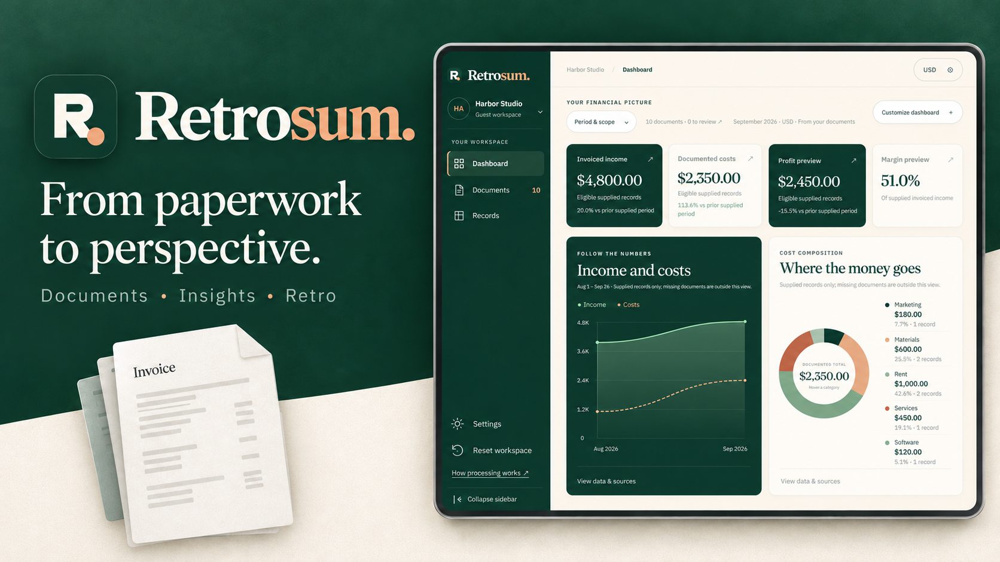

# Retrosum

Retrosum is a guest demo that turns financial PDF evidence into an interactive money dashboard and lets an assistant named **Retro** explain, guide and edit temporary session records. The local build supports both simulation and the accepted paid OpenAI path. Two numeric/record corpus passes and seventeen live Retro cases passed; actual localhost Turnstile/browser checks passed. Hosted release acceptance remains separate.

The interface and source documents use English/exact USD; dashboard EUR display uses an automatically retrieved dated ECB reference rate. Every sample figure comes from a viewable PDF; the intended public AI sample will process those originals live. Development fake mode supports the same interaction flow without API usage. Records and PDF previews survive refresh using bounded browser storage, with a fixed two-hour expiry and no server database.

## Documentation

- [Complete product, architecture and delivery blueprint](docs/RETROSUM_DEMO_SOURCE_OF_TRUTH.md)
- [Short visual product brief](docs/RETROSUM_OVERVIEW.html)
- [Detailed implementation tickets and dependencies](docs/tickets/README.md)
- [Current completion and remaining acceptance](docs/CURRENT-STATUS.md)
- [Documentation map and authority](docs/README.md)
- [Prepared manual release and rollback guide](docs/operations/MANUAL-DEPLOYMENT.md)

**Status:** RET-001 through RET-013 have product, packaging and audit evidence. The app is deployed with public live processing at [Retrosum](https://retrosum-frontend-imspgi7bya-ew.a.run.app/demo), using the committed quality/security source `35bc824`. The ten-PDF/eighteen-page sample is source-backed; the workspace starts empty. RET-011's local live checks, RET-012's bounded hosted paid walkthrough and RET-013's local paid portfolio run/new free hosted checks retain their separate scopes. Committed examples remain fake/paid-off. Custom-domain cutover, hosted maximum-load checks, actual billing/account enforcement and broader arbitrary-upload/physical-device acceptance remain separate. See the [current release](docs/operations/RELEASE-RECORD-RET-013-2026-10-11.md), [current validation](docs/validation/RET-013.md) and [live setup](docs/engineering/OPENAI-LIVE-TESTING.md). No Git remote push occurred.

## Local development

Use Node 24.19.0 (24 LTS) and pnpm 11.25.0. Install with `pnpm install --frozen-lockfile`, then start `pnpm dev:backend` and `pnpm dev:frontend` in separate terminals. Open http://localhost:3000; the backend binds 127.0.0.1:4000. Default mode is fake/paid-off, with no API key needed. App-local `.env.example` files document optional overrides; no root secret file is used.

`pnpm check` runs formatting, lint, strict typechecking, AST ownership boundaries, isolated tests and production builds. See [foundation decisions and commands](docs/engineering/FOUNDATION.md) for exact dependencies and verification scope. Docker and deployment are not required for local development.
