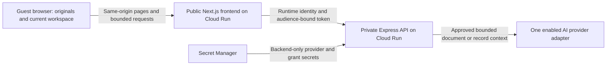

# Retrosum — Product, Architecture and Delivery Blueprint

**Status:** proposed implementation source of truth, ready for owner review.  
**Prepared:** 7 October 2026.  
**Product:** a public, disposable business money workspace demonstrating useful AI.  
**Companion:** [Retrosum product overview](RETROSUM_OVERVIEW.html).  
**Implementation status:** documentation only. No application, live integration, deployment or accuracy claim is established by this file.  
**Planning boundary:** no tickets have been created. The future repository tree and delivery sequence below describe responsibilities; they are not a scaffold or implementation queue.

Retrosum turns a small collection of business documents into understandable money records, a traceable overview, and an AI copilot that explains what the supplied records show. The visitor can inspect the evidence, correct an interpretation, review a duplicate or payment relationship, and export the result.

The first build should feel like a complete product in a short visit. A visitor previews believable documents, starts without labelling their types, sees them become connected records, understands the difference between invoiced work and cash received, and checks one explanation against its sources.

## Contents

1. [Authority, evidence and decisions](#1-authority-evidence-and-decisions)
2. [Product contract and audience](#2-product-contract-and-audience)
3. [Scope and success](#3-scope-and-success)
4. [Landing page](#4-landing-page)
5. [Signature visitor journey](#5-signature-visitor-journey)
6. [Workspace and screen specifications](#6-workspace-and-screen-specifications)
7. [Synthetic sample business](#7-synthetic-sample-business)
8. [Inputs, previews and recognition](#8-inputs-previews-and-recognition)
9. [Financial meaning and calculations](#9-financial-meaning-and-calculations)
10. [Review, corrections and manual records](#10-review-corrections-and-manual-records)
11. [Insights and data copilot](#11-insights-and-data-copilot)
12. [State, revisions and persistence](#12-state-revisions-and-persistence)
13. [Exports and session reset](#13-exports-and-session-reset)
14. [Framework and architecture](#14-framework-and-architecture)
15. [Repository structure and ownership](#15-repository-structure-and-ownership)
16. [Domain and shared contracts](#16-domain-and-shared-contracts)
17. [HTTP API and private transport](#17-http-api-and-private-transport)
18. [Processing and provider boundaries](#18-processing-and-provider-boundaries)
19. [Limits, admission and spend](#19-limits-admission-and-spend)
20. [Privacy, security and cleanup](#20-privacy-security-and-cleanup)
21. [Configuration and local operation](#21-configuration-and-local-operation)
22. [Cloud infrastructure and deployment](#22-cloud-infrastructure-and-deployment)
23. [Visual system and accessibility](#23-visual-system-and-accessibility)
24. [Verification and evaluation](#24-verification-and-evaluation)
25. [Observability, reliability and recovery](#25-observability-reliability-and-recovery)
26. [Documentation and engineering guidelines](#26-documentation-and-engineering-guidelines)
27. [Delivery sequence without tickets](#27-delivery-sequence-without-tickets)
28. [Open decisions and release acceptance](#28-open-decisions-and-release-acceptance)
29. [Appendix A — extraction field inventory](#appendix-a--extraction-field-inventory)
30. [Appendix B — examples and invariants](#appendix-b--examples-and-invariants)
31. [Appendix C — source map and references](#appendix-c--source-map-and-references)

## 1. Authority, evidence and decisions

### 1.1 What this document owns

This file consolidates the received Retrosum product material and the engineering patterns inspected in both sibling repositories. It owns the proposed first-build product behavior, screens, financial semantics, application boundaries, resource policy, verification strategy and deployment shape.

The HTML companion is a short product-management reading view. It summarizes this blueprint and previews the brand direction. It is not a working application, a live AI demo, or a separate behavior specification.

The existing `retrosum.md` and `retrosum.html` remain received product research and a richer conceptual prototype. Preserve them as input history. Use this new blueprint for implementation planning once the owner accepts it. Conflicts are resolved by the latest explicit owner instruction; a historical prototype must not silently restore an older behavior.

No future `AGENTS.md`, operations guide, design reference, ticket folder or application directory is created by this documentation task. Those artifacts should arrive when implementation needs them.

### 1.2 Evidence actually inspected

| Source | What was inspected | What Retrosum adopts |
| --- | --- | --- |
| Retrosum drafts | `docs/retrosum.md`, `docs/retrosum.html`, `README.md` | Guest money workspace; source previews; automatic recognition; reviewed records; money overview; read-only copilot; exports; vintage identity. |
| Received ClipBuilder lessons | `docs/LESSONS_LEARNED_FROM_CLIPBUILDER.md` | Explicit ownership, strict boundaries, private transport, cleanup, measured resource limits, restrained dependencies, release evidence. |
| Received ScreenPilot playbook | `docs/PORTFOLIO_DEMO_BUILD_PLAYBOOK.md` | Signature journey, authority system, canonical state, fake-first evaluation, selective persistence, two-service Cloud Run deployment. |
| Actual ClipBuilder repository | Root instructions, public README, package manifests, source-of-truth structure, frontend/backend feature directories, and current Cloud Run deployment guide | pnpm monorepo; Next.js/React; Express; Zod contracts; use cases and adapters; public frontend/private API; manual audited deployment. |
| Actual ScreenPilot repository | Root instructions, package manifests, source of truth, frontend/backend directories, and manual Google Cloud deployment guide | Browser-session workflow; same-origin private proxy; browser-safe contracts; no application database; GitHub Actions for quality checks; owner-controlled release. |

The sibling repositories live at `../ClipBuilder` and `../screen-pilot`. They were explored as actual repositories, not merely named as inspiration. Their project-specific approvals, cloud identities, domains, secrets, data and completed-feature claims do not transfer to Retrosum.

### 1.3 Reuse and adaptation

| Area | Shared backbone | Retrosum adaptation |
| --- | --- | --- |
| Application layout | `apps/frontend`, `apps/backend`, `packages/contracts` | Document and money features replace video or interview features. |
| Browser framework | Next.js App Router, React, TypeScript | Landing, document collection, overview, records, copilot and export. |
| Server framework | Express, explicit composition, validated HTTP edges | Request-scoped document interpretation and deterministic money calculations. |
| Shared schemas | Browser-safe Zod contracts | Money values, source references, review commands, metrics and AI outputs. |
| Workflow | One reducer with explicit asynchronous states | File-level partial results and a versioned workspace graph. |
| Providers | Ports, live adapters and deterministic fakes | OpenAI document interpretation and explanations as the proposed first live adapter. |
| Hosting | Docker, Google Cloud Run, Artifact Registry, Secret Manager, runtime IAM | Two services; no renderer, media worker or upload bucket in the initial design. |
| Abuse controls | Server validation, challenge, short-lived grants, capacity and usage bounds | Grants bind to document-processing or copilot operations; preview and arithmetic remain free of AI calls. |
| Verification | Vitest, Supertest, boundary checks, focused manual acceptance | Exact financial invariants, source grounding and record-review behavior. |
| Release | Audited immutable images and manual release evidence | Synthetic documents and bounded owner-run live format acceptance. |

ClipBuilder's Remotion composition, FFmpeg pipeline, renderer and media storage solve its video workload. ScreenPilot's voice, microphone and ElevenLabs tools solve its interview workload. Retrosum should inherit the same ownership and infrastructure principles while adding only the document capabilities its story needs.

### 1.4 Decision language

- **Carried forward:** already expressed in the Retrosum drafts and retained here.
- **Proposed baseline:** a concrete recommendation made by this blueprint; implementation should use it unless the owner changes it.
- **Release prerequisite:** must be resolved or measured before enabling the relevant public capability.
- **Deferred:** recorded for context; outside the first build.

| Decision | Position | Status |
| --- | --- | --- |
| Brand | Retrosum; warm vintage wordmark and colors, modern readable workspace | Carried forward |
| Intended domain | `retrosum.com`; registration and ownership unconfirmed | Carried forward |
| Audience | Freelancers, agencies and small service businesses exploring scattered records | Carried forward |
| Product form | Public guest portfolio demo; no accounts or bank connections | Carried forward |
| Core story | Documents → linked records → money overview → cited explanation → review → export | Carried forward |
| Financial scope | Explain supplied records; document-view preview and recorded cash kept separate | Carried forward |
| AI action scope | Interpret, investigate and explain; guest confirms record changes outside chat | Carried forward |
| Web/API stack | Next.js, React, Express, TypeScript, Zod, pnpm | Proposed baseline inherited from both demos |
| Application hosting | Public frontend and private backend on Google Cloud Run | Proposed baseline inherited from both demos |
| State | Browser memory, self-contained backend requests, no durable application database | Proposed baseline aligned with existing drafts |
| Initial live provider | OpenAI Responses adapter; one compatible evaluated model for each operation class | Proposed baseline preserving the original GPT direction |
| Gemini | Alternative adapter after an explicit provider decision and equivalent evaluation | Deferred alternative, no automatic fallback |
| Production region | One owner-approved region; `europe-west1` is the comparison baseline | Release prerequisite |
| Version pins | Compatible supported releases verified at bootstrap, exact lockfile committed | Release prerequisite |
| Live spend | Paid-off defaults, measured bounds, owner-selected monetary budget | Release prerequisite |
| Tickets | None during this task | Explicit owner instruction |

## 2. Product contract and audience

### 2.1 Product sentence

**Retrosum helps a guest turn invoices, bills, receipts and payment exports into a clear, AI-assisted view of their business money, with inspectable sources behind every figure.**

Working line: **Make sense of your business money.**

Primary invitation: **Drop in your documents. We'll figure out what they are.**

Descriptor: **Business money workspace.** The word *fintech* is useful positioning, but the experience should explain the actual job in familiar language.

### 2.2 The problem

A small business can have invoices in a folder, rent receipts as PDFs, a software purchase in a spreadsheet, and a payment export from another tool. Reading each item is possible; connecting them is harder. An invoice can be mistaken for money already received. A photographed copy can become an extra expense. A payment row can be counted again as income. An unexplained dashboard leaves the owner unable to check the answer.

Retrosum demonstrates a useful transition from scattered files to connected digital records. The original remains available. The structured interpretation is editable. The totals expose their contributors. The copilot can investigate a question without turning a guessed explanation into an accounting fact.

### 2.3 Primary user and useful visit

The primary visitor is a freelancer, studio owner or service-business operator with limited appetite for accounting setup. The secondary visitor is a recruiter, prospective client or technical reviewer evaluating the demo's product quality and engineering discipline.

The visitor should not need an account, a provider API key, an administrator, a bank login or knowledge of document classification. A single business-identity clarification is acceptable because direction depends on whether the business issued or received the invoice.

A useful visit ends with an understandable overview, organized records, visible unresolved issues and an export. Chat is an enhancement to this result; the workspace must be useful without sending a question.

### 2.4 Ten-second comprehension

The landing must make the following apparent:

1. What goes in: ordinary business money documents.
2. What comes out: organized records and an explainable money picture.
3. Why AI helps: recognizes different documents and answers questions using the records.
4. How to try it: explore a realistic sample business immediately.
5. What can be checked: figures and answers link to their sources.

Avoid leading with technology names, a blank chat box, a sign-up wall or a long feature grid. The memorable moment is the connected record-to-explanation interaction.

## 3. Scope and success

### 3.1 First-build capabilities

| Capability | Required behavior |
| --- | --- |
| Landing and sample entry | Explain the product; preview original sample files; start a coherent sample workspace. |
| Supported own-file intake | Validate bounded files; no document-type form; distinguish available live processing from unavailable formats. |
| Recognition | Propose type, parties, business direction, amounts, category and evidence; retain uncertainty. |
| Document collection | View originals and field interpretations; show progress, failures, exclusions and review issues. |
| Connected money records | Separate economic events, payment evidence and source documents; support reviewable relationships. |
| Money overview | Document income/cost/profit or loss, recorded operating cash, known open amounts, coverage and contributors. |
| Source-grounded observations | At most four concise findings from supplied records, each with evidence and scope. |
| Data copilot | Bounded read-only investigation, cited answer and navigation to records. |
| Review tools | Correct key fields/categories; confirm or reject duplicate/payment candidates; see resulting changes. |
| Manual entry | Add a missing sale or cost with explicit user-supplied amount, date, currency and basis. |
| Export and reset | Download a coherent revision, optionally include originals, and clear the session. |
| Failure recovery | Preserve completed work; isolate failed files; offer deliberate bounded retries and manual fallback. |

### 3.2 First-build exclusions

The demo does not include accounts, organizations, shared books, subscription billing, durable history, bank sync, payment execution, automatic emailing, tax filing, regulatory certification, bookkeeping certification, a general ledger, payroll, inventory accounting, balance sheets, forecasting, arbitrary web import, inbox watchers, or multi-user approvals.

No vector database, general background queue, MCP server, autonomous write agent, independent document-rendering service or cross-provider fallback is required. Add a service only after a documented workload or isolation need demonstrates why the two-service baseline cannot meet the agreed bounds.

### 3.3 Later additions

| Addition | Value | Gate before adding |
| --- | --- | --- |
| Simple outgoing invoice builder | Create and download a draft using the same money primitives | Core document-to-overview journey works; draft remains excluded until explicitly included as issued. |
| More document profiles | Broader tested import coverage | Profile-specific parsing, preview, fixtures, limits and live acceptance. |
| Read-only MCP adapter | Let another client inspect the same validated records | In-app tools stable; separate access/lifetime contract. |
| Temporary storage or parser worker | Handle larger/native workloads safely | Measurements justify storage, lifecycle, IAM, costs and extra services. |
| Persistent product | Save projects and collaborate | New authentication, tenancy, durable storage and retention specification. |

### 3.4 Observable success

An evaluator can complete a guided sample visit in roughly five minutes, a target to measure after implementation. They can inspect a genuine sample PDF, reach the overview, ask why invoiced income differs from recorded cash, inspect the cited sources, resolve a relationship, and export.

Success also requires correct calculations and honest limits. Unsupported uploads cannot receive unrelated fixture output. Mixed currencies cannot become a single unlabeled total. A document stating *paid* cannot create an extra bank movement when the same payment already appears elsewhere.

No accuracy percentage, adoption claim, speed guarantee, cost guarantee or regulatory claim is established here.

## 4. Landing page

### 4.1 Page hierarchy

| Section | Content | Purpose |
| --- | --- | --- |
| Navigation | Retrosum wordmark; How it works; Sample business; short privacy link; Try the sample | Immediate orientation and one clear action. |
| Hero | Headline, two-sentence explanation, primary sample CTA, secondary own-file CTA | State the problem and invite action without setup. |
| Product illustration | A few distinct document covers leading into a compact money summary and cited answer | Show the connected outcome in one composition. |
| Three-step explanation | Bring documents; understand the money; check the explanation | Describe the experience in PM language. |
| Sample business preview | Harbor Studio, September 2026, synthetic files, readable covers and Preview actions | Make the first interaction tangible. |
| Traceability example | One figure and its supporting invoice/payment record | Explain why sources matter. |
| Trust and limits | Guest session, source-linked figures, tested formats, provider disclosure before live processing | Set accurate expectations at the appropriate point. |
| Final invitation | Explore sample business; use your own supported documents | Repeat the useful next step. |
| Footer | Product descriptor; privacy/handling; documentation or portfolio link if provided | Keep secondary information accessible. |

### 4.2 Proposed copy

**Hero heading:** Make sense of your business money.

**Hero explanation:** Bring your invoices, receipts and payment records into one clear workspace. Retrosum organizes the documents and helps you understand the numbers, with sources you can inspect.

**Primary CTA:** Explore the sample business.

**Secondary CTA:** Use my documents.

**Supporting line:** No account needed. Start with realistic fictional documents.

**Three steps:**

1. **Bring the paperwork.** Preview a sample or add supported files. No document labels to fill in.
2. **See the money picture.** Understand documented income, costs, profit or loss, recorded cash and open amounts.
3. **Ask and check.** Ask what explains a number, inspect the source, and review any uncertain relationship.

**Traceability line:** Every figure has a way back to the records behind it.

Provider names, SDKs, state revisions and service boundaries belong in the blueprint or an optional technical information view. Put them into the visitor flow only when they help the visitor decide whether to submit their documents.

### 4.3 Honest illustration

A static hero can show the Harbor Studio example with a label such as **Illustrative sample**. It cannot animate as if a real upload or inference is happening. A short animation may connect file covers to records, provided it is clearly an explanation and has a still reduced-motion alternative.

Do not fake a processing percentage, a live message stream, user testimonials, user counts, a bank connection or a guarantee about profit. A screenshot-like preview should show the document basis and sample designation where the numbers appear.

### 4.4 Entry behavior

- Opening the landing makes zero paid provider calls.
- Opening a sample preview makes zero paid provider calls.
- Exploring the prepared sample starts local deterministic state and calculations.
- Live sample reprocessing, if offered, is a distinct deliberate action with provider disclosure and spend admission.
- Own-file selection remains local until the visitor deliberately starts the disclosed processing operation.
- If live processing is unavailable, show that state before the visitor expects an upload result; retain preview, sample and manual-entry routes.

## 5. Signature visitor journey

### 5.1 The complete story

| Step | Visitor action | Application response | Checkable outcome |
| --- | --- | --- | --- |
| 1. Explore | Select the sample business; preview a document | Show actual original bytes or a clearly labelled safe rendition | Visitor sees what will be interpreted. |
| 2. Start | Use the sample bundle or select supported files | Establish one business; request identity confirmation only when needed | Direction has an explicit business context. |
| 3. Recognize | Start processing | Validate, read, interpret and link; show real stages per file | Files become records with provenance. |
| 4. Understand | Open Overview | Render deterministic metrics, charts, coverage and pending issues | Visitor can inspect where each number came from. |
| 5. Investigate | Ask why income exceeds recorded cash | Copilot uses allowed tools and returns a cited explanation | The basis distinction is understandable. |
| 6. Review | Confirm the HS-101 match or A-77 duplicate | Validate command; update one workspace revision; recompute dependent views | Relationships change without double counting. |
| 7. Take away | Export the current workspace | Download the same revision with scope, basis, evidence and unresolved issues | Result remains useful outside the site. |
| 8. Reset | Clear and start again | Cancel owned work, release previews, discard session data | A new workspace starts cleanly. |

### 5.2 Prepared sample entry

Default sample entry uses verified stored interpretations paired with the exact synthetic inputs. This gives an immediate first result without paid inference. Display **Prepared sample interpretation** where recognition and narrative outputs are shown.

Ordinary interactions remain real: filtering, computing metrics, reviewing relationships, changing a category, entering a manual cost and exporting all execute actual validated code. Stored sample language must be scoped to the matching fixture and revision. Once the visitor changes facts, use deterministic compatible templates or mark the prepared explanation stale; do not present an old sample answer as fresh AI.

Offer a fully reviewed sample overview for quick exploration and a guided review variant with two pending relationships. Identify which variant is active. The fully reviewed overview is the default concise product demonstration; the guided variant is the memorable review lesson.

### 5.3 Own-document entry

1. Select files with a conventional picker or drag-and-drop.
2. Preview the collection locally, validate type/size/page limits and remove unwanted files.
3. Confirm the business identity once if the documents do not establish which party is the visitor.
4. Read the actual enabled provider disclosure and choose Process documents.
5. Admit and process files sequentially; clear sources can become eligible without forcing review of every field.
6. Keep uncertain direction, incompatible currencies, questionable amounts and duplicate candidates in the review queue.
7. Open the overview from the successful subset with explicit coverage and pending exclusions.

A failure in one document must not discard other successful records. The visitor can finish a useful session through preview, review, manual entry and export even when a live AI operation fails.

### 5.4 The memorable interaction

The sample contains two invoices issued by Harbor Studio and a separate payment export. The overview shows USD 4,800 of invoiced income and USD 3,000 of recorded operating cash in. The visitor asks why those differ. The answer identifies the paid/matched HS-101 evidence, the explicitly open HS-102 invoice and the different measurement bases.

Confirming the HS-101 payment match resolves its settlement uncertainty. Income stays USD 4,800. Recorded cash stays USD 3,000. The known open HS-102 amount stays USD 1,800. The UI makes these unchanged values understandable: a relationship was resolved, an extra sale was not created.

The duplicate lesson then shows A-77 twice, as a scan and an image. The candidate copy is held outside eligible totals. Confirming the duplicate preserves both sources and associates one cost with both. Rejecting the candidate requires a separate decision about whether a distinct cost can be established; it must not silently make the copy eligible.

## 6. Workspace and screen specifications

### 6.1 Information architecture

The initial app has a landing and one connected workspace. The workspace has four primary areas: **Overview**, **Documents**, **Records**, and **Copilot**. **Review** is a focused view of issues within Documents/Records. **Export** is a workspace action and review sheet rather than an unrelated product area.

Proposed routes are `/`, `/workspace`, `/workspace/documents`, `/workspace/records`, `/workspace/copilot`, and `/workspace/review`. They compose the same client session. Route navigation must not create separate ledgers, reset filters unexpectedly, or dispatch inference. Direct navigation with no session leads to a friendly sample/start state.

### 6.2 Global shell

The shell displays the Retrosum brand, current business, sample/live mode, selected period and currency, a review-count indicator, Export and Clear session. Keep the document basis visible near financial content. Put detailed coverage and exclusions in an expandable explanation.

Desktop uses a compact navigation rail or sidebar, the active content area and an optional copilot panel. Tablet uses a reduced rail and drawers. Phone uses natural vertical page flow with a compact navigation control; sources and chat open as full-width panels with clear Back behavior.

Do not keep two independently mounted workspaces for desktop and phone. Adapt one semantic component tree so state, focus, errors and source references remain consistent.

### 6.3 Document collection

| Element | Specification |
| --- | --- |
| Collection heading | Name the business and distinguish sample from visitor originals. |
| Add-files area | Picker and drag-and-drop; show supported formats and limits from configuration. |
| Document row/card | Safe display name, original format, page/sheet count when known, recognized type, review/processing state. |
| Preview action | Open original or labelled rendition; no extraction side effect. |
| Processing action | Explicit start; show provider disclosure and unavailable states before dispatch. |
| Progress | Real named stages; completed/failed counts; no invented smooth percentage. |
| Recognized result | Parties, role, number, dates, currency, amounts, category and source links. |
| Issues | Specific reasons such as unknown business side, ambiguous date, total discrepancy or candidate duplicate. |
| Partial-result banner | State included successful files and pending/failed files; permit continued review. |
| Remove action | Show record/relationship consequences; apply through a revisioned command. |

Every selected file needs an individual state. A generic batch spinner cannot obscure a failed file or imply all files were understood.

### 6.4 Source viewer

Desktop uses a source pane next to extracted fields. A source click selects the document and page/row/block. Mobile opens the source first with an accessible control to inspect the interpretation.

PDF sources use a bounded viewer such as locally bundled PDF.js, with page controls, a loading/error state, selectable text when available, and Download original. Images use a bounded image viewer with zoom and readable orientation. Tables use an inert bounded table with sheet/row references. DOCX uses extracted paragraphs/tables or a verified rendition, clearly identified.

Never draw an arbitrary highlight box to imply precise provenance. When coordinates cannot be verified, show the real page or row and a short excerpt. A source reference must remain useful even if highlighting fails.

### 6.5 Overview

The overview answers **What do these supplied records show?**

Primary cards are **Invoiced income**, **Documented costs**, **Profit preview** and, where appropriate, **Preview margin**. A negative result becomes **Loss preview** with a clear negative amount, not a green success card. For wider document sets, avoid calling every sale an invoice; the UI can use **Documented income** with its basis explanation.

Below the cards show:

- Category breakdown with contributing records.
- Covered-period income/cost comparison when compatible historical records exist.
- Recorded operating cash in/out and net recorded movement.
- Known customer and supplier open amounts, with unknown settlement states kept separate.
- Review issues that affect the displayed coverage.
- Up to four source-linked observations.

Each card or chart affordance opens the contributing record set with the same period, currency and basis. Do not link a KPI to all records and force the visitor to discover the relevant ones.

### 6.6 Records register

Rows show event description, sale/cost/adjustment kind, source, category, event date, currency, documented amount, inclusion state and settlement evidence. The amount column identifies whether it is net, gross or a source-stated total without a separate tax breakdown.

Default filters are period, currency, direction/category and review status. Search is local over bounded safe text. Sorting uses canonical money/date values. The table has a small-screen detail presentation, but the accessible data relationships remain understandable.

Row details expose line items, amount checks, related documents, payments, duplicate relationships, source claims and guest edits. No hidden AI edits occur when a row is opened.

### 6.7 Review view

Review groups issues by the decision required, not by internal parser errors. Examples: **Which business is yours?**, **Are these the same bill?**, **Does this payment settle this invoice?**, **Which date does the source mean?**

Each issue shows the relevant sources, current proposal, reason, effect on the overview and clear actions. **Keep unresolved** remains available. If a decision affects totals, show a before/after preview computed by code before the guest confirms.

### 6.8 Copilot view

The copilot displays its current scope and relevant question chips. Answers show a direct explanation, computed fact cards, source links and optional View records or Open review actions. **How I checked** lists actual executed tool operations in plain language.

The composer supports keyboard submission, stop/cancel, clear error feedback, a bounded input length and a visible remaining question allowance when approaching the limit. Do not display raw JSON, internal prompts, chain of thought or token telemetry in the product conversation.

### 6.9 Export review

The export sheet states the revision, currency/period scope, included records, unresolved issues and processing modes. Default exports include structured data and an overview. Originals and sensitive source fields are separate explicit options with accurate wording about their unredacted contents.

Exports remain available when live processing or chat is disabled. If nothing is eligible for financial totals, export the inspected documents and review issues with an empty overview rather than blocking the result.

### 6.10 Empty, pending and unavailable states

| Situation | User-facing behavior |
| --- | --- |
| No session | Invite sample exploration or own documents. |
| No eligible records | Explain why; link unresolved fields; allow manual entry. |
| Only one period | Show snapshot; omit trend claims and comparison percentages. |
| Multiple currencies | Ask the visitor to select a currency; show a coverage count for the others. |
| Unknown payment state | Use Unknown; keep it separate from explicitly open amounts. |
| Live processing unavailable | Preserve previews and prepared sample; explain the available path. |
| Provider failure | Preserve file and completed records; offer deliberate retry within caps. |
| Stale explanation | Show original revision/scope; offer explicit refresh if allowance permits. |
| Session expired/reset | Discard obsolete responses and invite a fresh session. |

## 7. Synthetic sample business

### 7.1 Fixture story

**Harbor Studio** is a fictional service business. The base collection covers September 2026 in USD. Its fixed teaching snapshot is **as of 3 October 2026**. Optional August records support comparison.

Keep the sample as-of date fixed and visible; real uploaded workspaces use the visitor-selected reporting/as-of context. On 7 October or a later visit, the sample must not silently turn an October 8 due date into an overdue claim merely because the device clock advanced.

### 7.2 Original files

| ID | Proposed original | Meaning and amount | Teaching purpose |
| --- | --- | --- | --- |
| D01 | `harbor-HS-101.pdf` | Harbor → Cedar Works; issued 4 September, due 18 September; two service lines, USD 3,000, no separately charged tax | Outgoing invoice creates one sale; separate payment can settle it. |
| D02 | `harbor-HS-102.docx` | Harbor → Maple Retail; issued 24 September, due 8 October; USD 1,800; explicit open-status evidence as of 3 October | Different layout/format; open is not automatically overdue. |
| D03 | `northstar-A-77-scan.pdf` | Northstar → Harbor; issued 20 September, due 10 October; USD 360 net + 36 stated tax = 396 gross; explicitly open | Scanned incoming invoice, direction and net/gross distinction. |
| D04 | `rent-R-091.pdf` | Cove Spaces → Harbor; September rent, USD 800; paid receipt; no separately stated tax | Cost and payment claim can share a source without creating another cost. |
| D05 | `software-SW-09.xlsx` | Paper Cloud → Harbor; one sheet/receipt, USD 120 paid on 12 September; no separately stated tax | Spreadsheet can represent a receipt; native values remain exact. |
| D06 | `northstar-A-77-copy.jpg` | Second rendering of A-77 with the same parties/number/date/amounts | Different file bytes can describe one economic event. |
| D07 | `september-payments.csv` | Four dated rows: +3,000 HS-101; −800 rent; −120 software; −200 to another explicitly owned account | Separate settlement evidence and internal-transfer exclusion. |
| D08 | `august-events.csv` | Optional August sales 2,500 + 1,500; costs 800 rent + 200 services + 100 software | Honest supplied-period comparison without invented history. |

Actual source bytes and expected extraction fixtures still need to be authored. A conceptual HTML cover is not an original PDF. D02's preview rendition is not a ninth financial input. D06 is the intentional duplicate demonstration.

### 7.3 Original visual identities

Give Harbor, Northstar, Cove Spaces and Paper Cloud distinct typography, headers and table arrangements. Use reserved `.example` addresses and nonfunctional payment references. Every source has a discreet **Synthetic sample** designation.

Samples should look like ordinary business paperwork, not eight Retrosum-branded cards. Varied layouts demonstrate interpretation while preserving readability. Do not use real bank details, personal data, copied third-party branding or realistic actionable payment links.

### 7.4 Canonical reviewed results

| Metric | Value | Derivation |
| --- | --- | --- |
| September invoiced income | USD 4,800 | D01 3,000 + D02 1,800 |
| September documented costs on sample basis | USD 1,280 | D03 net 360 + D04 800 + D05 120 |
| Profit preview | USD 3,520 | 4,800 − 1,280 |
| Preview margin | 73.3% | 3,520 ÷ 4,800 × 100, one decimal |
| Recorded operating cash in | USD 3,000 | D07 incoming HS-101 row |
| Recorded operating cash out | USD 920 | D07 rent 800 + software 120 |
| Net recorded operating movement | USD 2,080 | 3,000 − 920 |
| Internal transfer excluded | USD 200 | D07 owned-account transfer |
| Known customer amount open | USD 1,800 | D02 explicit source state |
| Known supplier amount open | USD 396 | D03 gross open amount including stated tax |
| Rent share of included costs | 62.5% | 800 ÷ 1,280 × 100 |
| August income / costs / profit preview | USD 4,000 / 1,100 / 2,900 | D08 source rows |
| Recorded income change versus August | +20.0% | (4,800 − 4,000) ÷ 4,000 |
| Recorded cost change versus August | +16.4% | (1,280 − 1,100) ÷ 1,100, one decimal |
| Profit-preview change versus August | +21.4% | (3,520 − 2,900) ÷ 2,900, one decimal |

These are fixture expectations, not measurements of a real business. They must be generated from canonical records rather than copied as UI constants.

### 7.5 Guided review variant

Start D01 with a proposed HS-101 payment match and **Settlement unknown pending review**. Start D06 held outside financial totals as a potential duplicate. D02 and D03 retain explicit sample open-state evidence. The overview can already show the eligible income/cost values, but must expose the two pending evidence decisions.

Confirming either relationship reduces review issues without inventing a new financial event. The fully reviewed and guided variants share the same source manifest and deterministic invariant tests.

### 7.6 Manifest requirements

The manifest records original ID, safe asset path, validated MIME type, hash, page/sheet count, business, fixed sample context, expected recognition, rendition relationships and fixture version. It identifies which outputs are prepared interpretations and which are computed.

Validate that all manifest paths remain inside the sample asset root. A renamed or changed file cannot receive a stored interpretation merely because its display name matches. Sample fixtures never stand in for arbitrary visitor input.

## 8. Inputs, previews and recognition

### 8.1 Initial supported-format target

The target is different document layouts within an evaluated format set. Release support can be narrower than the target table, but the base sample story must remain complete. Each enabled format needs real parsing, preview, limits, fixtures and live evaluation where AI interpretation is claimed.

| Input | Proposed interpretation path | Preview | Enablement condition |
| --- | --- | --- | --- |
| Text PDF | Bounded PDF input to compatible model; deterministic metadata/page inspection | Original PDF viewer | Core fixture and live acceptance |
| Scanned/mixed PDF | Same bounded PDF route with page imagery | Original PDF viewer | Legibility/multipage fixtures and live acceptance |
| PNG/JPEG/WEBP | Safely inspected image; compatible vision input | Bounded image viewer | Orientation, pixel and legibility fixtures |
| DOCX | Native paragraphs/tables; explicitly extracted images when needed | Labelled text/table view or verified rendition | Text/table/image coverage; no false page-coordinate claim |
| XLSX | Native bounded cell values; known schema directly, unknown labels through one mapping operation if enabled | Safe table by sheet | No formula execution; exact-decimal and resource fixtures |
| CSV | Native bounded rows; documented payments/events schema or reviewed column mapping | Safe table with original row reference | Known headers, decimal/date/currency checks |
| TXT/Markdown | Inert bounded text with source blocks; AI interpretation when enabled | Plain text | Length/encoding and grounding fixtures |
| HTML | Extract inert text/tables without executing or fetching | Plain text/safe table | No scripts, network, remote CSS or active links |
| JSON | Versioned known invoice/event schema; unknown schema needs bounded reviewed mapping | Safe field view | Explicit adapter, depth and key-count limits |
| XML | One named/versioned e-invoice profile with hardened parser | Safe field/tree summary | External entities disabled; profile fixtures |

Legacy DOC/XLS, office conversion suites, TIFF/HEIC/BMP, email bundles, archives and additional e-invoice profiles are deferred. Password-protected, damaged or restricted files receive a readable explanation. No remote invoice URL fetching or platform login belongs in the first build.

PDF file inputs can provide both text and page imagery to compatible OpenAI models; non-PDF inputs have different treatment. That API capability does not prove Retrosum format correctness. Our application will parse bounded spreadsheet values directly and handle DOCX imagery explicitly. [Official OpenAI file inputs](https://developers.openai.com/api/docs/guides/file-inputs).

### 8.2 Proposed input envelope

| Resource | Limit | Behavior on excess |
| --- | --- | --- |
| Original files per workspace | 10 | Ask the visitor to remove files before processing. |
| Raw file size | 5 MiB each | Reject the individual file locally and again on the server. |
| Combined original bytes | 20 MiB | Reject admission before any paid operation. |
| Document pages | 20 combined | Inspect before dispatch; include source/rendition resource work in the page envelope. |
| Invoice lines | 25 per document | Mark longer tables unsupported; never silently drop lines. |
| Payment export | One file, 100 data rows | Reject or request a smaller export. |
| Historical events export | One optional file, 100 data rows | Reject or request a smaller export. |
| XLSX sheets / cells | 3 sheets / 5,000 occupied cells per file | Reject unsupported workbook before model mapping. |
| Image source pixels | 12 megapixels per image | Reject or request a smaller readable image. |
| Generated page/image preview | 4 megapixels each; 80 megapixels combined work | Bound decode/render operations and discard unused previews. |
| Expanded OOXML data | 32 MiB per file | Stop parsing on expansion limit. |
| Business context | One business per workspace | Separate another business into another session. |
| Currency | Separate ledgers by currency | No implicit FX conversion or combined total. |

MiB means 1,048,576 bytes. The UI can show rounded MB wording if it explains the effective limit consistently. These bounds are inherited from the drafts where specified and extended here for parser resources; they need Linux/browser measurement before live release.

Do not transmit the whole batch as one base64 JSON body. Process one original at a time through a streaming multipart route with a bounded context part. Inspect expanded/container resources as well as compressed bytes. Disable automatic archive processing.

### 8.3 Recognition output

For each source, propose:

- Container format and readable source units.
- Business document kind.
- Parties and their roles relative to the confirmed business.
- Document number and source references.
- Dates, currency and stated money values.
- Candidate sale/cost/adjustment/payment/reference meaning.
- Category with editable Unknown option.
- Source payment claims and candidate relationships.
- Field-level missing/ambiguous states and review issues.

Do not use an invented numeric confidence percentage. Use **Recognized**, **Needs review**, **Excluded**, **Matched**, **Source states paid** and **Settlement unknown** with concrete reasons.

### 8.4 Meaning by document kind

| Source meaning | Domain treatment |
| --- | --- |
| Invoice issued by confirmed business | Candidate sale; settlement remains an independent dimension. |
| Invoice addressed to confirmed business | Candidate cost/payable source. |
| Rent/purchase receipt | Candidate cost plus source-stated payment claim; connect existing bill if same event. |
| Payment row/statement | Recorded cash and settlement evidence; cannot automatically become additional income. |
| Credit note | Adjustment linked to original economic event; preserve its own date and basis. |
| Refund | Reversal/payment evidence with explicit direction; do not count both credit and cash refund as two cost reductions. |
| Deposit/prepayment | Review-only in the first build unless a narrow supported fixture establishes treatment. |
| Quote/estimate/pro-forma/order | Reference document excluded from realized document income/cost totals. |
| Internal transfer | Non-operating cash movement only after explicitly owned accounts are established. |
| Unknown/unrelated/unreadable | Preserve source, explain limitation, exclude from eligible totals. |

### 8.5 Business identity

Infer candidate identities from repeated party references, then ask one confirmation if necessary. A single invoice is often insufficient to know whether the guest is buyer or seller. Provide a concise identity selector with **Another business** and a bounded manual name.

Business names are comparison labels, not verified legal identities. Never infer ownership of another account simply from a similar name. If business identity changes after recognition, invalidate affected direction decisions and relationships, recompute eligibility, and mark dependent narratives stale.

### 8.6 Source fidelity

Original bytes stay unchanged. Normalized fields retain their source strings and resolvable references. Native checks and guest corrections are stored separately from extracted claims.

Never silently replace a printed total with a calculated total. Show **Source says** and **Calculated check** when they differ. A discrepancy is a review issue, not permission to make the source agree with the model.

## 9. Financial meaning and calculations

### 9.1 Three distinct concepts

1. **Economic event:** the sale, cost or adjustment represented by reviewed source evidence.
2. **Document:** one source describing an event, payment or reference. Several documents may describe one event.
3. **Payment evidence:** a source claim or recorded movement that may settle an event. Settlement is not another sale or cost.

This distinction drives the data model. A document register alone cannot safely calculate totals from every uploaded amount.

### 9.2 Document view

The initial overview is a simplified document-based preview. Include supported reviewed or clear eligible sales/costs on their source issue/event dates. The period filter uses the explicit documented event date; it does not silently adopt due dates, cash dates or inferred service-period allocation.

Use explicit net amounts where stated. Where a source provides a total with no separately stated tax, retain that source-total basis and identify it in coverage. The sample has a compatible documented-cost basis: D03 net 360; D04 800 and D05 120 with no separately stated tax. This does not establish tax recovery, deductibility, accrual accounting or complete business accounts.

If a tax-inclusive source lacks a defensible net amount, do not invent a net amount. Hold it from a net-only metric or present an explicitly separate source-total view. A currency match alone is not sufficient to make incompatible amount bases comparable.

### 9.3 Canonical formulas

| Metric | Formula | Required interpretation |
| --- | --- | --- |
| Document income | Eligible sale amounts plus linked sale adjustments in scope | Based on supplied source events, not cash receipt. |
| Documented costs | Eligible cost amounts plus linked cost adjustments in scope | Basis and exclusions visible. |
| Profit/loss preview | Document income − documented costs | Omits absent records and accounting adjustments. |
| Preview margin | Preview result ÷ document income × 100 | Show only for positive income and compatible basis. |
| Recorded cash in | Sum of positive eligible operating movements by payment date | Distinct payment movements, not invoice totals. |
| Recorded cash out | Absolute sum of negative eligible operating movements by payment date | Excludes explicitly classified internal transfers. |
| Net recorded movement | Recorded cash in − recorded cash out | Not an account balance or available funds. |
| Known customer open | Evidenced collectible balance after confirmed relevant settlement/adjustments | Unknown states excluded and counted separately. |
| Known supplier open | Evidenced payable balance, normally gross, after confirmed settlement/adjustments | Separate from net documented costs. |
| Change percentage | (Current − prior) ÷ prior × 100 | Compatible supplied periods and nonzero positive baseline. |

Do not derive known open amount as total invoices minus all incoming cash. A payment may be unrelated, unmatched, outside the period or in another currency. A missing payment export proves no absence of payment.

### 9.4 Dates and as-of context

Store calendar dates as `YYYY-MM-DD` with original text. Use timezone-aware timestamps only for application events, not to shift printed invoice dates. The workspace holds an explicit reporting range and as-of date. A due date becomes overdue only when an evidenced open balance exists and due date is before that as-of date.

Ambiguous `03/04/2026` values remain ambiguous until resolved through source locale or guest review. Do not choose US or European ordering from the device locale alone. A source status timestamp outside the as-of context is shown as such and cannot silently establish historical open status.

### 9.5 Money representation

Use canonical decimal strings at transport boundaries and exact decimal arithmetic or safe integer minor units inside domain operations. Binary floating point must not be the authoritative money representation.

Each money value carries a validated currency and permitted scale. USD fixture money uses two decimal places. A versioned currency-scale policy can support other evaluated currencies; unknown scales require review. Use bounded integer-safe magnitudes and reject exponent notation, `NaN`, infinities, malformed separators and overflow.

Compute percentages at adequate precision and round only for display. Use one documented rounding policy, proposed half-up at the presentation scale. Preserve source rounding lines and do not repeatedly round intermediate line calculations.

### 9.6 Eligibility

An event contributes only if its business direction, date, currency and amount basis are sufficiently established; it is not excluded, a held duplicate candidate, an unresolved adjustment or a reference-only document. Review of an unrelated optional field must not unnecessarily block an otherwise clear event.

Every metric returns contributing event IDs, source/payment references, excluded/pending counts, basis and scope. A financial card cannot omit coverage merely because the included subtotal is nonzero.

### 9.7 Payment matching

Candidate matching considers exact references, counterparty, currency, direction, amount and date compatibility. A candidate is explained with these facts. The guest confirms the relationship. Matching changes settlement evidence, not sale/cost identity.

Allocate a payment amount explicitly. Allocation cannot exceed the eligible unallocated amount in the same currency. Partial payment leaves an evidenced remaining balance when the event's initial due/open amount is known. An overpayment is held as unallocated evidence or a review issue; it does not produce a negative open amount silently.

Receipts and payment exports can provide overlapping evidence. The canonical recorded-cash layer counts one movement with multiple source links when those links are confirmed. For the sample, D07 is the recorded-movement source; D04/D05 paid claims support settlement without adding another cash row.

### 9.8 Duplicates

Exact byte hashes can identify repeated files before inference. Different formats require a semantic candidate based on parties, number, dates, currency, amount and line context. Neither a shared amount nor a shared invoice number across suppliers is enough.

Hold uncertain duplicate copies outside totals with visible pending impact. Confirmed duplicates keep their original document identities and link to the canonical economic event. Unlinking a duplicate does not automatically establish a second real event.

### 9.9 Adjustments and negative results

Credit notes and refunds preserve separate documented and cash effects. A sale credit reduces document income only under a validated relationship; its associated cash refund affects recorded cash without another income reduction. Equivalent rules apply to cost credits/refunds.

Negative profit becomes a loss preview. Zero/negative income produces **Margin unavailable on this basis**, rather than dividing by zero or presenting a misleading ratio. A negative prior comparison baseline uses an absolute change explanation; do not reuse the ordinary growth percentage formula.

Category shares use positive compatible net-cost composition. If credits make shares ambiguous or totals nonpositive, show signed category contributions and omit percentage shares. Charts must not force negative values into positive pie slices.

### 9.10 Coverage language

Prefer: **Based on 5 included September events in USD. Two source relationships need review. This preview covers the supplied records.**

Avoid: **Your business earned this exact profit**, **You have this cash available**, **Your taxes are calculated**, or **Everything is reconciled**. The UI can be concise without making stronger claims than the data supports.

## 10. Review, corrections and manual records

### 10.1 Command-based changes

Use explicit validated commands for changing a field, confirming business identity, changing category, setting inclusion, linking duplicates, allocating payments, unlinking a relationship, adding a manual event and removing a document. Each command carries a command ID and expected workspace revision.

A command returns either a new valid workspace revision and deterministic derived values or a stable validation error. Apply it atomically. No half-updated chart, partial payment allocation or stale event reference can remain after a rejected command.

### 10.2 Correction provenance

Retain source value, normalized extracted value, current guest value, correction reason if supplied, application timestamp and source mode. Display **Guest correction** or **Manual entry** clearly. The correction does not rewrite the original file or become a source-stated claim.

Changing currency/direction/amount/date may invalidate matches and metrics. Revalidate affected relationships; do not keep a USD payment linked to an event corrected to EUR. Category-only edits change category charts and relevant narratives while leaving overall amount totals unchanged.

### 10.3 Manual-entry form

| Field | Rule |
| --- | --- |
| Kind | Sale or cost in the first build; complex deposit/adjustment handling stays source/review driven. |
| Description | Required bounded plain text. |
| Event date | Required unambiguous calendar date. |
| Currency | Required supported currency. |
| Amount | Required exact decimal with explicit basis. |
| Tax detail | Optional stated values; no jurisdictional inference. |
| Category | Supported category or Unknown. |
| Settlement | Unknown by default; explicit user-supplied state separately labelled. |
| Source | Manual entry; optional link to an existing source only through a validated relationship. |

A manual sale/cost participates in document totals on its declared basis. Merely checking Paid must not create recorded account cash; that would need an explicit distinct payment-evidence entry outside the minimal form. The demo can explain that limitation in the settlement detail.

### 10.4 Review effects

| Change | Required effect |
| --- | --- |
| Category edit | Recompute category chart; overall totals unchanged. |
| Add USD 200 cost | September costs 1,480; profit preview 3,320; margin 69.2%; payment status remains unknown unless separately evidenced. |
| Confirm HS-101 match | Resolve pending settlement; income 4,800 and cash in 3,000 unchanged. |
| Confirm D06 duplicate | Keep one A-77 cost and both sources; remove duplicate issue. |
| Exclude D03 | Remove 360 from documented costs; re-evaluate associated payable view and disclose exclusion. |
| Change business | Re-evaluate direction and relationships; previous narratives stale. |
| Remove source | Re-evaluate event evidence and allocations; never leave dangling citations. |

### 10.5 User control

Provide a before/after explanation for changes affecting financial inclusion. A deliberate removal or clear-session action needs a concise local confirmation where content would be lost. Ordinary browsing, filtering and source preview require no approval dialog.

An undo control is optional; the first build can retain an edit history with a deliberate restore command. Do not claim full audit logging or multi-user accountability from local guest correction history.

## 11. Insights and data copilot

### 11.1 Responsibilities

AI has two primary jobs after recognition: choose useful supplied evidence to investigate and explain the resulting facts clearly. Ordinary code establishes the ledger, amounts, comparison bases, eligible record sets and percentages.

The copilot can propose that the visitor review a relationship. It cannot commit a match, change a category, exclude a record, send a payment, communicate externally, or act on a document's embedded instructions.

### 11.2 Insight cards

Each insight contains an ID, workspace revision, period/currency/basis, observation type, brief headline, explanation, computed fact references, evidence references, coverage caveat and optional allowed navigation action.

Generate at most four cards. Prioritize interpretation/data-quality issues when they affect coverage, followed by open amounts and record composition, then compatible historical comparisons. Do not use urgency merely to make an ordinary observation look important.

| Good sample observation | Required evidence | Unsupported extension to avoid |
| --- | --- | --- |
| Rent is USD 800, or 62.5% of included September costs | D04 and category metric | Recommend moving office or cutting rent. |
| HS-102 has USD 1,800 explicitly open; due 8 October | D02 and fixed sample as-of context | Call it overdue on 3 October. |
| HS-101 and the USD 3,000 row are a candidate settlement match | D01 and D07 row | Treat the candidate as confirmed payment. |
| A-77 appears in two source files | D03/D06 comparison facts | Remove the second source automatically. |
| Recorded income is 20% above the supplied August figure | September sale evidence and D08 | Claim whole-business growth or invent a cause. |

Use deterministic cards for the prepared sample where the fixture permits. Live generation is deliberate; loading Overview, editing a record or changing a filter must not silently consume another insight operation.

### 11.3 Allowed read-only tools

| Tool | Input | Output | Bound |
| --- | --- | --- | --- |
| `get_summary` | Current allowed scope | Deterministic metric IDs, values and coverage | One requested scope, no raw source bytes |
| `list_events` | Finite filters and pagination cursor | Bounded event summaries and source IDs | At most 20 rows per call |
| `compare_periods` | Two explicit compatible periods and currency | Current/prior values, differences and eligibility notes | Two supplied periods |
| `get_metric_evidence` | Current metric ID | Contributor/exclusion references and basis | At most 50 references, paginated if needed |
| `get_document_excerpt` | Allowed document ID and source locator | Minimal inert text/cell excerpt | 2,000 characters per call |
| `list_review_issues` | Issue type/status filter | Concrete pending decisions and source IDs | At most 20 issues per call |

Tools operate on the validated snapshot supplied with that request. They have no general filesystem, network, SQL, Python, shell, external MCP, email or payment capability. An unknown tool name, unknown ID, malformed filter or out-of-scope source produces a safe typed tool error.

### 11.4 Bounded investigation

One guest question can use at most four tool calls across at most three model requests. These are whole-question limits, not per-round limits. A first request may select tools, a later request can use their results, and the final allowed request must complete or return a limited answer. If the loop cannot finish inside its cap, return the useful deterministic facts already obtained and explain that the investigation was limited.

Questions and insight generation share the same tool executor and validation rules, but have separate product allowances. Parallel tool calls are permitted only for independent read operations within the total cap; no second model dispatch begins before its required tool results and admission checks are complete.

### 11.5 Answer contract

The result has:

- A direct answer in bounded plain text.
- The exact revision and scope investigated.
- Referenced server-computed fact IDs.
- Resolvable source references.
- A short coverage/uncertainty statement when necessary.
- Actual executed tool-step labels.
- Optional application-owned navigation action.
- Processing mode and adapter/schema versions.

Money amounts and percentages displayed as authoritative facts come from computed fact objects. The model selects those fact IDs and writes surrounding language. Reject or remove unsupported numeric assertions in prose through a grounded-output check; schema-valid prose is not sufficient evidence.

Never render provider-produced HTML. A narrative can be plain text or a tightly restricted safe formatting format. Citation targets are IDs resolved by application code, never model-provided URLs.

### 11.6 Example answer

**Question:** Why is income higher than cash received?

**Prepared reviewed-sample answer:** Your September records show USD 4,800 in invoiced income and USD 3,000 in recorded operating cash received. HS-101 is linked to the USD 3,000 payment. HS-102 has USD 1,800 explicitly open in the sample evidence. The invoice view measures documented work; the cash view measures supplied payment movements.

**Sources:** D01, D02 and D07's HS-101 row. **Action:** View the invoices and payment match. **Coverage:** supplied September USD records, sample as of 3 October 2026.

In the guided pre-review variant, replace the confirmed-match statement with **The USD 3,000 row is a proposed match to HS-101; review it to establish that settlement relationship.** The answer must agree with the active revision.

### 11.7 No-financial-advice behavior

The product explains documents and calculations. It does not recommend investments, tax deductions/filing, borrowing, business spending allocations, staffing changes or payment actions. This boundary is behavioral and evaluated, not satisfied by a footer alone.

| Visitor request | Useful bounded response |
| --- | --- |
| Should I cut rent? | Explain rent's recorded amount/share and offer the underlying source; avoid recommending a spending decision. |
| Can I deduct this bill? | Offer stated tax/amount fields and source context; decline a tax conclusion. |
| What stock should I buy with the profit? | Explain that the preview is a supplied-record measure and offer its contributors; decline investment advice. |
| Pay this supplier | Explain the documented payable/source evidence and open its review view; no execution capability. |
| What will revenue be next quarter? | Explain available supplied periods and lack of forecast evidence; do not invent predictions. |

Product copy beside the composer: **Explains your records. Does not provide financial, tax or investment advice.** Keep refusals brief and useful. No external research or generic financial guidance is needed to answer the sample record questions.

### 11.8 Staleness

An answer remains associated with the revision that produced it. Any relevant record or scope change marks it stale. Disable obsolete navigation that could target invalid records; source inspection may remain available only when the source still exists and the old context is visible.

An explicit Refresh explanation consumes the applicable question/insight allowance. No automatic narrative regeneration occurs after edits. A response arriving after reset or revision change is discarded from current state.

## 12. State, revisions and persistence

### 12.1 State authority

The browser owns one current guest workspace. A canonical reducer owns stage transitions, documents, the record graph, current review revision and asynchronous operation identities. Route state owns navigation; it does not become a second financial state machine.

Metrics are derived through the shared pure money engine. The backend revalidates/recomputes a submitted snapshot before AI investigation, using that same engine. It has no persistent financial book or cross-request authoritative ledger.

Guest data is self-supplied. Validation establishes internal consistency, not authenticity or verification of the business documents. The architecture must not imply server-certified accounting truth.

### 12.2 Top-level states

```text
empty
  -> selecting
  -> confirming_business
  -> ready_to_process
  -> processing
  -> workspace_ready

processing -> workspace_ready_with_issues
processing -> processing_failed
workspace_ready <-> reviewing
workspace_ready -> exporting -> workspace_ready
any populated state -> clearing -> empty
```

Navigation among Overview, Documents, Records and Copilot is orthogonal to this workflow. A failed chat operation does not move the whole workspace into an unusable failure state.

### 12.3 Per-document states

```text
selected -> validating -> preview_ready -> waiting
waiting -> reading -> interpreting -> validating_result
validating_result -> recognized | needs_review | excluded
reading/interpreting/validating_result -> failed | cancelled
failed -> retry_requested -> waiting
```

Native structured parsing can skip `interpreting` when no AI operation is needed. Prepared sample recognition uses its labelled stored interpretation without a fake provider-progress animation.

### 12.4 Asynchronous operation ownership

Every operation carries `workspaceId`, generation ID, operation ID, input revision and an abort signal. An operation result is accepted only if all identifiers still match the active state. Clear, source replacement and a conflicting record change invalidate obsolete operation ownership.

Use explicit operation states: idle, admitting, running, succeeded, failed, cancelled and outcome_unknown. The last state matters when a network response is lost after provider dispatch; it must not automatically trigger a second paid request.

### 12.5 Revision rules

Start at revision 1 after a valid initialized workspace. Increment once per successful atomic graph-changing command. Filters, source-preview navigation and opening chat do not increment the financial revision. Scope changes separately invalidate scoped narratives even when financial records are unchanged.

`expectedRevision` mismatch returns a conflict. A stale provider answer cannot overwrite newer records. Duplicate command IDs are rejected or recognized as already applied within the current browser command history.

### 12.6 Persistence choice

**Proposed first-build default:** originals, extracted records, guest corrections and chat stay in browser memory. A refresh loses the workspace. Show **This is a temporary session. Export before leaving or refreshing.** A navigation warning can protect a populated session, subject to browser support; never promise a warning will fire in every close/crash case.

Only non-sensitive preferences may use session storage: chosen workspace tab, non-content display preference and a versioned last sample-selection identifier. Do not serialize the entire runtime object. No financial document fields, messages, filenames, tokens or originals belong in local storage.

Sample state can be reconstructed from its versioned manifest after the guest deliberately starts again. Original uploads cannot be reconstructed from a file path after refresh. A future opt-in session-storage projection for normalized records would change the retention story and needs a documented decision before implementation.

### 12.7 Cleanup ownership

Each feature owns and cancels its requests, timers, listeners, workers, object URLs and decoded previews. Maintain an explicit cleanup registry or feature cleanup functions; avoid one global routine that guesses which resources another feature created.

Export captures an immutable revision. Clear waits for local cleanup completion, invalidates all operation generations and then resets the graph. Browser abort is best effort; backend/provider deadlines and cleanup remain necessary even after a tab closes.

## 13. Exports and session reset

### 13.1 Default bundle

| File | Contents |
| --- | --- |
| `overview.md` | Business label, period/currency/basis, computed totals, coverage, revision and limitations. |
| `financial-events.csv` | Canonical sale/cost/adjustment rows, amount basis, category and inclusion status. |
| `documents.csv` | Source IDs, safe display names, format, interpretation/review states and rendition relationships. |
| `payments.csv` | Recorded movements and separate source payment claims, clearly typed. |
| `matches.csv` | Confirmed/candidate allocations and duplicate relationships with evidence IDs. |
| `issues.csv` | Unresolved issues, source/record links and effects on eligibility. |
| `insights.md` | Current and optionally retained stale observations with explicit revision labels. |
| `conversation.md` | Optional cited answers; stale responses clearly identified. |
| `workspace.json` | Versioned structured snapshot with exact decimal strings and source references. |
| `manifest.json` | Bundle version, export revision/scope, processing modes, included files and redaction policy. |

Package into one bounded ZIP using a reviewed browser-compatible library. ZIP export is an output capability; ZIP upload remains unsupported. Optional originals are byte-preserved and labelled unredacted. Renditions and thumbnails are separate preview assets, not financial originals.

### 13.2 Export integrity

Use one immutable snapshot captured at export start. If the workspace changes while ZIP generation runs, either finish the captured revision with its label or cancel and offer a new export; never combine files from different revisions.

CSV quotes and separators must be valid. Defend against spreadsheet formula injection for untrusted text beginning with `=`, `+`, `-`, `@` or relevant control characters. Controlled numeric columns retain real numeric signs. JSON stores inert source values and never becomes executable instructions.

Safe filenames remove traversal/path separators, control characters and reserved device names; resolve collisions deterministically. Preserve the human original name as a safely encoded field. Do not use file content, business names or original filenames in download URLs.

### 13.3 Sensitive fields

Default exports mask bank/payment identifiers and unnecessary contact extensions. Redaction must also apply to `raw_values`, excerpts, custom fields and narrative text that could repeat those identifiers; hiding the formatted field alone is insufficient.

An explicit **Include original documents** option warns that originals retain their original contents. An independent **Include full source financial identifiers** option may be offered only after its redaction/consent behavior is implemented and tested. No implicit redaction claim can cover a byte-preserved original.

### 13.4 Reset semantics

Clear session discards originals, derived fields, graph, corrections, metrics, questions, explanations and generated downloads still held by the page. Revoke owned object URLs and stop browser workers. Clear content-free admission cookies through the backend route when reachable.

Reset does not delete a file the visitor already downloaded or revoke every copy processed by an external provider. If remote cleanup cannot be confirmed, show accurate handling information; do not turn a local reset button into a universal deletion promise.

## 14. Framework and architecture

### 14.1 Stack baseline

| Responsibility | Proposed choice | Reason |
| --- | --- | --- |
| Runtime | Node.js 24 LTS compatibility target | Aligns with ScreenPilot and a supported ClipBuilder runtime range. |
| Workspace | pnpm workspaces, one exact package-manager pin and lockfile | Matches both sibling repositories. |
| Web app | Next.js App Router, React, strict TypeScript | Routes, accessible features and private server bridge. |
| API | Express with TypeScript | Explicit testable HTTP composition. |
| Runtime contracts | Zod | Shared external-boundary validation. |
| Pure money domain | Small browser-safe `packages/money` | One calculation/review implementation needed by browser and API. |
| PDF preview | Locally bundled PDF.js candidate | Existing family experience in ScreenPilot; evaluated document preview. |
| Charts | Small accessible SVG components; add a chart library only if needed | Few bounded charts; avoid unnecessary general dashboard machinery. |
| Icons | One consistent icon family, such as the Lucide family already used in ClipBuilder | Recognizable actions with accessible text. |
| Styling | Shared CSS tokens and component styles | Fits the custom vintage visual direction without multiple UI systems. |
| Tests | Vitest, Testing Library, Supertest; focused browser E2E | Matches inherited verification style. |
| Quality | TypeScript, ESLint, Prettier, executable import boundaries | Detect unsafe cross-layer coupling. |
| Images | Nonroot multi-stage Docker images | Reproducible Linux runtime. |
| Application hosting | Google Cloud Run | Same public/private service pattern. |
| Supporting cloud | Artifact Registry, Secret Manager, IAM, content-free logging/budgets | Same deployment tools and operational boundaries. |
| Public challenge/domain | Cloudflare Turnstile when live routes enabled; Cloudflare DNS for an approved domain | Consistent public-demo pattern. |

Observed package versions differ between the repositories: ClipBuilder pins pnpm 11.19.0 and Next.js 16.3.8; ScreenPilot pins pnpm 11.24.0 with a Next.js 16 range. These are local observations on 7 October 2026, not recommendations to copy every version. Bootstrap must choose one tested compatible exact set and validate supported/secure releases then.

No TypeScript/React major upgrade is authorized merely by this blueprint. There is currently no Retrosum application to migrate. Select the compatible family once, commit the lockfile, and avoid drifting tool versions across packages.

### 14.2 Runtime topology



The frontend serves pages/assets and authenticates private API calls. The backend validates input, admits expensive work, prepares sources, invokes the enabled provider, validates output and recomputes domain facts. Provider secrets never reach the browser or frontend public configuration.

### 14.3 Why two services are enough

The initial corpus is small and requests are bounded. Originals can remain in browser memory between operations. Backend extraction handles one source per request. Subsequent copilot requests carry validated records and minimal source excerpts, not all original files again.

No durable backend job state is promised. Work does not continue reliably after a response has ended or an instance is lost. If measurements show that office conversion or larger input cannot fit request limits, narrow support or propose a specific isolated parser worker; do not quietly introduce background work with no lifecycle.

### 14.4 Shared-domain addition

The base sibling shape has `packages/contracts`. Retrosum adds `packages/money` because both the browser's immediate/offline review and the backend's verified tool facts need identical arithmetic, eligibility and relationship rules.

This package is justified shared implementation, not a general utility bucket. It accepts typed bounded domain values and returns deterministic values/commands/issues. It has no HTTP, React, environment, provider SDK, filesystem or storage access.

### 14.5 Dependency directions

```text
apps/frontend -> packages/contracts <- apps/backend
apps/frontend -> packages/money     <- apps/backend
packages/money -> packages/contracts
```

Contracts cannot import money, either app, React, Next.js, Express, Node built-ins or provider SDKs. Money cannot import either app or any platform SDK. Frontend browser modules cannot import server modules. Applications never import each other through relative paths or unpublished source aliases.

### 14.6 Layering

- Route files compose features or perform a narrow server bridge.
- Express routes validate, call one use case and map one result.
- Use cases coordinate product policies through injected ports.
- Money-domain functions own calculations, commands and eligibility.
- Adapters translate external SDK/parser output into product contracts.
- Security modules own grants, source checks, admission and capacity.
- Explicit composition wires the application; imports have no startup effects.

Do not add a generic service layer that mixes parsing, prompts, money calculation, UI state and transport.

## 15. Repository structure and ownership

### 15.1 Intended tree

This is a future responsibility map. Create each directory only when its first real module arrives. The current task creates only the two requested documentation artifacts.

```text
Retrosum/
├─ AGENTS.md                           # Future repository operating constraints
├─ README.md                           # Concise product story and documentation map
├─ package.json                        # Root package scripts and exact manager pin
├─ pnpm-workspace.yaml
├─ pnpm-lock.yaml
├─ tsconfig.base.json
├─ eslint.config.mjs
├─ prettier.config.mjs
├─ .editorconfig
├─ .gitattributes
├─ .gitignore
├─ .dockerignore
├─ .github/workflows/quality.yml        # Unpaid checks; no deployment credentials
├─ apps/
│  ├─ frontend/
│  │  ├─ README.md
│  │  ├─ .env.example
│  │  ├─ Dockerfile
│  │  ├─ next.config.ts
│  │  ├─ public/samples/               # Original synthetic assets and renditions
│  │  └─ src/
│  │     ├─ app/                       # Landing, workspace routes, API bridge
│  │     ├─ features/
│  │     │  ├─ entry/                  # Landing and sample entry
│  │     │  ├─ documents/              # Selection, preview, recognition display
│  │     │  ├─ overview/               # KPIs, charts and contributor navigation
│  │     │  ├─ records/                # Register and manual-entry UI
│  │     │  ├─ review/                 # Decisions and correction forms
│  │     │  ├─ copilot/                # Questions, answers and cited navigation
│  │     │  ├─ export/                 # Snapshot export and optional originals
│  │     │  ├─ session/                # Reducer, effect ownership, preferences
│  │     │  └─ privacy/                # Current handling disclosure
│  │     ├─ server/                    # Server-only proxy and IAM transport
│  │     ├─ shared/ui/                 # Stable accessible primitives
│  │     ├─ styles/                    # Tokens, global styles and type rules
│  │     └─ test/                      # Frontend-specific test setup
│  └─ backend/
│     ├─ README.md
│     ├─ .env.example
│     ├─ Dockerfile
│     └─ src/
│        ├─ app.ts                    # Construct Express without listening
│        ├─ server.ts                 # Explicit configuration/start/shutdown
│        ├─ composition.ts            # Wire concrete adapters and use cases
│        ├─ config/                   # Validated private configuration
│        ├─ http/                     # Routes, middleware and response mapping
│        ├─ use-cases/                # Extract, investigate, disclose, clear
│        ├─ documents/               # Preparation, source locators, parser policy
│        ├─ ai/                      # Prompt builders, tool executor, grounding
│        ├─ providers/
│        │  ├─ fake/                 # Deterministic product-facing adapters
│        │  └─ openai/               # SDK translation and approved live dispatch
│        ├─ security/                # Grants, CSRF, rate/capacity/usage admission
│        ├─ demo/                    # Matching sample interpretations/manifest
│        └─ observability/           # Content-free event mapping
├─ packages/
│  ├─ contracts/
│  │  ├─ README.md
│  │  └─ src/                       # Runtime schemas and crossing DTOs
│  └─ money/
│     ├─ README.md
│     └─ src/                       # Pure ledger commands, metrics and evidence
├─ test/                            # Shared fake/paid-off network isolation
├─ tests/
│  ├─ fixtures/
│  │  ├─ documents/                 # Synthetic expected inputs
│  │  ├─ ledgers/                   # Exact calculation/relationship cases
│  │  ├─ providers/                 # Valid/refused/incomplete adapter responses
│  │  └─ adversarial/               # Injection, resource and malformed cases
│  └─ e2e/                          # Focused fake-mode connected journeys
├─ scripts/                         # Named quality/build/release verification
└─ docs/
   ├─ RETROSUM_DEMO_SOURCE_OF_TRUTH.md
   ├─ RETROSUM_OVERVIEW.html
   ├─ retrosum.md                   # Received scope/reference
   ├─ retrosum.html                 # Received conceptual prototype
   ├─ PORTFOLIO_DEMO_BUILD_PLAYBOOK.md
   ├─ LESSONS_LEARNED_FROM_CLIPBUILDER.md
   ├─ architecture/                # Later accepted ADRs where necessary
   ├─ operations/                  # Later setup/cost/release evidence
   └─ tickets/                     # Later only; none created now
```

### 15.2 Module placement rules

| Responsibility | Owner |
| --- | --- |
| Browser file lifecycle and preview URLs | Documents feature |
| Current workflow/revision ownership | Session feature |
| Calculation and relationship rules | Money package |
| External data schemas | Contracts package |
| Paid transport and IAM token | Frontend server module |
| Source preparation and native parsing | Backend documents module |
| User-action orchestration | Backend use case |
| Provider raw request/response shape | Provider adapter |
| Grounded read-only tool execution | Backend AI module |
| Admission, single-use grant and usage reservations | Backend security |
| Source-matched deterministic sample | Backend demo and public synthetic assets |
| Content-free diagnostics | Backend observability |

Prefer named modules such as `calculate-open-balances.ts`, `apply-payment-allocation.ts` or `prepare-docx-blocks.ts` over catch-all `utils`, `helpers`, `common`, `services` and root barrels. Extract reusable primitives only for stable shared responsibilities.

### 15.3 Tests and packages

Colocate unit tests with the owning module. Use root fixtures for reusable synthetic inputs and root E2E for the connected journey. Keep one shared test-isolation setup in `test/`; app-specific setup can extend it without relaxing paid/network restrictions.

Publish contracts and money through explicit package exports. Build in dependency order. Do not import another package's `src` directory or rely on stale generated output left by a previous local run.

## 16. Domain and shared contracts

### 16.1 Core vocabulary

| Type | Core meaning |
| --- | --- |
| `Workspace` | Current bounded business graph, revision and provenance. |
| `WorkspaceScope` | Period, currency, reporting basis and as-of date. |
| `BusinessIdentity` | Guest-confirmed identity label and explicit known party/account references. |
| `Document` | Original source identity, validated container, interpretation and review state. |
| `SourceReference` | Document plus page/row/cell/block/path, with bounded excerpt where needed. |
| `FieldValue` | Raw string, normalized value, presence/ambiguity state and provenance. |
| `FinancialEvent` | Canonical sale, cost or linked adjustment with amount basis and inclusion. |
| `PaymentEvidence` | Recorded movement or source payment claim; these kinds remain distinct. |
| `PaymentAllocation` | Confirmed amount linking one movement to one event in the same currency. |
| `DuplicateRelationship` | Candidate/confirmed source relationship to one economic event. |
| `ReviewIssue` | Specific unresolved decision and affected records/metrics. |
| `ReviewCommand` | Explicit revisioned guest action. |
| `MetricResult` | Deterministic value, scope, contributors, exclusions and coverage. |
| `ComputedFact` | Immutable fact ID and bounded domain value for grounded narrative. |
| `Insight` | Cited observation associated with one revision/scope. |
| `ChatAnswer` | Cited explanation, facts and actual tool steps. |
| `OperationResult` | Typed success/failure/cancellation/unknown outcome. |
| `ExportManifest` | Versioned file list, scope, revision and redaction settings. |

### 16.2 IDs and bounded values

Use generated opaque IDs with fixed schemas for workspaces, documents, events, payments, matches, issues, commands, requests and facts. IDs are not derived from filenames, bank accounts or business names. Sample D01–D08 labels are friendly teaching identifiers mapped to canonical IDs.

Strings have defined maxima; arrays have bounded counts; nested metadata has a depth/key limit. Review command unions are discriminated by command type. Unknown extra keys are rejected at external boundaries rather than silently passed into internal code.

### 16.3 Source references

```text
SourceReference
  documentId
  locator:
    pdf_page(pageNumber, optional verified text anchor)
    table_cell(sheetId, rowIndex, columnKey)
    text_block(blockId, optional character range)
    xml_path(profileId, canonical element path)
    image_region(optional verified bounded region)
  excerpt: bounded optional text
```

Validate references against inspected document metadata. Page 999 in a two-page PDF is invalid. Cell references outside imported rows are invalid. Model-generated coordinates are not trusted merely because they fall within normalized numeric bounds; a reliable region must correspond to actual inspected content or be omitted.

### 16.4 Example money/event boundary

```json
{
  "eventId": "event_sample_hs101",
  "kind": "sale",
  "businessRole": "seller",
  "eventDate": "2026-09-04",
  "currency": "USD",
  "amount": "3000.00",
  "amountBasis": "net_no_separately_charged_tax",
  "category": "services",
  "inclusion": "eligible",
  "documentIds": ["document_sample_d01"],
  "settlementState": "confirmed_paid"
}
```

This illustrates the intended vocabulary. Concrete schema naming is fixed during bootstrap; one spelling must be used across contracts, implementation, fixtures and exports. Payment allocations and source claims remain separate typed objects rather than hidden inside an event's display label.

### 16.5 Stable errors

The shared envelope contains an allow-listed code, safe public message, request ID, retry disposition and optional affected document/field IDs. It never returns raw parser exceptions, SDK bodies, source text, paths, tokens or stack traces.

Proposed codes include `UNSUPPORTED_FORMAT`, `INPUT_LIMIT_EXCEEDED`, `SOURCE_UNREADABLE`, `BUSINESS_IDENTITY_REQUIRED`, `AMBIGUOUS_FIELD`, `REVISION_CONFLICT`, `INVALID_RELATIONSHIP`, `PAID_PROCESSING_DISABLED`, `ALLOWANCE_EXHAUSTED`, `CAPACITY_BUSY`, `PROVIDER_REFUSED`, `PROVIDER_TIMEOUT`, `INVALID_PROVIDER_OUTPUT`, `OPERATION_ALREADY_DISPATCHED`, `OPERATION_OUTCOME_UNKNOWN` and `SESSION_EXPIRED`.

### 16.6 Contract versioning

Snapshots, manifests, extraction schema, prompt policy and exports carry explicit versions. Reject incompatible major versions with a readable restart/export instruction. Migrate only small preference projections through an allow-listed transformation; do not coerce malformed financial graphs into a ready workspace.

## 17. HTTP API and private transport

### 17.1 Public and private paths

Browser requests use relative same-origin `/api/retrosum/v1/**` paths. Next.js maps only the allow-listed routes below to private Express `/v1/**`. It does not implement a general reverse proxy or accept an upstream URL from the browser.

Local service-to-service transport uses the documented loopback API. Hosted transport obtains a runtime identity token for the private backend's configured audience. Use a dedicated frontend identity with backend invocation permission only. [Google Cloud service-to-service authentication](https://docs.cloud.google.com/run/docs/authenticating/service-to-service).

### 17.2 Route inventory

| Private route | Purpose | Paid boundary |
| --- | --- | --- |
| `GET /v1/health` | Content-free liveness/readiness category | Never |
| `GET /v1/config` | Public capabilities, formats, limits and disclosure version | Never |
| `GET /v1/samples/manifest` | Versioned public synthetic sample manifest/interpretation metadata | Never |
| `POST /v1/session` | Create short-lived content-free admission identity | Never |
| `POST /v1/grants` | Validate challenge/scope and issue one action-bound grant | Never invokes AI |
| `POST /v1/money/extract` | One bounded multipart original plus business/preparation context | Only if a live interpretation/mapping dispatch is required |
| `POST /v1/money/insights` | Validated current snapshot, computed facts, bounded investigation | Live mode only |
| `POST /v1/money/chat` | One bounded question and validated snapshot | Live mode only |
| `DELETE /v1/session` | Revoke current admission state and request cleanup of owned in-flight work | Never |

Local review, filtering, arithmetic and export use `packages/money` and browser-owned state. A separate review API is unnecessary in the first design because there is no server-stored ledger to mutate. The backend independently validates the same snapshot before AI operations. This refines the earlier draft's proposed `/money/review` route into one shared command engine rather than two competing state authorities.

### 17.3 Configuration response

Return public facts such as supported format IDs, declared limits, sample version, prepared-sample availability, native-parser availability, live document/copilot availability and current provider disclosure label. Do not return secrets, private origins, account IDs, secret resource names or raw internal readiness details.

A capability flag means composition prerequisites appear satisfied; it is not evidence that a provider will accept the next request or that live extraction quality has passed evaluation. Public claims require separate evaluation/release evidence.

### 17.4 Extraction request

The request contains one original multipart file, document ID, workspace/generation ID, operation ID, validated business context, source metadata bounds and an action grant when a live call may occur. Reinspect server-side type, bytes, pages and parser resources. Do not trust browser validation or its claimed page count.

Return recognized proposal, evidence references, native checks, eligibility/review issues, actual processing mode and content-free usage metadata. The original does not become a durable backend object. A malformed file returns a file-specific error without affecting prior browser results.

### 17.5 Insight/chat request

Include a bounded snapshot with revision, scope, normalized records, confirmed relationships, review issues, approved source excerpts and a short recent conversation projection. The server revalidates graph integrity and recomputes metrics; it ignores client-supplied metric values as authority.

Chat includes one question of at most 1,000 characters. Recent conversation is at most four user/answer pairs and 8,000 characters combined, further restricted by the model input envelope. Exclude unrelated personal/contact/payment identifiers from context preparation.

### 17.6 Status and transport behavior

Use 400 for invalid contract, 409 for revision/replay conflict, 413 for body/resource limits, 415 for unsupported container, 422 for recognized but unusable source/output, 429 for rate/allowance/capacity rejection, 503 for unavailable processing, and 504 for timeout. Product-level per-file states remain typed independently of HTTP status.

Paid bodies and session responses use `Cache-Control: no-store`. Protect mutations with exact origin/source checks and CSRF controls appropriate to the cookie design. Correlation IDs are generated/validated by the app and carry no user content.

### 17.7 Streaming and cancellation

The first extraction implementation can use a bounded request/response with real local stage updates. If server stage streaming is added, use one allow-listed stream protocol through the frontend; proxy flushing and intermediary buffering must be tested in hosted composition.

Provider text must not become the authoritative response until grounding validation completes. Streaming can expose stage/status events while holding the final narrative until validated. Abort propagates from browser to frontend to backend where possible, with independent timeouts if the connection disappears.

## 18. Processing and provider boundaries

### 18.1 Deterministic preparation

1. Admit bounded work without invoking a provider.
2. Validate MIME/container from bytes and inspect resource limits.
3. Produce safe source units: PDF metadata/pages, image dimensions, DOCX blocks, native rows/cells or recognized structured fields.
4. Establish business context.
5. Select native known-schema interpretation or one live document/mapping operation.
6. Validate returned shape, source references, amount/date normalization and role consistency.
7. Return a proposal and concrete review issues.
8. Release request resources and clean temporary parser data.

Do not make a separate paid classification request followed by paid field extraction when one bounded interpretation call can provide both. Native exact-file deduplication can avoid repeat processing when the exact same original is already present in the current workspace.

### 18.2 Ports

```ts
interface DocumentInterpreter {
  interpret(input: PreparedDocumentInput, signal: AbortSignal): Promise<InterpretationProposal>;
}

interface RecordInvestigator {
  investigate(input: InvestigationInput, tools: ReadOnlyToolExecutor,
    signal: AbortSignal): Promise<GroundedNarrative>;
}
```

These are conceptual interfaces; concrete types come from contracts and private use-case inputs. Provider SDK types stay inside the adapter. Tests inject deterministic implementations and assert dispatch counts.

### 18.3 OpenAI proposal

Use a Responses API adapter with a model evaluated for required document/vision inputs and structured output. Use a versioned JSON schema and validate the received result again with application contracts. Handle refusal, incomplete output, unsupported schema/model combinations and invalid grounding explicitly. Structured output constrains shape; it does not prove field truth. [Official OpenAI Structured Outputs](https://developers.openai.com/api/docs/guides/structured-outputs).

Select exact model IDs after fixtures, input/output bounds and an owner-approved cost comparison. Extraction and explanation can use different evaluated models if that provides a measured benefit, but all selection remains centralized and documented. No speculative model name or price is required to make this blueprint implementable.

Prefer foreground request-scoped operations with `store: false` where supported and appropriate. Avoid a persistent conversation/vector store for this tiny corpus. Prefer inline bounded source submission over provider file persistence. If the chosen path uses provider file objects, implement explicit deletion/expiry handling. Application-local reset and `store: false` do not establish universal provider deletion or retention guarantees. [Official OpenAI data controls](https://developers.openai.com/api/docs/guides/your-data).

### 18.4 Gemini alternative

The owner allowed OpenAI or Gemini in the latest request. This blueprint proposes OpenAI first because the received Retrosum product explicitly targeted GPT-based unstructured interpretation. Gemini can replace that live adapter if the owner selects it after an equivalent capability/cost/retention evaluation.

Keep the product ports stable, but do not install a second SDK, maintain a second prompt family or silently retry another provider in the initial build. A provider switch updates disclosure, configuration, fixtures, live acceptance and cost evidence. No Gemini-specific capability is assumed without checking its then-current official documentation.

### 18.5 Fake mode

Fake mode is a deterministic product-facing adapter with no credentials and no external network. Its document interpretation works only with declared synthetic fixture inputs or explicit failure fixtures. Arbitrary uploaded documents receive **Live interpretation unavailable** while native preview/manual review can remain available.

Fake investigation can return fixture-bound answers or deterministic explanations generated from the current validated money graph. Label the mode clearly. It must not claim to be live AI or give a canned response that disagrees with a changed manual record.

### 18.6 Prompt policy

Prompts separate system policy, developer-defined schema/tool restrictions and delimited source/user data. Filenames, invoice notes, CSV cells, documents and questions are untrusted data. Instructions printed in an invoice cannot authorize network access, data disclosure, ledger changes or policy overrides.

Send only the context required for the operation. Contact and banking extension fields are excluded from copilot context unless specifically necessary to answer an allowed record question. Extraction can observe a printed field without echoing all sensitive identifiers into later explanations.

### 18.7 Grounding validation

| Check | Response to failure |
| --- | --- |
| Unknown document/event/fact ID | Reject the unsupported reference and return a safe limited result or invalid-output error. |
| Locator outside source metadata | Reject locator; do not fake a highlight. |
| Claim not supported by returned fact | Remove/reject unsupported claim; no extra repair call by default. |
| Model-generated authoritative arithmetic | Replace only through declared deterministic fact rendering, never silently accept it. |
| Unsupported paid/open conclusion | Require source/payment evidence or mark unknown. |
| Unsupported causal explanation | Restrict to observable record contributions and coverage. |
| Write-tool or remote URL proposal | Reject as outside allowed capabilities. |
| Advice recommendation | Return useful supplied-record explanation within boundary. |

### 18.8 Retry policy

Set provider SDK automatic retries to zero for metered operations. No automatic output-repair request, cross-provider fallback or retry on page reload. A visitor may deliberately retry one failed extraction once per workspace after seeing whether the outcome is known. The retry consumes its own admitted operation budget.

Chat/insight failure consumes any already-dispatched usage; a deliberate resubmission consumes the next question/generation allowance. Recoverable native parsing can be retried locally after correcting the input without claiming another AI request was free.

## 19. Limits, admission and spend

### 19.1 Action-to-operation budget

| Visitor action | Provider allowance |
| --- | --- |
| Landing, sample preview, source viewing | 0 |
| Prepared sample start | 0 |
| Known native structured import | 0 |
| Live unstructured interpretation | At most 1 model request per original |
| Unknown supported sheet/column mapping | At most 1 interpretation request, charged to that document |
| Explicit extraction retry | At most 1 additional request across the workspace |
| Live insight generation | At most 2 generations per workspace; each ≤3 model requests and ≤4 total tool calls |
| Live guest question | At most 4 questions per workspace; each ≤3 model requests and ≤4 total tool calls |
| Filter, review, arithmetic, export, reset | 0 |

With all 10 originals requiring interpretation, one extraction retry and the maximum six investigation actions, the structural ceiling is **29 model requests**: 10 + 1 + (2 + 4) × 3. Most visits should use fewer. This is an operation ceiling, not a currency-denominated cost guarantee.

### 19.2 Proposed model envelopes

| Operation | Maximum admitted input | Maximum output | Deadline |
| --- | --- | --- | --- |
| One document interpretation | 24,000 evaluated input-token units | 6,000 output tokens | 75 seconds provider deadline; 90 seconds full backend operation |
| One investigation model request | 12,000 input tokens | 1,500 output tokens | Fits a 60-second whole-question/generation deadline |
| One tool result | Explicit row/reference/text caps | Deterministic bounded data | Local bounded execution inside whole-operation deadline |

The provider's tokenization and image/PDF accounting must be measured for the selected model. Do not equate raw text characters with document-image tokens. If an upper bound cannot be established for a format/model combination, that live route remains unavailable until an evaluated representation/cap exists. Never silently truncate required invoice lines to fit a budget.

The structural worst-case envelope is 480,000 input-token units and 93,000 output tokens across the whole run under these per-request maxima. This comes from 11 × 24,000 + 18 × 12,000 and 11 × 6,000 + 18 × 1,500. Actual monetary allowance can be lower and must reject additional work before dispatch when its reservation would exceed the owner-approved budget.

### 19.3 Admission order

1. Verify enabled capability and current processing disclosure/consent action.
2. Check exact origin/source policy and bounded request headers/body.
3. Validate the session/admission identity and action-bound one-use grant.
4. Verify the challenge for the relevant paid action.
5. Validate files/snapshot, graph, revision and operation identity.
6. Check source/session and route rate limits.
7. Acquire one expensive-operation capacity lease.
8. Reserve the maximum possible usage/cost for the declared operation.
9. Mark operation as dispatched atomically in the process-local ledger.
10. Invoke the provider with deadline and zero automatic retries.

Failures before dispatch make zero provider calls. Failures after dispatch remain usage-bearing even if no valid result reaches the visitor. Release a reservation only according to known provider usage/outcome rules; do not refund uncertain metered work simply because a fetch rejected.

### 19.4 Proposed public-demo capacity

| Control | Initial proposal |
| --- | --- |
| Expensive operations per backend instance | 1 in flight |
| Document processing within a workspace | Sequential |
| Content-free admission session lifetime | 30 minutes |
| Action grant lifetime | 2 minutes; one operation class/input identity |
| Per admission session | One workspace run with the file/question/generation limits above |
| Paid-action attempts per hashed source | 6 per minute and 30 per hour; enforce alongside run limits |
| Route-wide paid-action starts per instance | 20 per hour during initial controlled preview |
| Cloud Run minimum / maximum | 0 / 1 for each service, measured before widening |

These are conservative proposals for controlled release, not copied spend guarantees. Tune through measured owner walkthroughs and rejection telemetry. The longer hourly source window can be bounded in-memory with expiry; browser refresh cannot reset the active server session counter, but a new session/IP or process restart limits enforcement.

### 19.5 Stateless-quota limitation

The backend may hold ephemeral content-free admission counters, grant IDs, in-flight IDs, boot epoch and usage reservations. This is operational memory, not a durable document database. It disappears on process loss.

One anonymous person cannot be durably identified by this design. New identities, IP changes, restarts, deployment overlap and replicas can weaken quotas. Never call the controls a global lifetime budget or robust per-person allowance. Maximum instances can also be temporarily exceeded according to platform behavior. [Google Cloud maximum instances](https://docs.cloud.google.com/run/docs/configuring/max-instances).

Provider/account controls and an emergency paid-off switch complement application admission. If durable public spend enforcement becomes necessary, introduce a small justified durable counter store through a new architecture decision rather than overclaiming process-local guarantees.

### 19.6 Replay and unknown outcomes

Bind action grants to operation class and a bounded request identity. Maintain a process-local consumed-grant/operation record before dispatch. Duplicate starts return an already-dispatched state rather than another provider call. Do not cache raw documents/provider responses as a durable replay feature.

After restart, grants tied to the prior boot epoch fail closed. Requests routed to an incompatible epoch during overlap return a safe unavailable/re-admission response without dispatch. Lost responses produce `outcome_unknown`; explain that processing may have occurred and require a deliberate retry using the reserved retry/next-action allowance.

### 19.7 Cost model

```text
one run cost = admitted model input usage × current input rates
             + model output usage × current output rates
             + any separately billed document/image processing
             + frontend/API compute and request costs
             + network delivery
             + build, registry, secret and logging costs
             + deliberate retry reserve
```

Use official current prices at the time of provider selection; record pricing date, model ID and actual units. Separate credits/free allowances from underlying unit cost. A cloud budget notification is not automatically a hard cap. Describe the exact enforcement coverage of any enabled provider/cloud budget mechanism.

### 19.8 Paid-off behavior

`PAID_DEMO_ENABLED=false` overrides all live operation flags. Prepared samples, native imports, source preview, arithmetic, review, export, reset, health and configuration remain usable. Paid-off must reject before any provider request. Tests prove that behavior even if credentials or live flags are accidentally inherited from the shell.

## 20. Privacy, security and cleanup

### 20.1 Data inventory

| Data | Browser | Frontend server | Backend | Provider | Retention |
| --- | --- | --- | --- | --- | --- |
| Original files | Current-session memory and object URLs | Bounded forwarding stream; no saved application copy | One request's bounded buffer/parser resources | Submitted only for enabled disclosed interpretation | No durable Retrosum copy in baseline |
| Source text/cells | Current-session graph | Bounded request transport | Request-scoped preparation/context | Minimal necessary extraction/investigation context | Browser lifetime; external handling per enabled provider |
| Money records/corrections | Current-session graph | Transport only | Revalidate/recompute per request | Minimized normalized context for explanations | No application database |
| Chat questions/answers | Current-session bounded conversation | Transport only | Request scope | Enabled provider operation | No durable Retrosum chat history |
| Sample assets/results | Public original synthetic fixtures | Static assets | Versioned matching fixtures | Only in deliberate live sample processing | Source-controlled synthetic data |
| Session/grant identifiers | Secure cookie or short-lived memory | Transport only | Content-free admission memory | No document access capability passed as a provider instruction | Short-lived; revoke/expire |
| Provider/grant secrets | Never | No provider secret | Private runtime composition | Required provider authentication only | Secret Manager or ignored local file |
| Operational telemetry | Minimal UI status | Content-free fields | Allow-listed metrics/categories | Provider-owned usage | Documented log retention, no content |

### 20.2 User-facing handling

Proposed concise wording: **Your workspace is temporary. Files stay available in this tab while you use it. When you start live processing, the selected provider receives the content needed to interpret your documents or answer your question. Retrosum does not save a document library or account history. Export before leaving.**

Before live processing, disclose the actual provider, submitted data categories, application lifetime, external-policy link and reset limitations. The prepared sample needs a shorter synthetic-data explanation. No blanket **never leaves your device**, **instant deletion everywhere** or **zero retention** claim belongs in the product without exact supporting implementation/provider evidence.

### 20.3 Input and parser controls

- Validate container bytes and all external schemas server-side.
- Bound bytes, pages, pixels, ZIP expansion, nesting, line counts and strings.
- Disable XML external entities, DTD/network resolution and uncontrolled recursion.
- Never execute XLSX formulas, macros, HTML scripts or links.
- Never fetch referenced invoice URLs, logos, remote images or embedded hyperlinks.
- Give each temporary parser path a generated request identity, with resolved-path containment checks.
- Use pinned in-process parsers where practical; isolate a parser if its risk/resource profile requires it.
- Avoid shell-based document conversion in the first design. Any later native tool runs with fixed executable/arguments and no user-built shell command.

### 20.4 Web and identity controls

Use a reviewed Content Security Policy, standard secure response headers, no provider HTML rendering, no paid-body caching, exact origin/CSRF checks, server-validated Turnstile and scoped short-lived grants.

The private backend remains IAM-authenticated. Browser cookies do not substitute for service-to-service identity. Hosted bridge code does not forward browser Authorization/cookies wholesale to the provider. Trust client-IP forwarding only through the verified ingress/proxy chain; do not let a visitor-supplied header create a fresh rate-limit identity.

Content-free session cookies use HttpOnly, Secure in hosted operation, an appropriate SameSite policy, explicit path/lifetime and clear behavior. Browser-accessible action tokens remain short-lived and never enter URLs, logs or persisted financial state.

### 20.5 Cross-run isolation

Use no global mutable document variable or shared source cache. Every request owns its snapshot/source context. Validate all cited IDs against that context. A guessed document ID cannot resolve another visitor's source because no public arbitrary document-fetch service exists.

Tests must interleave two workspaces and verify that records, answers, grants, revisions and cleanup do not cross. A stale callback from an old workspace cannot attach its result to a new one.

### 20.6 Logging allow-list

Allowed fields include timestamp, environment/service, generated request ID, route identifier, safe result category, duration, adapter/model/schema version, document count/byte/page totals, token totals, dispatch count and aggregated capacity/rate rejection counts.

Do not log original filenames, document text, business/contact names, invoice numbers, amounts tied to source content, prompts, chat, raw IP addresses, cookies, grants, signed URLs, private paths, provider payloads or secret values. Do not serialize Express/Next request objects or raw SDK errors.

A hashed source key can exist in expiring admission memory without being a logged identity. Hashing does not turn user content into safe public telemetry.

### 20.7 Cleanup timelines

| Resource | Primary cleanup | Failure fallback |
| --- | --- | --- |
| Browser object URLs/previews | Feature teardown, source removal, reset | Tab/process termination |
| Browser originals/graph | Explicit reset or tab lifetime | Browser memory release; no refresh restoration promised |
| Backend source buffers | Request finally block after completion/cancel/failure | Instance memory release |
| Temporary parser files | Request finally block with bounded deletion | Contained startup sweep and ephemeral instance removal; disclose inability to guarantee immediate deletion after crash |
| In-flight provider work | Abort propagation and provider deadline | Provider completion/timeout under its policies |
| Admission grants/counters | Revoke on clear, expiring memory entries | Boot-epoch invalidation and process loss |
| Provider file object if introduced | Explicit deletion/expiry | Documented provider expiry and content-free cleanup failure evidence |

Prefer parsers that avoid temporary disk. If scratch is required, measure its memory/disk characteristics in the Cloud Run image and do not publish a stronger cleanup window than the implementation demonstrates. A startup sweep operates only on the service-owned scratch root, never a broad system temp directory.

### 20.8 Rights and production claims

Use original synthetic sample content and documented licenses for any fonts/icons/libraries. The guest chooses their own local files; product handling copy should say to use documents they are allowed to process. Do not add complicated ownership checklists to the ordinary sample flow.

No compliance certification, audit assurance, fraud-detection accuracy or legal invoice-validity claim follows from this demo. Signature validation and jurisdiction-specific tax treatment are outside the first build.

## 21. Configuration and local operation

### 21.1 Configuration ownership

Parse configuration once during explicit composition. Importing an app module must not read an environment file, start a server, create a client with side effects, contact a provider or scan source files.

Backend `server.ts` may load its ignored app-local `.env.local` during an explicitly requested normal local startup. Next.js owns frontend local environment loading. There is no root secret file. Process-environment values take precedence. Tests disable environment-file loading and replace inherited live settings before imports.

Numerical resource limits, operation budgets, retry policy and tested model IDs live in a versioned reviewed server policy module. Environment variables select operating mode and private connection/secret values; avoid making every domain rule an unvalidated environment override.

### 21.2 Proposed settings

| Setting | Owner | Committed example/default |
| --- | --- | --- |
| `NODE_ENV` | Each app | Standard dev/test/production value |
| `PORT` | Runtime/service entry | Local backend 4000; hosted injected port |
| `FAKE_MODE` | Backend | `true` |
| `PAID_DEMO_ENABLED` | Backend | `false`, master override |
| `LIVE_DOCUMENTS_ENABLED` | Backend | `false` |
| `LIVE_COPILOT_ENABLED` | Backend | `false` |
| `AI_PROVIDER` | Backend | `fake`; approved live value `openai` |
| `OPENAI_API_KEY` | Backend | Blank |
| `TURNSTILE_SECRET_KEY` | Backend | Blank |
| `GRANT_SIGNING_SECRET` | Backend | Blank; live admission unavailable until configured |
| `FRONTEND_ORIGIN` | Backend | Documented local origin; hosted exact origin supplied at release |
| `BACKEND_ORIGIN` | Frontend server-only | Documented local private address; hosted private service URL |
| `BACKEND_AUDIENCE` | Frontend server-only | Blank hosted identity audience until release |
| `TURNSTILE_SITE_KEY` | Public frontend configuration projection | Blank until configured; safe public key only |
| `PUBLIC_SITE_ORIGIN` | Frontend | Local origin/example; approved hosted canonical origin |

Use a single backend capability response for fake/live availability. Do not add a second browser toggle that can disagree with backend mode. Live configuration errors return safe fixed prerequisite codes, never environment values.

Blank examples must not contain sibling-project keys, account IDs, buckets, private origins or real domains treated as owned. Keep owner identifiers in deployment configuration outside Git. Secret Manager stores hosted secrets; no service-account JSON belongs in the repository.

### 21.3 Proposed local commands

These are target scripts to establish at bootstrap, not commands available in the current documentation-only checkout:

```text
corepack pnpm install --frozen-lockfile
corepack pnpm build:contracts
corepack pnpm build:money
corepack pnpm dev:backend
corepack pnpm dev:frontend

corepack pnpm format:check
corepack pnpm lint
corepack pnpm typecheck
corepack pnpm test:unit
corepack pnpm build
```

Use the pinned manager's documented invocation if its distribution differs; do not rely on a globally mismatched pnpm. Root scripts delegate to named packages and preserve dependency order.

### 21.4 Local origins and readiness

Proposed baseline: backend listens on `127.0.0.1:4000`; frontend on `127.0.0.1:3000`; browser uses `http://localhost:3000`. Keep one documented canonical origin so cookies, challenge hostnames and origin checks agree.

Start backend first and check `/v1/health`, then start frontend and check `/` and `/api/retrosum/v1/config`. Readiness probes must be free of provider calls. A returned launcher PID or available page does not prove live AI quality.

These ports match a sibling pattern and may already be occupied while both demos are running. Establish process ownership first. Reuse a healthy matching Retrosum process when appropriate; never terminate another repository or silently switch ports to hide a conflict. An intentional alternate-port setup must update the documented origins together.

### 21.5 Process hygiene

Track launcher, watcher, actual service process, descendants and creation time. On Windows, background helper windows are hidden unless the owner requests an interactive window. Store content-safe logs and runtime records outside Git.

Stop supervisors before workers, then verify all owned listeners and descendants are gone. A full restart stops frontend before backend and starts backend before frontend. A failed new startup cleans its entire owned process tree while preserving unrelated healthy services.

Requested local startup uses normal configured behavior; automated tests use isolated fake/paid-off composition. Starting a service does not authorize a live paid flow or deployment.

## 22. Cloud infrastructure and deployment

### 22.1 Same deployment tool family

Retrosum should use the siblings' deployment tools: local Docker build, Google Cloud CLI, Artifact Registry, Google Cloud Run, Secret Manager and service-account IAM. GitHub Actions runs unpaid quality checks. Initial deployment is manually controlled from the audited checkout; no deployment CI, Terraform, Kubernetes or load balancer is necessary for the first managed-URL release.

Cloudflare DNS is the intended custom-domain tool if the owner confirms domain ownership. Turnstile protects admitted public paid operations. No Cloudflare domain purchase, DNS change or challenge setup occurs during documentation.

### 22.2 Resources and identities

| Resource | Purpose | Access |
| --- | --- | --- |
| Cloud Run frontend | Public pages/assets and same-origin bridge | Public invocation; dedicated runtime identity |
| Cloud Run backend | Private parsing, admission and provider orchestration | Only approved frontend runtime may invoke |
| Artifact Registry | Immutable frontend/backend images | Build/push identity and runtime image access only |
| Secret Manager | Provider, challenge and grant secrets | Backend runtime reads only its named secrets |
| Logging/monitoring | Content-free service and usage telemetry | Narrow operator access and bounded retention |
| Cloud billing controls | Alerts/eligible enforcement configured by owner | Scope and coverage recorded separately |

The frontend identity needs backend invocation, not provider-secret access. The backend needs its secrets and necessary telemetry permissions, not project Editor/Owner. Build/deploy permissions belong to an operator identity separate from runtime identities.

There is no first-build application database, object bucket, scheduler, queue, renderer or durable worker. If a later feature adds one, it must document resource ownership, cleanup, IAM, billing and failure behavior.

### 22.3 Initial resource envelope

| Setting | Frontend proposal | Backend proposal |
| --- | --- | --- |
| Region | Same owner-approved region | Same region |
| CPU | 1 vCPU | 1 vCPU |
| Memory | 512 MiB | 1 GiB, subject to parser measurements |
| Minimum instances | 0 | 0 |
| Maximum instances | 1 | 1 |
| HTTP concurrency | 8 | 4 |
| Expensive application concurrency | No independent inference | 1 |
| Cloud Run request timeout | 150 seconds | 120 seconds |
| Application extraction deadline | Proxy budget above backend operation | 90 seconds, provider ≤75 seconds |
| Investigation deadline | Proxy budget above backend operation | 60 seconds whole action |

These are proposals, not deployed values. Set the frontend proxy deadline to exceed the backend application deadline while remaining below its service timeout; include upload time in the bounded transport budget. For a slow upload that exhausts its deadline, abort before provider dispatch.

`europe-west1` is a concrete comparison region from ClipBuilder's inspected guide. The owner must choose Retrosum's project/region after considering latency, account constraints and provider/data handling. This file does not claim Cairo-specific latency or residency.

### 22.4 Images and build context

Build exact dependency versions from the lockfile and the audited source commit. Use multi-stage nonroot runtime images, include only compiled apps, required workspace package artifacts and approved public synthetic assets. Verify Next.js standalone tracing and public/static assets in a Linux container.

Exclude local environment files, private originals, temporary previews, diagnostics, logs, caches, ad hoc screenshots, developer harnesses and unnecessary documentation/test artifacts from runtime images. Inspect the actual image contents, not only `.dockerignore`.

No runtime npm install, browser/tool download or arbitrary document-conversion executable fetch is permitted. Parser/native dependency requirements must be baked into and verified with the image. Avoid building into the same output directory a running local dev server currently uses.

### 22.5 Release sequence

1. Complete deterministic quality gates and the focused sample/own-input UI matrix.
2. Audit source, boundaries, dependencies, secrets/content exclusion and declared claims.
3. Select exact candidate commit, image tags and digest pair.
4. Resolve project, region, identities, budgets, provider policy and required owner approvals.
5. Build/inspect Linux images and push immutable artifacts.
6. Deploy backend private and frontend public with paid processing disabled.
7. Verify free health/configuration, sample assets, same-origin private transport and IAM denial for direct unauthenticated backend access.
8. Configure approved challenge/provider prerequisites and exact origin/hostname policy.
9. Enable live flags only for the agreed bounded owner walkthrough.
10. Record live extraction, explanation, export, failure/cleanup and observed usage evidence.
11. Open the agreed public mode only after material release blockers are closed.

Deploying application services and enabling public paid processing are distinct actions. The documentation task authorizes neither. Future implementation can complete all code, runbooks and free verification before presenting concrete deployment choices.

### 22.6 Domain and HTTPS

Use the managed HTTPS frontend URL first. `retrosum.com` is intended, not verified as purchased. A later domain decision must select one canonical hostname, redirects, HTTPS routing method, cookie scope, exact origins and Turnstile hostnames.

Do not copy ClipBuilder DNS targets, IAM subjects or private service origins. Verify certificates and redirects before reporting cutover complete. Consider managed-URL access when describing domain-level abuse controls; protecting a custom hostname does not automatically protect every public service entry point.

### 22.7 Rollback and emergency controls

Retain the last known-good frontend/backend image and matching configuration. A rollback restores a tested compatible pair; do not point an old frontend at a new incompatible contract version.

Emergency paid-off disables new provider dispatch while retaining sample, review, export and cleanup. Pending request outcomes are handled according to actual dispatch state. Revision changes/restarts can invalidate content-free grants; explain re-admission instead of automatically replaying work.

Record exact image digests, revisions, safe configuration categories, IAM checks, deadlines/caps, usage counts and remaining manual states. Exclude secrets and source content from the release record.

## 23. Visual system and accessibility

### 23.1 Design thesis

Retrosum should feel like clear modern software framed by warm business stationery. A serif wordmark and paper-colored surfaces give the brand its retrospective character. Controls, numerals, tables and source links stay crisp and familiar.

Use restrained rules, generous spacing and calm data hierarchy. Avoid distressed text, tiny ledger typography, decorative financial charts, glowing AI gradients, constant motion or a dashboard so dense that the visitor cannot identify the next action.

### 23.2 Proposed tokens

| Role | Starting token | Use |
| --- | --- | --- |
| Canvas | `#F4EBDD` | Warm paper background |
| Surface | `#FFFCF5` | Clean working panels |
| Primary text | `#263C34` | Headings, body and values |
| Secondary text | `#5A685E` | Readable supporting labels |
| Primary | `#28594C` | Main actions and income/primary series |
| Agent accent | `#98442F` | Copilot and source-grounded observations |
| Secondary accent | `#77551F` | Small emphasis and distinct chart series |
| Border | `#D4C9B8` | Quiet surface separation; do not use as sole control boundary if contrast is insufficient |
| Focus | Dedicated high-contrast ring derived from primary | Keyboard-visible focus on every interactive element |

Use color plus text/icons for status. Terracotta denotes the agent accent, not a universal expense/error code. Loss, review and provider failure have distinct semantic labels even when colors overlap.

The HTML companion uses this provisional palette. Final UI contrast and component states need implementation-level verification; a pleasant overview does not establish accessibility conformance.

### 23.3 Type and layout

Use a warm readable serif for brand/large editorial headings and a clear sans-serif for interface copy. Local system font stacks are sufficient for the overview. If bundled fonts are added to the app, document licenses and use local assets to avoid unnecessary third-party loading.

Use tabular numerals for financial columns. Suggested body 16 px, supporting copy at least 14 px, compact labels no smaller than 12 px where practical. Use a consistent spacing scale around 4/8/12/16/24/32/48/64 px and restrained radii around 8–16 px.

Large content regions should have readable max widths. Keep amounts aligned, currency explicit, and explanation close to the figure it qualifies. Long filenames truncate visually with a readable full-name detail, not a page-width overflow.

### 23.4 Components

Required shared primitives include button, link, form label/input, select, status badge, amount, disclosure, accessible dialog/drawer, table, source chip, issue banner, empty state, progress stage and toast/status announcement. Chart components need textual summaries and data alternatives.

Feature components include sample card, document row, source viewer, interpretation panel, KPI card, contributor list, category chart, period comparison, open-amount row, duplicate comparison, allocation form, manual record form, insight card, chat answer and export sheet.

### 23.5 Responsive behavior

| Context | Required complete experience |
| --- | --- |
| 320–430 px phone | Sample entry, file selection, source preview, headline money view, record detail, chat, review and export through natural flow. |
| 768–1024 px tablet | Compact navigation; source/review drawer; no clipped primary actions. |
| 1280–1440 px laptop | Clear main workspace with optional copilot/source panel. |
| 1920–2560 px display | Bounded reading/chart widths; use space for source context rather than stretching copy. |
| Short viewport/zoom | Natural overflow and visible action/focus; no locked panel height that hides controls. |

Avoid horizontal page scroll. A genuinely wide source table may scroll within a labelled region. Primary touch targets should be at least 44 × 44 px. Respect safe-area insets and virtual keyboards in mobile chat/forms.

### 23.6 Accessibility

Use semantic headings/landmarks, labelled controls, keyboard-operable dialogs and explicit focus restoration. Source chips are buttons/links with meaningful accessible names. Live regions announce completed/failed stages without reading every token or creating constant interruptions.

Critical errors appear near the relevant input and in a navigable summary when appropriate. Charts have table/text alternatives. Never rely solely on color for paid/open/unknown/duplicate states. A PDF download or text alternative remains available if embedded viewing fails.

Honor reduced motion, forced-colors/high-contrast modes and 200% zoom. Reduced motion removes unnecessary spatial movement rather than merely speeding it up. Initial practical checks include keyboard-only, common screen-reader landmarks/status, phone and short laptop layouts.

## 24. Verification and evaluation

### 24.1 Verification layers

| Layer | What it proves |
| --- | --- |
| Contract tests | Bounded schemas, malformed-input rejection, version/error conventions. |
| Money-domain tests | Exact calculations, eligibility, currency/basis separation, relationship invariants. |
| Reducer/lifecycle tests | Legal transitions, stale results, revision conflicts, reset and cleanup ownership. |
| HTTP/security tests | Validation, source checks, grants, replay, admission, zero dispatch on rejection. |
| Adapter tests | Normalization, refusal/incomplete output, timeout, grounding and fake/live interface parity. |
| Frontend component tests | Forms, accessible states and source/navigation behavior. |
| Focused fake E2E | Connected sample journey and important recovery paths. |
| Owner live evaluation | Actual claimed formats, model quality, hosted transport and observed usage. |

Do not test every CSS rule or mirror implementation internals. Concentrate on the behaviors that protect financial correctness, paid-operation limits, source integrity and the connected visitor story.

### 24.2 Financial fixture matrix

Required cases include:

- The complete Harbor reviewed sample and guided variant.
- Exact repeated file and semantic cross-format duplicate.
- Invoice plus receipt plus payment row describing one event.
- Partial payment, overpayment and unmatched payment.
- Source-stated paid without independent recorded movement.
- Explicitly open versus unknown settlement.
- Internal transfer versus unexplained outbound movement.
- Sale/cost credit and cash refund without double adjustment.
- Net/gross/unknown tax basis and source-total discrepancy.
- Zero income, negative preview, zero prior baseline and negative prior baseline.
- Mixed currencies, absent dates and ambiguous date strings.
- Reference-only quote/pro-forma and unrelated document.
- Manual entry and category/date/currency correction.
- Source removal with related events/allocations and no dangling references.

Assert exact decimal values and contributor IDs. A visually correct USD 3,520 card is insufficient if the graph double-counts sources and happens to offset the error.

### 24.3 Input and source fixtures

Use original synthetic documents with varied layouts: text PDF, scan, rotated image, legibility failure, two-page line continuation, DOCX tables/images, known XLSX receipt, formula-containing sheet, CSV decimal/date/currency ambiguity and enabled structured profile.

Adversarial inputs include oversized/malformed containers, decompression bomb, excessive pages/pixels, XML entity payload, active HTML, dangerous filenames, extreme strings/numbers, forged source IDs, invalid locators and embedded instructions.

### 24.4 AI evaluation

Evaluate document kind, party direction, core money/date/currency fields, line coverage, source-reference validity, payment-claim handling, duplicate false positives and fabricated values. Separate schema success from semantic correctness.

Copilot evaluation checks factual support, numeric grounding, compatible comparisons, uncertainty handling, advice boundary, prompt injection, allowed-tool behavior, actual tool-step trace and stale revision rejection.

Do not grade by exact natural-language wording unless the output is a deliberate deterministic sample. Grade observable invariants and evidence coverage. Publish accuracy or latency measurements only after recording real test inputs, sample size, model/schema versions and failure categories.

### 24.5 Automated isolation

Before any app modules load, set test/fake mode, paid-off and all live flags false. Remove inherited credential variables, disable env-file loading and intercept unexpected external network. Tests must not attach to an already-running live app or read local secret files.

Assert exact dispatch counts at metered boundaries. Double click, retry, reset, reload-like stale action and malicious grant reuse must not dispatch extra model calls. Contract/money packages compile without ambient Node globals; executable negative import fixtures prove cross-app/platform imports fail.

### 24.6 Manual acceptance matrix

| Scenario | Acceptance |
| --- | --- |
| Sample entry | Real source preview; prepared outputs labelled; zero AI dispatch. |
| Guided match | Sources visible; confirm changes settlement/review state and preserves income/cash. |
| Duplicate review | Both sources preserved; one cost; clear unresolved behavior. |
| Manual USD 200 cost | All dependent metrics/charts/export update; old narratives stale. |
| Own supported files | Actual recognition, evidence and partial failure behavior. |
| Missing prior period | No invented comparison; helpful request for supplied data. |
| Advice question | Useful factual alternative with no recommendation. |
| Provider disabled/failure | Completed work, native/manual path and export preserved. |
| Lost response | Unknown outcome explained; no automatic redispatch. |
| Clear during processing | Local resources released; late result discarded. |
| Phone/keyboard | Complete meaningful journey and source access. |
| Export | Current immutable revision, exact fields, safe CSV and accurate original/redaction options. |
| Hosted composition | Same-origin bridge, private IAM, actual parser image, challenge/origin configuration. |

### 24.7 Verification gates

Implementation's normal final gate should include formatting, lint, typecheck, focused deterministic suite, package/app build and the meaningful manual matrix for changed behavior. Add broader checks only when a new change, failure or unresolved concern justifies them.

Live/credential/cloud tests remain explicit owner-controlled measurements. A deterministic fake pass does not become a live AI pass. A capability boolean, successful image build or ticket-named commit does not become product acceptance.

## 25. Observability, reliability and recovery

### 25.1 Operational measurements

Measure route durations, cold-start/readiness, native preparation time, provider time, dispatch count, input/output units, sanitized failure category, capacity rejection and cleanup result. Record aggregated parser memory/CPU during controlled synthetic tests.

Keep ordinary user content out of telemetry. A support report can identify a generated request ID and safe error code. Do not ask the visitor to paste private documents or provider payloads into a public issue.

### 25.2 Recovery matrix

| Failure | Preserve | Next action |
| --- | --- | --- |
| Unsupported original | Local source/preview where safe, existing workspace | Remove/replace or enter a manual record. |
| One file unreadable | Other files and recognized records | Retry readable copy; keep issue/export. |
| Uncertain business side | Source and field proposal | One identity clarification. |
| Arithmetic discrepancy | Source and separate calculated check | Review values; do not overwrite source. |
| Provider refusal/output invalid | Source and prior results | Explain limitation; deliberate retry if available. |
| Deadline after dispatch | Prior workspace and operation identity | Show consumed/unknown outcome; no automatic replay. |
| Capacity busy | Current workspace | Retry later by deliberate action; no hidden polling dispatch. |
| Revision conflict | Latest valid graph | Refresh local scope/command and review again. |
| Export failure | Captured source revision and graph | Retry local export; no AI operation. |
| Backend unavailable | Local records/metrics/previews | Continue local review/export; sample remains accessible. |
| Reset/tab loss | Only user-downloaded output persists | Start again; no promised restoration. |

### 25.3 Performance priorities

Load heavy PDF/ZIP/parsing dependencies only when needed. Limit simultaneous decoded pages and revoke unused preview assets. Avoid rendering all high-resolution document pages at once. Memoize deterministic metrics by revision/scope where helpful; do not cache private input in a shared server cache.

Keep the first meaningful sample view quick through static synthetic assets and prepared interpretations. Actual response-time targets should be measured in the deployed region with the selected model, not invented from a local mock.

### 25.4 Incident priorities

For suspected unexpected spend, disable new paid dispatch first, preserve content-free usage evidence and keep cleanup/free result access functioning. For suspected content logging, stop the offending capture path and follow the documented log-handling process. For a financial-calculation defect, withdraw the affected claim/metric and correct the shared engine before re-enabling it.

Document rollback and paid-off steps in the future operations guide. Do not add a bespoke incident-management platform to the initial demo.

## 26. Documentation and engineering guidelines

### 26.1 Authority order

1. Latest explicit owner instruction.
2. Accepted Retrosum source of truth.
3. Accepted architecture decision for the affected responsibility.
4. Future active implementation packet within its scope.
5. Original received drafts and sibling research/history.

A later packet cannot silently change privacy, financial semantics, public claims, provider transfer, spend or deployment boundaries. Update the owning authority document when a material choice changes.

### 26.2 Document ownership

| Document | Owns |
| --- | --- |
| Root README | Short product story, current status and repository/documentation links. |
| This blueprint | Product, financial behavior, architecture, constraints and first-build scope. |
| HTML overview | Concise owner-facing product summary. |
| Future AGENTS | Agent operating rules, commands, process hygiene, permission boundaries and verification expectations. |
| App/package README | Focused responsibilities, setup, configuration, commands and checks. |
| Future ADR | One material architecture tradeoff and accepted consequence. |
| Future operations guide | Provider setup, data handling, costs, release, rollback and evidence. |
| Future ticket | One coherent implementation scope and its actual completion evidence. |

Keep detailed commands in the owning service guide, not repeatedly in the public README. Avoid duplicated canonical limits, schemas or financial definitions across unrelated documents.

### 26.3 Coding practices

Use strict TypeScript with `noUncheckedIndexedAccess`, `exactOptionalPropertyTypes`, unknown catch values and exhaustive union handling where appropriate. Validate external input rather than asserting it through `any`, blanket casts or non-null operators.

Keep functions with the owner of the policy. Use dependency injection at meaningful external boundaries. Favor clear domain names and finite contracts. Avoid premature abstractions, speculative future files, unused flags, duplicate schemas and provider SDK leakage.

Do not add import-time listeners, secret loading, requests or scheduled work. Cleanup is part of a feature's completion. A route should not become a large script that performs parsing, financial policy and AI orchestration directly.

### 26.4 Git and release discipline

Preserve unrelated owner changes. Do not stage, commit, push, rewrite history, switch branches or deploy unless the owner authorizes that action. A future branch defaults to the `codex/` prefix unless the owner requests another name.

When authorized, group changes coherently and describe the resulting behavior, validation and material limitations. Never commit originals, private logs, credentials, real financial fixtures or screenshots containing source data.

### 26.5 Work completion

Report what changed, why, meaningful checks, actual manual/live states and remaining limitations. Distinguish planned behavior, implemented behavior and observed behavior. Do not turn an unchecked owner-only step into a pass to close a packet.

This documentation task is complete with the new detailed Markdown and concise HTML artifacts. It does not require creating app folders, implementation tickets, credentials, external resources or commits.

## 27. Delivery sequence without tickets

The following stages explain dependency order only. They are not ticket IDs, ticket files, an assigned backlog or an execution queue.

| Stage | Deliverable outcome | Evidence before advancing |
| --- | --- | --- |
| Product agreement | Accepted source of truth and short owner overview | Scope, signature journey and material open choices understood. |
| Foundation | pnpm workspace, contracts, money engine, app composition and fake isolation | Executable boundaries and exact sample calculation fixtures. |
| Brand and source assets | Accessible tokens/components and original synthetic documents | Real readable previews; approved composition at phone/laptop sizes. |
| Connected prepared sample | Landing → source collection → overview → cited explanation → review → export | Whole sample works without credentials or provider calls. |
| Native own-input path | Bounded parsers, source locators, graph and manual/review fallback | Supported schemas/resources verified; safe partial failure. |
| Live document interpretation | One admitted provider operation per supported original | Synthetic format evaluations and exact dispatch/usage evidence. |
| Live insights and copilot | Bounded read-only tools and validated narratives | Grounding, revision, advice/injection and loop-limit checks. |
| Product quality | Responsive source/review/export flow and meaningful failure states | Focused accessibility/device/lifecycle matrix. |
| Release audit | Combined code, dependency, privacy, spend and artifact checks | Exact candidate and no material unresolved blocker. |
| Controlled deployment | Public/private Cloud Run pair, free probes, bounded owner live walkthrough | IAM/transport, actual parser image, model quality, cleanup and usage. |

The sample slice should become a complete useful experience early. Live inference should replace the declared interpretation boundary, not force a rewrite of the UI/domain model. Hardening protects the working story rather than adding a broad commercial feature set.

When the owner later asks for tickets, convert these outcomes into dependency-ready coherent packets with concrete acceptance and verification. Do not generate them now.

## 28. Open decisions and release acceptance

### 28.1 Decisions still needed

| Decision | Proposed starting point | Needed by |
| --- | --- | --- |
| Canonical implementation document | This new blueprint, after owner review | Bootstrap |
| First live provider | OpenAI; Gemini remains a deliberate alternative | Live adapter |
| Exact model(s) and monetary budget | Select from bounded fixture/cost evaluation | First paid measurement |
| Initial own-upload claims | PDF/image plus base DOCX/XLSX/CSV story; enable only evaluated routes | Public capability copy |
| Structured profile | Known payments/events schemas first; one XML profile only when needed | Profile enablement |
| Version pins | One compatible supported exact set | Bootstrap |
| Cloud project and region | Owner-selected; compare `europe-west1` | Deployment preparation |
| Domain ownership/routing | Managed URL first; `retrosum.com` unconfirmed | Domain cutover |
| Public paid availability | Controlled owner preview, then agreed guest mode | Public live enablement |
| Monetary/provider/cloud enforcement | Record actual mechanism and limitations | Public live enablement |
| Log retention | Content-free, short documented operator window | Hosted release |
| Final typography/logo | Vintage wordmark direction, readable interface | Visual implementation |
| Refresh persistence | Memory-only baseline with clear temporary-session copy | Any persistence change |

These choices do not block documenting or implementing the deterministic sample/domain foundation. Resolve a prerequisite when its dependent action becomes concrete; avoid front-loading a long account/setup interview.

### 28.2 Release acceptance

- A visitor understands the product and starts the sample without an account.
- Actual original sources are readable in the app, with honest rendition labels.
- Automatic document recognition needs no per-file type form.
- Supported own-input claims match implemented and evaluated routes.
- The canonical sample values and edge-case invariants pass through the shared engine.
- The invoice/payment/duplicate story cannot double-count one event.
- Every headline figure and narrative can resolve its current-scope evidence.
- Known open states, unknown settlement and recorded cash are distinct.
- Corrections update the whole workspace and make outdated narratives stale.
- Copilot tools are read-only, bounded and grounded; advice and embedded instructions cannot expand capability.
- Export binds to one revision and accurately handles original/sensitive data options.
- Reset/cancellation prevent stale state and release owned resources.
- Fake tests are isolated from credentials/network and prove dispatch counts.
- The required phone/keyboard/failure flow is complete.
- Actual Linux images, private IAM, origins/challenge settings and paid-off controls are verified.
- Owner-controlled live quality/usage evidence is recorded separately from fake acceptance.
- Public claims match observed behavior, data handling and actual resource enforcement.

### 28.3 First-build handoff

Build one bounded guest money workspace. Keep the original files inspectable and the economic-event model separate from documents and payments. Reuse the siblings' Next.js/Express/contracts monorepo and public/private Google Cloud Run deployment tools. Use one pure money engine for browser and backend facts, one current workspace revision, explicit read-only AI tools and admitted provider operations. Preserve useful review/export behavior when AI is unavailable. Create implementation tickets only when the owner requests them.

## Appendix A — extraction field inventory

### Purpose and priority

The received Retrosum draft contains 136 proposed field targets. This inventory carries those targets forward so implementation does not discard useful document details while the default interface stays small. The keys are application proposals, not a universal invoice standard, required form, or promise that every field can be extracted from every source.

**C — Core:** useful default review/record fields. **D — Detail:** capture where present, expand on demand. **X — Extension:** uncommon, sensitive or custom information with restrained display/context/export. Missing source data is represented as missing, never manufactured to fill the inventory.

Default review uses parties, number, date/due date, currency, net/tax/gross or source-total basis, category, business direction, settlement evidence and review state. The extra workspace graph fields described in Section 16 are separate from this document-field inventory.

#### Document identity

| Proposed key | Priority | Meaning / review rule |
| --- | --- | --- |
| kind | C | Invoice, credit note, receipt, pro forma or unknown; review the document type. |
| invoice_number | C | Preserve the exact identifier, including leading zeros. |
| issue_date | C | Raw printed date plus normalized date when unambiguous. |
| due_date | C | May be absent or described through terms. |
| currency | C | Explicit currency code; a lone dollar sign is insufficient. |
| document_title | D | The title actually printed. |
| revision_reference | D | Revision/version if supplied. |
| preceding_invoice_reference | D | An earlier invoice or credit-note link. |
| tax_point_date | D | Separate from issue date. |
| tax_accounting_currency | X | Preserve separately from transaction currency. |

#### Supplier

| Proposed key | Priority | Meaning / review rule |
| --- | --- | --- |
| supplier_name | C | Displayed vendor name. |
| supplier_legal_name | D | Keep separate if different. |
| supplier_trade_name | D | Alternate trading identity. |
| supplier_address | D | Structured parts plus original address text. |
| supplier_country | D | Printed country; avoid guessing from language. |
| supplier_tax_ids | D | List of labelled VAT/GST/tax identifiers. |
| supplier_registration_id | D | Business/company registration if printed. |
| supplier_email | D | Contact only; never send automatically. |
| supplier_phone | D | Preserve international form. |
| supplier_website | D | Text value; do not fetch during extraction. |

#### Buyer and other parties

| Proposed key | Priority | Meaning / review rule |
| --- | --- | --- |
| buyer_name | D | Person or organization billed. |
| buyer_address | D | Billing address, separate from delivery. |
| buyer_country | D | Printed country. |
| buyer_tax_ids | D | Labelled identifier list. |
| buyer_registration_id | X | Separate business identifier. |
| buyer_contact | D | Named contact and printed contact details. |
| customer_reference | D | Supplier-assigned customer identifier. |
| payee | X | Payee identity when different from supplier. |
| tax_representative | X | Named tax representative, if present. |

#### Business references and timing

| Proposed key | Priority | Meaning / review rule |
| --- | --- | --- |
| purchase_order_reference | D | PO match key; no PO comparison in core demo. |
| sales_order_reference | D | Supplier order reference. |
| contract_reference | D | Agreement identifier. |
| project_reference | D | Project identifier/name. |
| buyer_reference | D | Internal routing reference. |
| accounting_reference | D | Printed account/cost reference. |
| service_period | D | Start/end or original service-period wording. |
| delivery_date | D | Do not confuse with issue/due date. |
| dispatch_reference | X | Dispatch document identifier. |
| receipt_reference | X | Goods receipt document reference. |
| tender_reference | X | Tender/lot identifier. |
| supporting_documents | X | Referenced attachment names/IDs, without remote fetch. |

#### Line items

| Proposed key | Priority | Meaning / review rule |
| --- | --- | --- |
| line_id | D | Original line identifier plus application row ID. |
| description | C | Original product/service wording. |
| item_name | D | Short item name when distinct. |
| quantity | C | Decimal value; null when omitted. |
| unit | D | Hours, each, kg or source unit. |
| unit_price | C | Preserve tax-inclusive/exclusive basis if known. |
| price_base_quantity | D | Price may apply to a pack or several units. |
| line_net_amount | C | Printed net line value. |
| line_gross_amount | D | Separate if explicitly available. |
| line_discount | D | Amount/rate plus its basis. |
| line_charge | D | Surcharge amount and reason. |
| line_tax_category | D | Printed category label. |
| line_tax_rate | D | Rate may be zero, exempt or absent. |
| line_tax_amount | D | Capture when printed; distinguish calculated value. |
| seller_item_id | D | SKU or supplier item code. |
| buyer_item_id | X | Buyer-assigned item code. |
| standard_item_id | X | Labelled standardized identifier. |
| origin_country | X | Item origin, not supplier location. |
| commodity_code | X | Printed commodity/classification code. |
| line_service_period | D | Line-specific dates may differ from the header. |
| line_order_reference | D | Related PO/order line. |
| line_accounting_reference | X | Printed cost/accounting assignment. |
| item_properties | X | Bounded name/value pairs for unusual attributes. |

#### Money

| Proposed key | Priority | Meaning / review rule |
| --- | --- | --- |
| lines_net_total | D | Printed sum of net lines. |
| subtotal_excluding_tax | C | Printed pre-tax subtotal. |
| tax_total | C | Printed total tax, not an inferred rate. |
| total_including_tax | C | The stated invoice total. |
| discount_total | D | Header-level allowances separate from line discounts. |
| charge_total | D | Header-level charges. |
| shipping_amount | D | Explicit shipping; do not count twice inside charges. |
| prepaid_amount | D | Deposit or prior payment explicitly stated. |
| rounding_amount | D | Printed rounding adjustment. |
| amount_due | C | May differ from the full invoice total. |
| amount_paid_claim | D | Document/API claim, not verified bank settlement. |
| balance_remaining_claim | D | Source state; distinguish from current live balance. |
| overpaid_amount_claim | X | Only if explicitly supplied. |
| discount_details | D | Reason, basis and amount/rate. |
| charge_details | D | Reason, basis and amount/rate. |

#### Tax details

| Proposed key | Priority | Meaning / review rule |
| --- | --- | --- |
| tax_breakdowns | D | Repeated groups rather than one universal tax rate. |
| taxable_base | D | Base for each group. |
| tax_category | D | Printed tax category. |
| tax_rate | D | Preserve zero versus unknown. |
| tax_amount | D | Printed tax for the group. |
| exemption_reason | D | Original exemption text/code. |
| withholding_details | X | Preserve printed withholding without applying tax law. |
| reverse_charge_note | X | Printed wording only. |
| other_tax_labels | X | Regional labels retained without a compliance claim. |

#### Payment and terms

| Proposed key | Priority | Meaning / review rule |
| --- | --- | --- |
| payment_terms_text | D | Original terms, including conditions. |
| payment_terms_days | D | Normalize only when clear. |
| payment_method | D | Stated method or code. |
| payment_reference | D | Remittance identifier. |
| beneficiary_name | D | Printed payee name. |
| bank_name | X | Hidden from default review/export. |
| bank_account | X | Sensitive; opt-in full-value export. |
| iban | X | Capture if present, masked by default. |
| bic_swift | X | Preserve with the financial details. |
| payment_link | X | Display safely as text; no payment action. |
| card_reference | X | Only an already masked printed reference. |
| direct_debit_reference | X | Mandate identifier if printed. |
| early_payment_discount_terms | X | Text and explicit amount/rate, no eligibility advice. |
| late_payment_terms | X | Printed wording, no automatic enforcement. |
| payment_status_claim | D | Unverified source claim with source/date. |

#### Delivery and industry extensions

| Proposed key | Priority | Meaning / review rule |
| --- | --- | --- |
| delivery_recipient | D | Ship-to identity. |
| delivery_address | D | Separate ship-to address. |
| delivery_location_id | X | Printed location identifier. |
| shipping_reference | X | Shipment/carrier reference if supplied. |
| subscription_details | X | Plan, period and billing-cycle wording. |
| usage_details | X | Printed usage, units, allowances or prorations. |
| currency_conversion_details | X | Printed rates/amounts; no new conversion. |
| industry_details | X | Travel dates, vehicle/job IDs or other labelled details. |
| custom_fields | X | Preserve unknown printed name/value pairs. |
| notes | D | Bounded original notes. |

#### Structured-source metadata

| Proposed key | Priority | Meaning / review rule |
| --- | --- | --- |
| provider_invoice_id | D | Only from supplied structured input. |
| source_status | D | Provider/source status with its timestamp. |
| source_pdf_reference | X | Supplied URL/identifier; never arbitrary server fetching. |
| source_hosted_page_reference | X | Keep as a reference, no platform login. |
| source_created_timestamp | D | Separate from printed invoice date. |
| source_custom_metadata | X | Bounded source keys; no uncontrolled object payload. |
| embedded_xml_profile | D | Recognized structured document profile/version. |

#### Application provenance and review

| Proposed key | Priority | Meaning / review rule |
| --- | --- | --- |
| record_id | C | Current-run identifier. |
| original_filename | C | Original name plus safe export name. |
| source_hash | D | SHA-256 of original file bytes. |
| input_format | D | Validated format, not extension alone. |
| source_locations | C | Page/text/cell/XML path where available. |
| raw_values | C | Keep original strings alongside normalization. |
| field_states | C | Present, missing, ambiguous, unsupported or user-supplied. |
| category_suggestion | C | Editable business-purpose category, not tax advice. |
| review_state | C | Needs review, reviewed or unresolved issues. |
| issues | C | Code-generated or clearly labelled model observations. |
| duplicate_candidates | C | Relationships and reasons, awaiting user confirmation. |
| export_disposition | C | Include, exclude confirmed duplicate, or keep unresolved. |
| user_edits | D | Old/new values, field and review origin. |
| calculated_checks | D | Computed values separate from source amounts. |
| extraction_mode | C | Sample result, native structured import or live GPT. |
| processing_metadata | X | Adapter/model/schema version and processing time. |

## Appendix B — examples and invariants

### B.1 Source-stated paid and recorded cash

A rent receipt says Paid USD 800. A payment export also contains an outgoing USD 800 row referencing that rent. The cost is one USD 800 event. The receipt's claim and the export's movement are different evidence kinds. A confirmed relationship lets the app show both sources while counting one cost and one recorded movement.

Without the payment export, the receipt supports **Source states paid**. It does not establish an account balance or an independently observed bank movement. The UI must name the basis rather than treating every paid label as interchangeable.

### B.2 Partial payment

An explicitly due USD 1,000 customer invoice has a confirmed USD 400 payment allocation. Its evidenced remaining amount is USD 600. A separate USD 700 payment candidate cannot be allocated in full to the USD 600 remainder; hold the USD 100 excess as unallocated evidence or a review issue. No negative unpaid balance is invented.

### B.3 Credit and refund

A USD 100 sale credit linked to a USD 1,000 sale changes document income to USD 900 on the applicable documented basis. A USD 100 cash refund changes the recorded cash movement. Linking the refund to the credit does not reduce document income a second time.

### B.4 Loss preview

If the September sample adds a manual USD 4,000 cost on the same basis, costs become USD 5,280 and the result becomes a USD 480 loss preview. The display labels the loss and preserves source/manual provenance. It does not recommend business decisions from that preview.

### B.5 Missing history

Removing D08 removes the valid August comparison. September remains USD 4,800 income, USD 1,280 costs and USD 3,520 profit preview. The copilot can explain September composition but cannot state a month-over-month growth percentage.

### B.6 Core invariant set

```text
one economic event can have multiple sources
one payment movement can have multiple evidence sources
source count is not transaction count
payment allocation is not new income or cost
duplicate confirmation preserves originals
unknown settlement is not unpaid
source paid claim is not independent account cash
internal transfer requires explicit owned-account evidence
incompatible currencies/bases are never silently combined
model prose never establishes authoritative arithmetic
review changes are atomic and revisioned
stale outputs never overwrite current records
preview/filter/review/export never trigger hidden AI dispatch
reset invalidates all obsolete operation ownership
```

## Appendix C — source map and references

### C.1 Received Retrosum material

- [Original complete product specification](retrosum.md): product scope, exact sample, 136-field inventory and brand direction.
- [Original conceptual HTML companion](retrosum.html): prepared local concept views and sample interactions.
- [Received ClipBuilder lessons](LESSONS_LEARNED_FROM_CLIPBUILDER.md): architecture, toolchain, privacy, operations and delivery standards.
- [Received portfolio playbook](PORTFOLIO_DEMO_BUILD_PLAYBOOK.md): ScreenPilot-derived signature-flow, state, testing and deployment practices.

### C.2 Actual sibling repository references

These links resolve in the owner's current side-by-side checkout arrangement; they are local references, not public URLs.

- [ClipBuilder repository instructions](../../ClipBuilder/AGENTS.md).
- [ClipBuilder product/architecture source of truth](../../ClipBuilder/docs/CLIPBUILDER_DEMO_SOURCE_OF_TRUTH.md).
- [ClipBuilder root manifest](../../ClipBuilder/package.json), [frontend manifest](../../ClipBuilder/apps/frontend/package.json), [backend manifest](../../ClipBuilder/apps/backend/package.json).
- [ClipBuilder current Cloud Run deployment guide](../../ClipBuilder/docs/operations/CLOUD_RUN_PUBLIC_DEPLOYMENT_2026-10-07.md).
- [ScreenPilot repository instructions](../../screen-pilot/AGENTS.md).
- [ScreenPilot product/architecture source of truth](../../screen-pilot/docs/SCREENPILOT_DEMO_SOURCE_OF_TRUTH.md).
- [ScreenPilot root manifest](../../screen-pilot/package.json), [frontend manifest](../../screen-pilot/apps/frontend/package.json), [backend manifest](../../screen-pilot/apps/backend/package.json).
- [ScreenPilot manual Cloud Run deployment guide](../../screen-pilot/docs/operations/manual-google-cloud-deployment.md).

### C.3 Official sources checked for this blueprint

Provider/platform guidance was checked on 7 October 2026. Recheck it when selecting model versions or deploying; availability, supported schemas, retention and platform behavior can change.

- [OpenAI file inputs](https://developers.openai.com/api/docs/guides/file-inputs): file-input behavior used to inform the proposed interpretation adapter.
- [OpenAI Structured Outputs](https://developers.openai.com/api/docs/guides/structured-outputs): structured schema output and explicit refusal/incomplete handling.
- [OpenAI data controls](https://developers.openai.com/api/docs/guides/your-data): retention distinctions relevant to accurate handling copy.
- [Google Cloud service-to-service authentication](https://docs.cloud.google.com/run/docs/authenticating/service-to-service): private runtime-identity transport.
- [Google Cloud maximum instances](https://docs.cloud.google.com/run/docs/configuring/max-instances): scaling cap and its limitations.

### C.4 What is established at handoff

The product, architecture, sample expectations and operating policies above are documented proposals grounded in the received materials and both actual sibling projects. The new HTML is a concise reading companion. Application code, sample bytes, format evaluation, provider budgets, cloud resources, domain ownership and live release acceptance remain future work. No tickets are part of this handoff.
