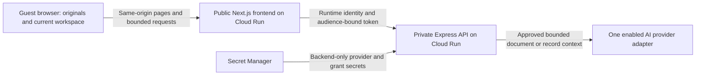

# Retrosum — Product, Architecture and Delivery Blueprint

**Latest owner-authorized local live work — 10 October 2026:** Two independently generated numeric/record passes over the ten visible PDFs/eighteen pages and seventeen live Retro intent cases passed. Accepted normal startup now enables both live features with fake off, the single paid switch on and complete key/challenge/grant prerequisites. Exact full-input token preflight replaces unproven image-token estimates; missing/excess counts stop generation. Receipt paid claims never invent cash, missing printed net stays absent and owned transfers never allocate to invoices. Real localhost disclosure, Turnstile, one-use grant, PDF extraction and Retro checks passed. Current checks and spend/failure evidence are in [RET-011 validation](validation/RET-011.md); earlier closed/fake-only implementation snapshots below are historical. Owner/physical/general handwriting and hosted domain/IAM/retention/account/deployment acceptance remain pending.

**Status:** active implementation source of truth; external acceptance remains pending.
**Prepared:** 7 October 2026. **Updated:** 8 October 2026 with the owner’s core-flow, design, accuracy and Retro requirements.<br>
**Product:** a public, disposable business money workspace demonstrating useful AI.  
**Companion:** [Retrosum product overview](RETROSUM_OVERVIEW.html).  
**Earlier fake/packaging implementation snapshot — 8 October 2026:** RET-001 through RET-011 are verified locally: foundation, brand/landing, visible sample PDFs/viewer, exact money/manual CRUD/Undo/recovery, simulated actual-byte recognition/review, source-backed interactive dashboard and floating Retro conversation/guidance. Typed simulations ground current figures and sources; local shortcuts, registered tour/highlights and inline Undo remain usable without AI. RET-008 animated editable CRUD proposals, clarification, one confirmation and latest Undo are verified locally. RET-009 reviewed revision-bound ZIP exports, local created-invoice PDFs and whole-session cleanup are verified locally. RET-010 local privacy/admission/spend hardening is verified: scoped one-use grants, retained conservative reservations, private identity transport, bounded resources, nonce security policy and explicit processing disclosure. Actual live/IAM/challenge/spend gates stay closed; RET-011 connected product verification is complete locally, including actual ZIP download, ten hero/eight dashboard sizes and 190 settled tests. Physical/assistive performance and live acceptance remain pending. RET-012 local preparation is complete: both nonroot Linux images, packaged originals/fonts/workers, canonical proxy origins and free fake/unavailable probes are verified. The settled final gates passed 192 tests and 105 boundary checks. Manual deployment/rollback guides and unresolved Cloud Run templates are ready; no images were pushed and nothing was deployed. Owner aesthetics/physical-device feedback, live accuracy/spend and cloud deployment remain pending; public live capability stays closed. See each ticket's evidence, [money/session decisions](engineering/MONEY-SESSIONS.md), [recognition decisions](engineering/RECOGNITION.md), [dashboard decisions](engineering/DASHBOARD.md) and [Retro decisions](engineering/RETRO.md).<br>
**Execution status:** the owner authorized the [12-ticket queue](tickets/README.md) in a local fake-mode execute/validate loop, including RET-012 local preparation and per-ticket commits after clean validation. Actual paid tests, owner visual feedback and cloud deployment happen later.

Retrosum turns a small collection of business documents into understandable money records, a traceable overview, and an AI assistant named **Retro** that explains the dashboard, summarizes supplied records, guides the visitor and helps create, edit and remove session records. The visitor can inspect the evidence, correct an interpretation, review a duplicate or payment relationship, and export the result.

The first build should feel like a complete product in a short visit. A visitor previews believable documents, starts without labelling their types, sees them become connected records, understands the difference between invoiced work and cash received, and checks one explanation against its sources, then asks Retro to prepare a new invoice or expense and sees the confirmed change update the workspace.

## Contents

**Owner sample amendment — 10 October 2026:** The expanded Harbor sample now has ten visible PDFs/eighteen pages. Two new native receipt packs add Materials, archive-storage Rent, Services and Marketing; together with Software the initial eligible donut has five positive categories totaling USD 1,190. Original scan/handwriting/duplicate holds remain; reviewed costs are USD 2,350. Original cash/history evidence and all eight original bytes stay unchanged. Sections 7 and 8 supersede earlier corpus counts/results; live accuracy/spend and new release packaging verification remain pending.

**Owner Retro amendment — 9 October 2026:** [Capability map and provider parity](design/RET-011-RETRO-CAPABILITIES.md) extends section 11 and the demo redesign. Strict `workspace_request` intents connect editable filters, original PDF selection/review, register navigation, settings/export/reset/intake panels, sidebar control, income targets, layout restoration, independent Undo and confirmed conversation clearing. Exact topics include due-soon/tax/categories/customers/vendors; those amounts remain engine-owned. Supported KPI metrics include explicit tax and known customer/supplier due-soon. The browser supplies bounded current widget context to the API and validates layout revision separately. Fake phrases and the actual Responses adapter with injected HTTP responses share the same controls; true live language accuracy, numeric extraction and spend remain unverified without a funded key and testing budget. The built-in capability guide requires no model call.

**Owner journey/dashboard amendment — 9 October 2026:** [RET-011 demo redesign](design/RET-011-DEMO-REDESIGN.md) governs the new canonical `/demo` single-page experience and replaces the prior query-based workspace entry/fixed dashboard. Choose upload or fictional sample; inspect/select mini PDFs with expanding source dialogs; process selected documents with actual completed/total progress; enter the full-screen dashboard automatically. Retro appears only at the dashboard. The responsive collapsible sidebar provides Dashboard, Documents, Records, profile/settings and Reset. Bounded session preferences support charts, KPIs, manual income targets, reordering, restoring defaults and separate layout Undo. Retro offers illustrated/typed chart choices and confirms bounded chart/KPI/restyle/remove/move proposals; all numbers still come from the canonical money engine and visible sources. Source records/forms remain USD; EUR dashboard display automatically loads a dated ECB reference rate through the backend's fixed Frankfurter lookup, with exact shared cent rounding and a visible rate/date label. No invented fallback rate, executable model chart code or invented quarterly history is allowed. Latest owner FX feedback supersedes the earlier visitor-entered-rate requirement. Earlier USD-only display and fixed-workspace wording is superseded by this amendment. External live/physical/owner/cloud acceptance remains pending.

1. [Authority, evidence and decisions](#1-authority-evidence-and-decisions)
2. [Product contract and audience](#2-product-contract-and-audience)
3. [Scope and success](#3-scope-and-success)
4. [Landing page](#4-landing-page)
5. [Signature visitor journey](#5-signature-visitor-journey)
6. [Workspace and screen specifications](#6-workspace-and-screen-specifications)
7. [Synthetic sample business](#7-synthetic-sample-business)
8. [Inputs, previews and recognition](#8-inputs-previews-and-recognition)
9. [Financial meaning and calculations](#9-financial-meaning-and-calculations)
10. [Review, corrections and session CRUD](#10-review-corrections-and-session-crud)
11. [Insights and Retro](#11-insights-and-retro)
12. [State, revisions and persistence](#12-state-revisions-and-persistence)
13. [Exports and session reset](#13-exports-and-session-reset)
14. [Framework and architecture](#14-framework-and-architecture)
15. [Repository structure and ownership](#15-repository-structure-and-ownership)
16. [Domain and shared contracts](#16-domain-and-shared-contracts)
17. [HTTP API and private transport](#17-http-api-and-private-transport)
18. [Processing and provider boundaries](#18-processing-and-provider-boundaries)
19. [Limits, admission and spend](#19-limits-admission-and-spend)
20. [Privacy, security and cleanup](#20-privacy-security-and-cleanup)
21. [Configuration and local operation](#21-configuration-and-local-operation)
22. [Cloud infrastructure and deployment](#22-cloud-infrastructure-and-deployment)
23. [Visual system and accessibility](#23-visual-system-and-accessibility)
24. [Verification and evaluation](#24-verification-and-evaluation)
25. [Observability, reliability and recovery](#25-observability-reliability-and-recovery)
26. [Documentation and engineering guidelines](#26-documentation-and-engineering-guidelines)
27. [Delivery sequence and ticket ownership](#27-delivery-sequence-and-ticket-ownership)
28. [Open decisions and release acceptance](#28-open-decisions-and-release-acceptance)
29. [Appendix A — extraction field inventory](#appendix-a--extraction-field-inventory)
30. [Appendix B — examples and invariants](#appendix-b--examples-and-invariants)
31. [Appendix C — source map and references](#appendix-c--source-map-and-references)
32. [Appendix D — research and asset decisions](#appendix-d--research-and-asset-decisions)

## 1. Authority, evidence and decisions

### 1.1 What this document owns

This file consolidates the received Retrosum product material and the engineering patterns inspected in both sibling repositories. It owns the proposed first-build product behavior, screens, financial semantics, application boundaries, resource policy, verification strategy and deployment shape.

The HTML companion is a short product-management reading view. It summarizes this blueprint and previews the brand direction. It is not a working application, a live AI demo, or a separate behavior specification.

The existing `retrosum.md` and `retrosum.html` remain received product research and a richer conceptual prototype. Preserve them as input history. Use this new blueprint for implementation planning once the owner accepts it. Conflicts are resolved by the latest explicit owner instruction; a historical prototype must not silently restore an older behavior.

This pass creates the ticket folder and queue after the latest owner answers. Application directories, executable configuration and operational evidence remain future implementation artifacts. Read the ticket index before choosing work.

### 1.2 Evidence actually inspected

| Source | What was inspected | What Retrosum adopts |
| --- | --- | --- |
| Retrosum drafts | `docs/retrosum.md`, `docs/retrosum.html`, `README.md` | Guest money workspace; source previews; automatic recognition; reviewed records; money overview; original read-only copilot concept now expanded by the owner into Retro; exports; vintage identity. |
| Received ClipBuilder lessons | `docs/LESSONS_LEARNED_FROM_CLIPBUILDER.md` | Explicit ownership, strict boundaries, private transport, cleanup, measured resource limits, restrained dependencies, release evidence. |
| Received ScreenPilot playbook | `docs/PORTFOLIO_DEMO_BUILD_PLAYBOOK.md` | Signature journey, authority system, canonical state, fake-first evaluation, selective persistence, two-service Cloud Run deployment. |
| Actual ClipBuilder repository | Root instructions, public README, package manifests, source-of-truth structure, frontend/backend feature directories, and current Cloud Run deployment guide | pnpm monorepo; Next.js/React; Express; Zod contracts; use cases and adapters; public frontend/private API; manual audited deployment. |
| Actual ScreenPilot repository | Root instructions, package manifests, source of truth, frontend/backend directories, and manual Google Cloud deployment guide | Browser-session workflow; same-origin private proxy; browser-safe contracts; no application database; GitHub Actions for quality checks; owner-controlled release. |

The sibling repositories live at `../ClipBuilder` and `../screen-pilot`. They were explored as actual repositories, not merely named as inspiration. Their project-specific approvals, cloud identities, domains, secrets, data and completed-feature claims do not transfer to Retrosum.

### 1.3 Reuse and adaptation

| Area | Shared backbone | Retrosum adaptation |
| --- | --- | --- |
| Application layout | `apps/frontend`, `apps/backend`, `packages/contracts` | Document and money features replace video or interview features. |
| Browser framework | Next.js App Router, React, TypeScript | Landing, document collection, overview, records, copilot and export. |
| Server framework | Express, explicit composition, validated HTTP edges | Request-scoped document interpretation and deterministic money calculations. |
| Shared schemas | Browser-safe Zod contracts | Money values, source references, review commands, metrics and AI outputs. |
| Workflow | One reducer with explicit asynchronous states | File-level partial results and a versioned workspace graph. |
| Providers | Ports, live adapters and deterministic fakes | OpenAI document interpretation and explanations as the proposed first live adapter. |
| Hosting | Docker, Google Cloud Run, Artifact Registry, Secret Manager, runtime IAM | Two services; no renderer, media worker or upload bucket in the initial design. |
| Abuse controls | Server validation, challenge, short-lived grants, capacity and usage bounds | Grants bind to document-processing or copilot operations; preview and arithmetic remain free of AI calls. |
| Verification | Vitest, Supertest, boundary checks, focused manual acceptance | Exact financial invariants, source grounding and record-review behavior. |
| Release | Audited immutable images and manual release evidence | Synthetic documents and bounded owner-run live format acceptance. |

ClipBuilder's Remotion composition, FFmpeg pipeline, renderer and media storage solve its video workload. ScreenPilot's voice, microphone and ElevenLabs tools solve its interview workload. Retrosum should inherit the same ownership and infrastructure principles while adding only the document capabilities its story needs.

### 1.4 Decision language

- **Owner requirement:** explicitly decided in the current conversation; do not reopen it as an implementation prerequisite.
- **Proposed baseline:** a concrete bounded implementation choice; use it unless changed by the owner or disproved by measured constraints.
- **Release prerequisite:** evidence or operator configuration still needed before enabling a public capability.
- **Deferred:** outside the first release.

| Decision | Position | Authority |
| --- | --- | --- |
| Language and money | English interface and documents; USD; one fictional service business | Owner confirmed |
| Core pillars | Exact document recognition → beautiful interactive dashboard → Retro helping explain and act | Owner requirement |
| Sample evidence | Eight viewable PDFs, several multipage; one core handwritten PDF; no hidden financial dataset | Owner requirement; eight is the bounded planning choice |
| Public sample processing | Process the actual displayed sample PDFs live through OpenAI | Owner confirmed |
| Development behavior | Explicit fake mode supports fixture recognition, generic supported prompts and every major UI state without an API | Owner confirmed; never disguise it as live processing |
| Provider | OpenAI; initial evaluated candidate `gpt-6.1-sol`, Responses API | Owner selected OpenAI; model researched 8 October 2026 |
| Retro appearance | Floating pill composer and floating messages; glass/shadow, user bubbles, unboxed Retro replies, contextual answer shortcuts | Owner confirmed; ClipBuilder/ScreenPilot implementation references |
| Retro interaction | Summaries, explanations, tour, auto-scroll, highlights/outlines and animated form filling, in addition to questions | Owner requirement |
| Record actions | Invoices, expenses/bills, payment records and customers/vendors; one shared local command engine | Owner confirmed session CRUD; bounded object set retained |
| Mutation control | Editable proposal and compact inline confirmation; small Undo for the latest reversible action | Prior recommended confirmation retained; latest owner requires Undo |
| Refresh and lifetime | Restore records and selected original PDFs across refresh; per-tab workspace; proposed fixed two-hour expiry and explicit Reset | Owner confirmed refresh recovery; two hours follows ScreenPilot's bounded lifetime |
| Upload ownership | Originals retained only in temporary browser storage; request-scoped forwarding to OpenAI when processing is requested | Owner requirement interpreted as no retained server upload library |
| Database | No server/application database, account store or upload bucket; browser-only IndexedDB holds temporary PDF Blobs | Browser storage is required for refresh-safe PDFs; explicitly a local storage mechanism |
| Brand and motion | Logo green/orange, ivory, professional vintage typography, calm photo hero, smooth charts; no animation-off product setting | Owner requirement |
| Initial AI funding | Approximately USD 5 of OpenAI credits for initial testing; meter actual consumption | Owner preference; no assertion that it covers all tests or public traffic |
| Delivery plan | Twelve cohesive packets with outcome, ownership, dependencies and focused verification | Owner now authorized tickets; adopt ClipBuilder consolidation |
| Handwriting authoring | Research/fetch a reusable specimen or recreate a fictional handwriting-style receipt; record human/synthetic provenance accurately | Owner clarification, 8 October 2026; no owner-provided scan prerequisite |
| Current execution phase | Authorized local fake-mode execute/validate loop across all tickets; RET-012 local packaging/preparation included; live accuracy/spend, owner visual feedback and actual cloud deployment later | Owner authorization, 8 October 2026; no cloud changes or paid calls during this loop |

Published performance remains unproved until implemented and measured. `gpt-6.1-sol` currently supports image input, structured outputs and function calling; its official standard short-context rates are USD 2 input / USD 10 output per million tokens. Recheck availability and rates at setup. [OpenAI model reference](https://developers.openai.com/api/docs/models/gpt-6.1-sol).

## 2. Product contract and audience

### 2.1 Product sentence

**Retrosum helps a guest turn invoices, bills, receipts and payment exports into a clear, AI-assisted view of their business money, with inspectable sources behind every figure.**

Working line: **Make sense of your business money.**

Primary invitation: **Drop in your documents. We'll figure out what they are.**

Descriptor: **Business money workspace.** The word *fintech* is useful positioning, but the experience should explain the actual job in familiar language.

### 2.2 The problem

A small business can have invoices in a folder, rent receipts as PDFs, a software purchase in a spreadsheet, and a payment export from another tool. Reading each item is possible; connecting them is harder. An invoice can be mistaken for money already received. A photographed copy can become an extra expense. A payment row can be counted again as income. An unexplained dashboard leaves the owner unable to check the answer.

Retrosum demonstrates a useful transition from scattered files to connected digital records. The original remains available. The structured interpretation is editable. The totals expose their contributors. Retro can investigate, summarize, explain and prepare changes without turning a guessed explanation into an accounting fact.

### 2.3 Primary user and useful visit

The primary visitor is a freelancer, studio owner or service-business operator with limited appetite for accounting setup. The secondary visitor is a recruiter, prospective client or technical reviewer evaluating the demo's product quality and engineering discipline.

The visitor should not need an account, a provider API key, an administrator, a bank login or knowledge of document classification. A single business-identity clarification is acceptable because direction depends on whether the business issued or received the invoice.

A useful visit ends with an understandable overview, organized records, visible unresolved issues and an export. Retro is a core product interaction; summaries, tours, chart explanations and confirmed CRUD demonstrate its value. The workspace also remains useful through manual forms and source inspection when live language processing is unavailable.

### 2.4 Ten-second comprehension

The landing must make the following apparent:

1. What goes in: ordinary business money documents.
2. What comes out: organized records and an explainable money picture.
3. Why AI helps: recognizes different documents, summarizes and explains the money, guides the visitor and prepares record changes.
4. How to try it: explore a realistic sample business immediately.
5. What can be checked: figures and answers link to their sources.

Avoid leading with technology names, a blank chat box, a sign-up wall or a long feature grid. The memorable moment is the connected record-to-explanation interaction.

## 3. Scope and success

### 3.1 First-build capabilities

| Capability | Required behavior |
| --- | --- |
| Landing and sample entry | Explain the product; preview original sample files; start a coherent sample workspace. |
| Supported own-file intake | Validate bounded files; no document-type form; distinguish available live processing from unavailable formats. |
| Recognition | Propose type, parties, business direction, amounts, category and evidence; retain uncertainty. |
| Document collection | View originals and field interpretations; show progress, failures, exclusions and review issues. |
| Connected money records | Separate economic events, payment evidence and source documents; support reviewable relationships. |
| Money overview | Premium animated KPI cards and interactive charts for document income/cost/profit or loss, recorded cash, open amounts, composition, comparisons and coverage; every data mark has useful detail. |
| Source-grounded observations | At most four concise findings from supplied records, each with evidence and scope. |
| Retro | Grounded questions and summaries; guided tours; dashboard explanations; bounded confirmed session CRUD. |
| Review tools | Correct key fields/categories; confirm or reject duplicate/payment candidates; see resulting changes. |
| Session record management | Create/read/update/delete draft invoices, expenses/bills, payment records and customers/vendors through simple forms or Retro; shared commands and provenance. |
| Export and reset | Download a coherent revision, optionally include originals, and clear the session. |
| Failure recovery | Preserve completed work; isolate failed files; offer deliberate bounded retries and manual fallback. |

### 3.2 First-build exclusions

The demo does not include accounts, organizations, shared books, subscription billing, durable history, bank sync, payment execution, automatic emailing, tax filing, regulatory certification, bookkeeping certification, a general ledger, payroll, inventory accounting, balance sheets, forecasting, arbitrary web import, inbox watchers, or multi-user approvals.

No vector database, general background queue, MCP server, unconfirmed autonomous ledger writes, independent document-rendering service or cross-provider fallback is required. Add a service only after a documented workload or isolation need demonstrates why the two-service baseline cannot meet the agreed bounds.

### 3.3 Later additions

| Addition | Value | Gate before adding |
| --- | --- | --- |
| More document profiles | Broader tested import coverage | Profile-specific parsing, preview, fixtures, limits and live acceptance. |
| Read-only MCP adapter | Let another client inspect the same validated records | In-app tools stable; separate access/lifetime contract. |
| Temporary storage or parser worker | Handle larger/native workloads safely | Measurements justify storage, lifecycle, IAM, costs and extra services. |
| Persistent product | Save projects and collaborate | New authentication, tenancy, durable storage and retention specification. |

### 3.4 Observable success

An evaluator can complete a guided sample visit in roughly five minutes, a target to measure after implementation. They can inspect a genuine sample PDF, reach the overview, ask why invoiced income differs from recorded cash, inspect the cited sources, resolve a relationship, and export.

Success also requires correct calculations and honest limits. Unsupported uploads cannot receive unrelated fixture output. Mixed currencies cannot become a single unlabeled total. A document stating *paid* cannot create an extra bank movement when the same payment already appears elsewhere.

The document establishes acceptance targets and dated, sourced adoption context. It does not establish achieved extraction accuracy, live speed/cost guarantees or regulatory compliance. The primary release target is zero numeric transcription errors across the published demo corpus; evidence must be recorded before claiming it has passed.

## 4. Landing page

### 4.1 Experience and hierarchy

The landing is calm, professional and photographic. Its eye catcher is one beautifully composed high-resolution office image with floating, shadowed editorial text. It does not reuse ScreenPilot’s hovering hero cards or ClipBuilder’s motion-graphics hero. Retrosum’s visual story connects a quiet financial workplace, an industry-adoption section and the responsive money workspace opened through Explore demo.

| Section | Content | Visitor purpose |
| --- | --- | --- |
| Navigation | Retrosum logo; How it works; Meet Retro; Explore demo CTA | Understand the offer and begin easily. |
| Photographic hero | Wide office photo, dark forest-green overlay, off-white heading, orange detail, two clear CTAs | Feel the professional brand and understand the promise. |
| Three core pillars | Exact document reading; interactive money picture; Retro helping explain and act | Establish steps 3, 4 and 5 as the product’s center. |
| Finances are becoming digital | Three dated statistics with scope/source links and named AI examples, in a rounded green panel on a dark forest section immediately after the pillars | Place the product in a credible wider transition. |
| Meet Retro | Summary, tour, dashboard explanation and invoice/expense creation examples | Show an assistant that helps complete tasks. |
| Short trust and limits | Temporary guest session; tested formats; disclosure before live processing | Support the choice to use documents without a wall of technical copy. |
| Final invitation and footer | Explore sample / Use my documents; temporary handling, brand and tagline | Provide a clear next action. |

### 4.2 Copy direction

**Owner navigation feedback, 9 October 2026:** The hero navigation keeps How it works and Meet Retro, removing the former dashboard/industry link. Both section buttons use ClipBuilder's directional underline: draw from the left, retract to the right, with Retrosum's orange accent and the same effect on keyboard focus. Scrolling remains smooth and hash-free.

**Hero:** Know your numbers. Understand your business.

**Owner main-headline feedback, 10 October 2026:** The owner selects “Know your numbers. Understand your business.” after reviewing five researched alternatives, superseding “Your finances. In focus.” Keep the ivory/orange sentence hierarchy, supporting copy and typed eyebrow; allow responsive wrapping so the longer wording remains readable inside the first device viewport.

**Owner slogan feedback, 9 October 2026:** The typed hero line is “A better way to handle your finances.” This replaces “A clearer way to work with money” with the owner's preferred professional language, retaining the typewriter and continuously blinking dot.

**Explanation:** Turn invoices, receipts and payment records into a clear picture of your business. Explore your numbers, check their sources, and let Retro help with the next task.

**Primary CTA:** Explore demo. **Secondary CTA:** Use my documents.

**Owner visual feedback, 9 October 2026:** The Harbor Studio introduction and original sample gallery belong inside the Explore demo entry, not on the landing. Introduce Harbor Studio explicitly as a fictional example with eight provided PDFs/fourteen pages, nothing to upload, clear processing/preview actions and a short guide to review, dashboard and Retro. The personal-document entry focuses on business details and uploads; switching entry intent preserves the existing session. Later feedback in the same review removes the landing dashboard preview entirely: the existing adoption statistics take its earlier position and forest-green styling, with one rounded green panel, ivory type, orange accents and retained dated source links. The previous ivory statistics section is removed rather than duplicated.

**Supporting line:** No account needed. A temporary demo with realistic fictional documents.

**Pillars:** Read the details. See the bigger picture. Work with Retro.

Do not publish “perfect on any document,” “send anything,” or a universal accuracy percentage. Show multiple evaluated layouts and describe the supported format set plainly. A future achieved zero-error fixture result can be described as a measured sample result with its test conditions, not as a guarantee about every upload.

### 4.3 Photograph and motion

The HTML companion embeds a licensed **3840 × 2563** office photograph, downloaded from a **7167 × 4783** source by Max Vakhtbovych. It is a generic office, not a claimed real bank or Retrosum customer. [Photo origin](https://www.pexels.com/photo/modern-interior-design-of-a-business-office-7534224/), [Pexels license](https://www.pexels.com/license/).

For application implementation, keep the high-resolution master and generate responsive modern formats. Target an appropriately sized mobile image, avoid sending the 4K master to every device, reserve hero dimensions and prioritize the first image. Use a controlled gradient, subtle text shadow and a contrast-tested scrim; text remains HTML, never baked into the photo. Crop intentionally on phone. The photo is decorative when the neighboring copy conveys the complete meaning.

Hero entrance is a gentle one-time opacity/position transition, roughly 500–700 ms. The photo can remain still. Rich chart transitions carry the product motion. No endless background panning, flashing, hover-card swarm or theatrical processing simulation is required.

**Hero motion feedback, 9 October 2026:** The current line “A better way to handle your finances” types out letter by letter after the hero entrance, with a moving caret and a continuously blinking orange dot to its left. Reserve the finished text width and expose the complete phrase once to assistive technology. Keep the Next.js development badge disabled. App animations remain permanently enabled: do not add an animation-off setting, reduced-motion suppression or a conditional zero-duration path.

**Typewriter completion repair, 9 October 2026:** Drive the letter reveal with one elapsed-time client timer, rather than independent CSS animations that left the later letters transparent in the local preview. Delayed callbacks catch up; after completion all letters stay visible. The initial server-rendered phrase is readable, and the owned timer is cleared on unmount. Preserve the same colors, reserved width, caret and continuously blinking dot.

**Sheets of paper transitions, 9 October 2026:** Owner approved trying the paper proposal. The five surfaces after the photographic hero have rounded upper edges, shallow overlaps and soft shadows. A bounded lift follows normal scrolling and reverses when scrolling back; headings and the Retro preview/final actions follow slightly behind their surfaces. Use smaller travel/edges on phones and a quieter footer, whose transition range fits its short height. The hero remains a full first viewport. Measure stationary section wrappers so hash-free section destinations stay stable; render readable content before hydration and clean up the owned frame, listeners and resize observer on unmount. No orange connecting line was added in this trial. Owner aesthetic and physical-device review remain pending.

**Visible transition follow-up, 9 October 2026:** The owner could not see the first trial's movement. Increase surface travel to 120 px on desktop / 56 px on phone and extend the entry progression across three quarters of the viewport, capped at 640 px and the section height. Use smooth progression and elapsed-frame settling so surfaces continue into place after scrolling stops, while their headings are visible. Preserve reverse motion, stable section targets and the quieter footer. Confirm actual intermediate and completed transforms with content on screen. Remove the requested footer language/currency/fictional-demo line; retain only the wordmark and tagline.

**Hero photograph feedback, 9 October 2026:** Back up the original before image editing and add casually messy paper documents on the wooden desk at the right. The app now uses the AI-edited derivative, with the original photograph retained. Subsequent owner feedback removes the optional photographer/AI-edit footer credit: the [Pexels license](https://www.pexels.com/license/), rechecked 9 October 2026, does not require attribution. See [backup, final prompt and retained asset provenance](design/HERO-PHOTO-EDIT.md). The historical HTML companion still embeds the original photograph and its credit.

**Permanent owner constraint:** intended animations must always run. Never reintroduce Render animations off, Disable animations, a static-dashboard setting or an equivalent control; do not suppress intended motion through reduced-motion/OS preferences, paused/zero-duration overrides or conditional gates. Motion is a designed part of the demo. Verify visible movement while the animated element is on screen and verify completion; static rounded edges or configured animation names alone are insufficient evidence. Keep movement short and readable, with normal keyboard, touch and textual chart access. This rule is also recorded in root [AGENTS.md](../AGENTS.md).

### 4.4 Dated adoption evidence and company examples

Use these precise claims, with adjacent source links and readable date/scope captions:

| Landing fact | Exact scope/date | Presentation and limit |
| --- | --- | --- |
| **75% already use AI** | 118 respondents to the Bank of England/FCA 2024 financial-services survey; report published 21 November 2024 | Caption: “Of responding UK financial-services firms, 2024.” This is survey adoption, not 75% of all companies worldwide. [Bank of England/FCA report](https://www.bankofengland.co.uk/report/2024/artificial-intelligence-in-uk-financial-services-2024). |
| **42% made digital merchant payments** | Adults in low- and middle-income economies, 2024; Global Findex 2025 context | Demonstrates digital financial activity, not paperless-document adoption or company AI use. [World Bank analysis](https://blogs.worldbank.org/en/allaboutfinance/digital-technology-is-unlocking-financial-inclusion), [Findex report and methodology context](https://www.worldbank.org/en/publication/globalfindex/report). |
| **98% of adviser teams adopted its Assistant** | Morgan Stanley Wealth Management’s announcement, 26 June 2024 | Name the company and tool; describe this as its reported internal adoption. [Morgan Stanley announcement](https://www.morganstanley.com/press-releases/ai-at-morgan-stanley-debrief-launch). |

The examples row can describe Morgan Stanley’s AI meeting summaries and Intuit’s accounting/payment/finance agents, announced 1 July 2025. Use short attributed descriptions rather than broad claims about complete automation. [Intuit announcement](https://investors.intuit.com/news-events/press-releases/detail/1258/intuit-introduces-ground-breaking-virtual-team-of-ai-agents-to-fuel-growth-for-businesses).

Section heading: **Finance is moving into a digital, AI-assisted era.** Supporting copy connects the evidence to easier record organization and explanation. Label names as **Examples across the industry**. Do not use a “Trusted by” logo bar, testimonials or partner wording. The digital-payment figure is not evidence that 42% digitized their documents. E-invoice template ecosystems provide concrete document examples, but no fabricated paperless-adoption percentage belongs here.

Keep a source registry containing claim text, denominator, geography, observation year, publication date, URL and last checked date. Research checked 8 October 2026. Review landing facts before public release; the wording must retain the original observation year.

### 4.5 Entry behavior

- Landing, photo, statistics and sample preview make zero model calls.
- Public sample entry processes the actual viewable PDFs live, with disclosure and admission.
- Only explicitly labelled development fake mode uses fixture interpretations and generic fake Retro responses.
- Own-file selection stays local until Process documents.
- A disabled live route is disclosed before upload processing is expected; sample exploration and manual CRUD remain available.
- The documentation companion is a product brief. Any interactive charts inside it illustrate the intended behavior; they do not implement the application or prove live OCR.

## 5. Signature visitor journey

### 5.1 The complete story

| Step | Visitor action | Application response | Checkable outcome |
| --- | --- | --- | --- |
| 1. Explore | Select the sample business; preview a document | Show actual original bytes or a clearly labelled safe rendition | Visitor sees what will be interpreted. |
| 2. Start | Use the sample bundle or select supported files | Establish one business; request identity confirmation only when needed | Direction has an explicit business context. |
| 3. Recognize — core | Start processing | Preserve exact number strings; validate fields, source evidence and arithmetic; hold ambiguity | Varied documents become accurate, traceable records. |
| 4. Understand — core | Open Overview; hover or click a figure | Animate validated KPIs/charts; expose values, comparisons and contributors | A beautiful money picture that can be explored and checked. |
| 5. Work with Retro — core | Ask for a summary, tour, explanation or new invoice | Return grounded explanations or a structured change preview; apply confirmed session commands | Retro helps understand the site and manage the session. |
| 6. Review | Confirm the HS-101 match or A-77 duplicate | Validate command; update one workspace revision; recompute dependent views | Relationships change without double counting. |
| 7. Take away | Export the current workspace | Download the same revision with scope, basis, evidence and unresolved issues | Result remains useful outside the site. |
| 8. Reset | Clear and start again | Cancel owned work, release previews, discard session data | A new workspace starts cleanly. |

### 5.2 Live sample entry and development fakes

The visitor selects **Explore demo**, sees the fictional Harbor Studio introduction and supplied originals, opens any PDF, then chooses **Process sample documents**. Navigation alone does not process documents or create records. Public live mode reads those actual bytes through the same inspection, admission, OpenAI interpretation, review and calculation path as visitor PDFs. Show genuine per-document stages and explain ambiguous numbers rather than substituting stored answers.

There is no hidden starting ledger, no invisible comparison-month dataset and no public “instant prepared sample” shortcut. Every sample event, payment, category and comparison value must resolve to a visible PDF/page/field. The fixture manifest lists assets and evaluation expectations, but live recognition must not read the expected-result JSON or seed the live graph with it.

In explicit **development fake mode**, the same original gallery and progress UI use production-shaped fixture outputs with deterministic delays, failures and generic supported Retro responses. Per the owner's 9 October visual-feedback instruction, the website omits development/simulation banners and technical mode copy; internal provenance, exported evidence and paid/live accuracy gates remain intact. This is the place for resettable data during local iteration; it is not a second public product path.

On a live outage or exhausted allowance, retain PDF viewing, existing records, manual forms, local tour, calculations and export. Explain that AI is unavailable and offer a deliberate retry when allowed. Never silently turn failed live processing into fake success. Refresh restores completed records without automatically reprocessing or rebilling the files.

### 5.3 Own-document entry

1. Select files with a conventional picker or drag-and-drop.
2. Preview the collection locally, validate type/size/page limits and remove unwanted files.
3. Confirm the business identity once if the documents do not establish which party is the visitor.
4. Read the actual enabled provider disclosure and choose Process documents.
5. Admit and process files sequentially; clear sources can become eligible without forcing review of every field.
6. Keep uncertain direction, incompatible currencies, questionable amounts and duplicate candidates in the review queue.
7. Open the overview from the successful subset with explicit coverage and pending exclusions.

A failure in one document must not discard other successful records. The visitor can finish a useful session through preview, review, manual entry and export even when a live AI operation fails.

### 5.4 The memorable interaction

The sample contains two invoices issued by Harbor Studio and a separate payment export. The overview shows USD 4,800 of invoiced income and USD 3,000 of recorded operating cash in. The visitor asks why those differ. The answer identifies the paid/matched HS-101 evidence, the explicitly open HS-102 invoice and the different measurement bases.

Confirming the HS-101 payment match resolves its settlement uncertainty. Income stays USD 4,800. Recorded cash stays USD 3,000. The known open HS-102 amount stays USD 1,800. The UI makes these unchanged values understandable: a relationship was resolved, an extra sale was not created.

The duplicate lesson then shows A-77 twice, as a scan and an image. The candidate copy is held outside eligible totals. Confirming the duplicate preserves both sources and associates one cost with both. Rejecting the candidate requires a separate decision about whether a distinct cost can be established; it must not silently make the copy eligible.

### 5.5 A second signature interaction: ask Retro to create

After exploring the numbers, the visitor says: **“Create an invoice for Cedar Labs for USD 2,000, due 30 November 2026, for website design.”** Retro resolves the customer or offers to create it, fills one service line, shows the proposed issue date and tax treatment explicitly, and prepares a draft. Missing required information is asked together in one concise follow-up rather than guessed.

The visitor reviews a compact invoice preview and clicks **Create draft**. The invoice appears in Records with **Created with Retro** provenance, can be edited and downloaded, and does not inflate September income or recorded cash. An explicit **Mark issued** command includes it in its own document period; recording a payment is a separate session action. Retro then links to the result. This proves useful AI-assisted CRUD without a database, email delivery or payment execution.

## 6. Workspace and screen specifications

### 6.1 Information architecture

The initial app has a landing and one connected workspace. The workspace has four primary areas: **Overview**, **Documents**, **Records**, and **Retro**. Contacts, invoices, expenses/bills and payments are tabs within Records. **Review** is a focused view of issues within Documents/Records. **Export** is a workspace action and review sheet rather than an unrelated product area.

The implemented routes are `/` and `/demo`. Legacy `/workspace` entries redirect to `/demo`. Choose, Documents, Process and the dashboard areas are stages/views in the same two-hour per-tab session; selection/view recovery uses bounded browser persistence rather than URL queries/fragments. Both landing entry actions lead to the first two-choice screen. Navigation, preview, layout and currency controls do not create separate ledgers or dispatch inference. Direct navigation with no session opens Choose; interrupted processing returns to Documents for deliberate retry.

**Hash-free navigation feedback, 9 October 2026:** Do not generate fragment URLs. Same-page section CTAs are accessible buttons that scroll to their targets with a 640 ms eased animation while retaining the current URL. Keep Skip to content focus transfer and cancel superseded/user-interrupted motion. The latest `/demo` amendment persists in-page stages/views in the bounded tab session; they do not create URL/history entries. Historical `/workspace` URLs redirect to `/demo`; recognized landing fragments are replaced with clean URLs while retaining their section destination. Original-PDF external links have no page fragment; relevant pages remain directly viewable inside the app.

### 6.2 Global shell

Before processing, use a minimal brand header, short step indicator and one primary action. The full dashboard shell displays business/profile, selected period/display currency and review/failure counts, with a collapsible forest sidebar for Dashboard, Documents, Records, Settings and Reset. Expanded navigation is 284 px wide on laptops, 240 px on tablets, and a viewport-bounded 284 px phone drawer. Main navigation uses 16 px text and 22 px icons, with larger profile/supporting labels; the compact icon rail retains its existing width. Retro appears only here. Phones use a focus-contained drawer and keyboard-aware composer; short screens scroll naturally. Source basis stays visible near figures; detailed contributors, coverage and exclusions open in focused dialogs.

**Latest owner sidebar-branding feedback, 10 October 2026:** Restore the canonical browser icon to the left of the serif Retrosum name in expanded navigation, including the full phone drawer, using the shared Wordmark component. This supersedes the earlier text-only expanded sidebar preference. Show the canonical browser icon alone in the collapsed desktop/tablet rail. Keep the same accessible home link and sidebar animation.

Desktop uses a compact navigation rail/sidebar, the active workspace and the persistent floating Retro pill with messages above it. Tablet uses a reduced rail. Phone uses natural vertical flow, centered responsive source dialogs and an expandable conversation sheet; reserve composer and keyboard safe-area space.

Do not keep two independently mounted workspaces for desktop and phone. Adapt one semantic component tree so state, focus, errors and source references remain consistent.

### 6.3 Document collection

| Element | Specification |
| --- | --- |
| Collection heading | Name the business and distinguish sample from visitor originals. |
| Add-files area | Picker and drag-and-drop; show supported formats and limits from configuration. |
| Document row/card | Safe display name, PDF page count, layout/handwriting hint, recognized type and review/processing state. |
| Preview action | Open original or labelled rendition; no extraction side effect. |
| Processing action | Explicit start; show provider disclosure and unavailable states before dispatch. |
| Progress | Real named stages; completed/failed counts; no invented smooth percentage. |
| Recognized result | Parties, role, number, dates, currency, amounts, category and source links. |
| Issues | Specific reasons such as unknown business side, ambiguous date, total discrepancy or candidate duplicate. |
| Partial-result banner | State included successful files and pending/failed files; permit continued review. |
| Remove action | Show record/relationship consequences; apply through a revisioned command. |

Every selected file needs an individual state. A generic batch spinner cannot obscure a failed file or imply all files were understood.

**Owner shared-review feedback, 10 October 2026:** Show the unresolved-source review section in both Documents and Records, deriving both from the same current workspace issues and revisioned review commands. Place it above the original-document list in Documents with a forest-green surface, ivory text and warm review actions; retain the ivory Records presentation. Counts, pending sources and decisions must remain synchronized across navigation and latest Undo, independently of either date range. Use the same checked source-review dialog and original PDF actions; see section 6.7.

### 6.4 Source viewer

A gallery or source click opens the same centered floating-paper dialog at the selected original PDF/page/block. The restrained paper entry motion settles for reading. Review fields/source excerpts remain available beside or below the page at responsive widths; preserve focus and a clear return to the originating metric/record.

All first-release originals use locally bundled PDF.js with real page controls, fit/zoom, loading/error state, selectable native text where available and Download/Open original fallback. Scanned/handwritten pages remain inside their PDFs. Multipage tables keep page/block evidence; non-PDF viewers are deferred.

Never draw an arbitrary highlight box to imply precise provenance. When coordinates cannot be verified, show the real page or row and a short excerpt. A source reference must remain useful even if highlighting fails.

### 6.5 Overview: the dashboard contract

The dashboard is a primary product showcase. It should feel polished at first glance and become more useful as the visitor explores it. A clean hierarchy matters more than placing every available widget on one screen. The initial viewport has a context header, four headline cards, one wide trend/comparison panel, a spending breakdown and Retro’s concise summary. Cash and open amounts remain visible nearby, with deeper panels below.

Research basis: Intuit documents profitability, cash-flow, receivable/payable and revenue dashboards; Mercury demonstrates interactive filters, money-in/out breakdowns and AI explanations; Ramp documents consolidated spend reports and filtered chart/table views. These are observed product patterns, not proof that every customer wants the same dashboard. Retrosum adapts the patterns to its small supplied-record corpus. [Intuit dashboards](https://quickbooks.intuit.com/learn-support/en-us/help-article/business-reports/create-dashboards-view-key-business-insights/L7C4Ftrzx_US_en_US), [Mercury Insights](https://mercury.com/blog/introducing-insights), [Ramp reporting](https://support.ramp.com/real-time-reporting).

#### 6.5.1 Context and headline figures

**Owner independent-date feedback, 10 October 2026:** Main Dashboard and Records date ranges are separate. Editing either range must leave the other unchanged. Both retain their own selection during view navigation, then return to the default period on browser refresh: the sample manifest's declared month, or the upload workspace's UTC creation month. Dashboard's other scope controls and workspace recovery continue normally; see sections 6.6 and 12.6.

**Owner KPI typography feedback, 10 October 2026:** Keep the existing numerical font and all responsive number-size rules. Enlarge card labels to 14 px and supporting/comparison copy to 12 px on laptops; phones use 12.8/11.2 px with readable line heights. At the existing 500 px phone breakpoint, stack cards in one column so unchanged numeric sizes fit without splitting the sample amounts. Chart/target spans stay within that column. Preserve amounts, colors, source actions and motion.

**Latest owner card-title feedback, 10 October 2026:** Use 600-weight titles on all KPI cards, including cash/open and visitor-added cards, so they are visibly stronger than the regular-weight supporting and comparison text. Keep existing numerical typography and responsive sizes.

**Owner header feedback, 10 October 2026:** Remove “A little clarity. A bigger picture.” Retain “Your financial picture” as a small semantic page heading. Combine the period/currency/source caption with Period & scope, document coverage/review and conditional layout Undo, with Customize dashboard aligned right on the same laptop toolbar. Wrap at constrained widths while preserving touch targets, filter/customization behavior and the overview/period/customize tour anchors.

**Owner scope-panel feedback, 10 October 2026:** Let Period & scope grow up to 36 rem within the toolbar's available width, with roomy date/category fields, a full-width counterparty field and a single phone column. Clicking or tapping outside collapses the native disclosure without applying or clearing draft fields; Escape also closes it and returns focus to its summary. Preserve normal validation, Apply, exact shared scope calculations and tour anchors.

**Automatic EUR display, latest owner decision — 9 October 2026:** Selecting EUR or opening EUR settings loads the latest published ECB USD→EUR reference quote from Frankfurter through the same-origin API and backend-only adapter. Show the rate/source/publication date with loading and Retry states; no manual rate field. Prevent applying EUR until a quote is available. The adapter uses a fixed anonymous request, a five-second fetch/body deadline, 4 KiB body bound, strict currency/rate/date validation and one-hour in-memory cache of one public quote. Reject quotes over seven calendar days old or in the future; weekend/holiday reference dates remain visible. No fallback is fabricated on failure. Only the quote's bounded integer-micro rate/date enters the two-hour browser preferences. All money conversion and symmetric half-up cent rounding remain in the shared engine, and original records/details/forms stay USD. A saved dashboard uses that rate snapshot through refresh; opening settings retrieves the latest quote again. FX works with fake, paid-off and live AI configuration, without an OpenAI key/call. No business/document/amount/cookie/key goes to the rate source, and Retro can only open settings, never supply or fetch a rate itself. See [Frankfurter's official JavaScript/provider documentation](https://frankfurter.dev/javascript/).

**Owner palette feedback, 9 October 2026:** Use more of the Profit preview forest green across income/profit/cash-in/net KPI surfaces, the built-in trend chart and targets, with ivory content and mint/orange chart marks. Retain contrasting ivory costs, margin, open balances and composition surfaces. Color does not change eligibility, financial meaning or source interactions.

**Owner chart feedback, 9 October 2026:** Default dashboard charts have no chart-style dropdown. Visitor-added charts retain their style controls. Identify built-in charts by canonical widget identity, preserving current styles, source interactions and Retro customization.

Show business, currency, reporting period, basis, fixed sample as-of date, supplied-record coverage, pending-review count and most recent local edit. Separate **Document view** from **Recorded cash** through clear labels. A selected currency applies to every visible metric. Never sum USD and EUR.

| KPI | Question it answers | Formula/meaning | Harbor reviewed sample | Click target |
| --- | --- | --- | --- | --- |
| Invoiced income | What work did the supplied issued invoices record? | Eligible sale amounts on the documented basis, excluding drafts/reference/duplicate sources | USD 4,800 | Included invoices and their source amount fields |
| Documented costs | What costs are in the supplied documents? | Eligible costs, net when separately stated tax exists; basis disclosed | USD 2,350 | Cost records with category and source |
| Profit / loss preview | What remains after those costs? | Document income − documented costs | USD 2,450 | Income/cost bridge, contributors and exclusions |
| Margin preview | What share of income remains? | Profit preview ÷ income × 100; unavailable at zero income | 51.0% | Formula, basis and contributing totals |
| Recorded operating cash in | What incoming payment movements were supplied? | Included operating inbound movement evidence | USD 3,000 | D07 payment row; distinguish matches from unmatched |
| Recorded operating cash out | What outgoing operating movements were supplied? | Included operating outbound movements; internal transfer excluded | USD 920 | Rent/software payment rows |
| Recorded net cash movement | How did supplied operating movements change cash? | Operating cash in − operating cash out | USD 2,080 | Cash movement breakdown; not account balance |
| Known customer open | What explicitly remains due from customers? | Source/user-confirmed open invoice gross amount less validated allocations | USD 1,800 | HS-102 and due date |
| Known supplier open | What explicitly remains due to vendors? | Source/user-confirmed bill gross amount less validated allocations | USD 396 | A-77 with net/tax/gross detail |
| Overdue known open | What known open items passed their due date? | Positive known open, due date earlier than as-of; unknown due dates separated | USD 0 on 3 October 2026 | Empty overdue list plus next due items |
| Due soon | What is due in the next 7 days? | Known open due from as-of through as-of + 7 days inclusive | Customer 1,800 due 8 October; supplier 396 due 10 October | Receivable/payable groups, never one combined balance |
| Review coverage | How much of the collection is usable? | Eligible/review/failed/excluded source counts and reasons; no invented AI confidence | Exact active variant counts | Review queue and excluded source list |
| Prior-period change | What changed in the supplied comparison? | (Current − prior) ÷ positive prior; same period span/currency/basis | Income +20%; costs +113.6%; profit −15.5% vs August | Both period sets and absolute differences |

The table uses the fully reviewed ten-PDF sample. Before accepting the held scan/studio-rent/duplicate sources, eligible costs are USD 1,190, profit USD 3,610 and margin 75.2%; supplier open is zero from eligible records. These variants must never be mixed. Headline row uses the first four. Secondary bands carry cash and open amounts. Support zero, negative, missing and incompatible states intentionally: missing is **Unavailable from supplied records**, never a fabricated zero. The dashboard describes the provided slice, not complete business accounts.

#### 6.5.2 Charts and exact interaction behavior

**Owner chart-heading feedback, 10 October 2026:** The built-in trend chart is titled “Income and costs,” spelling out the conjunction. Existing tabs displaying the original default title use this wording too; visitor-renamed titles and chart settings are preserved.

**Owner chart-height feedback, 10 October 2026:** Keep the aligned trend/composition cards. Extend the trend's vertical plotting area through the available card body so it no longer leaves a large empty lower half. Measure the bounded responsive canvas and derive the axis, guide, label and pointer coordinates together, preserving the existing financial range and uniformly scaled text. Keep source controls outside the plot and phone inspection below it. Try this presentation first; a second source-backed chart is a fallback only if the taller plot is unsuitable.

| View | Chart | Values and data rules | Hover/focus | Click/tap |
| --- | --- | --- | --- | --- |
| Income vs costs over time | Paired bars for sparse periods; line/area only with sufficiently populated real dated buckets | August 4,000/1,100; reviewed September 4,800/2,350 when D08 exists; no interpolated invented months | Period, exact totals, changes and coverage | Open those period contributors |
| Profit / loss trend | Discrete period bars or actual-point line | August 2,900; reviewed September 2,450; losses cross a visible zero axis | Exact value, income/cost basis | Profit bridge for selected period |
| Cost composition | One labelled donut, with an adjacent ranked list | Reviewed Rent 1,000 (42.6%); Materials 600 (25.5%); Services 450 (19.1%); Marketing 180 (7.7%); Software 120 (5.1%); sum 2,350 | Category amount, share and count | Filter Costs by category and list source records |
| Top vendors | Horizontal bars | Same cost amounts/basis; long labels readable; Other bucket reveals all members | Vendor, amount, share and source count | Vendor’s records and source evidence |
| Top customers | Horizontal bars | Issued sale amounts; missing customer uses Unknown; avoid falsely distinct aliases | Customer, income and invoice count | Customer profile and invoices |
| Cash movement | Paired inflow/outflow bars by actual movement date/bucket | In 3,000; out 920; net 2,080; transfer 200 separately disclosed | Date, movement direction, amount and linkage | Payment drawer with matched/unmatched records |
| Open receivables/payables | Two status lists with compact ageing bars | Current; 1–30, 31–60, 61+ days overdue; unknown due date separate; counts plus gross amounts | Bucket, age rule, amount and items | Exact open-invoice/bill list |
| Profit bridge | Compact waterfall or aligned reconciliation bars | Reviewed income 4,800 − Rent 1,000 − Materials 600 − Services 450 − Marketing 180 − Software 120 = 2,450 | Each component, contribution and running result | Cost category or income contributors |
| Coverage | Compact segmented count bar and review list | Distinguish source documents from economic-event counts | Count plus reason | Relevant documents/review queue |

Use a donut only for non-negative parts of one whole. A negative/refund category switches to ranked bars or an explicit adjustment view. Do not add three redundant pie charts or a 3D/exploded pie. A waterfall can be a deeper detail rather than crowding the default screen.

The small initial fixture has sparse dated events. Do not draw a smooth invented daily revenue line just to fill space. The application can add a second richer synthetic **dashboard showcase** fixture with real authored dated invoices/expenses/payment rows and exact ground truth. That fixture must be independently reconciled; its values cannot be mixed into Harbor’s published example. A visually smooth interpolation is acceptable only as drawing style between genuine points with no invented observation labels; linear/monotone presentation must not imply extra recorded data.

#### 6.5.3 Common interaction contract

**Implemented owner detail-dialog feedback, 10 October 2026:** All metric/chart source drill-downs use a wider paper dialog with a forest summary separating the exact source amount/unit, reporting period and inclusion/exclusion counts. Calculation, amount basis and date/filter coverage have distinct panels; the profit equation displays existing income, cost and profit facts from the same scoped engine catalogue. Each contributor has its own card with a signed contribution, labeled counterparty/date/category/basis/gross/tax fields, unchanged record notes and readable original-PDF/page actions. Warm exclusion cards and grouped review notes remain separate from included records. Zero and unavailable meanings are retained, and source amounts remain explicitly USD when dashboard display uses EUR. The title and 44 px close remain sticky, source actions are at least 48 px, and narrow layouts stack without horizontal overflow. Preserve native modal focus/Escape, source-viewer return and the always-running paper entrance; no financial or review decision follows from opening a source.

**Implemented owner chart feedback, 9 October 2026:** The default trend accepts pointer movement across the plot, selects the nearest actual dated bucket and shows a vertical guide with both series' emphasized marks. Its readout displays exact engine income/cost amounts and contributor counts, with separate source-record buttons. It never invents interpolated observations. Focus on either series produces the same readout; background tap/click inspects, while a data mark opens its contributors. The readout sits opposite the selected endpoint on laptops and below the plot on narrow phones. The donut and its source table include only positive eligible contributors, preserving each category's original palette index. Hover/focus emphasizes the slice and legend and updates the center to category amount, exact-engine percentage and contributor count. Zero/unavailable categories do not clutter the legend. Held source figures remain excluded until reviewed, with a Review held figures action to Documents; no automatic acceptance or replacement with fabricated zero occurs. The default charts retain their fixed styles.

- Hover and keyboard focus show the same tooltip: label/date, currency, exact amount, basis, count, optional valid comparison and **View records** affordance.
- Click/tap/Enter opens a contributor drawer, or filters Records with a visible filter chip and Back to Overview action. Every KPI and meaningful chart data mark has a destination; decorative grid lines do not.
- Touch uses tap to inspect and a clear action for deeper navigation. Avoid depending on hover alone.
- Legends can temporarily highlight/isolate a series. The chart caption explains visible scope; financial headline cards do not silently become partial totals because a legend was clicked.
- Period, currency, category and counterparty filters recompute the same shared facts. Changing filters makes scoped Retro text stale without triggering inference.
- Tooltips stay in the viewport, have adequate contrast and do not cover the selected value. Dense tick labels simplify at narrow widths; detail remains in the tooltip/table.
- Each drawer includes the formula, included/excluded records, source chips and coverage. A source chip opens the exact original page/row/cell where feasible.
- Count-up values settle to exact formatted facts. Model output never supplies plotted amounts.
- A compact **View data** table accompanies each chart and uses the same computed series; it is an access route, not an animation-off setting.

#### 6.5.4 Motion and implementation choice

Use 450–650 ms chart entrances, 250–400 ms data transitions, 120–180 ms hover/focus feedback and spring easing with restrained overshoot for panels. Stable data keys preserve continuity through filters and CRUD; cancelled/outdated updates cannot keep animating stale values. Animate from old validated data to new validated data, then settle. Do not loop numeric counters or animate profit as if money is still being received.

**Implemented local chart choice (RET-006):** small bounded custom SVG bars/arcs, native interaction buttons, CSS entrances/transitions and exact `packages/money` facts/series. This measured case needs no chart dependency. Each view has keyboard/touch actions, source detail and an equivalent data table; stable values, calm motion and accessibility come from the feature contract rather than a library default. Cost/counterparty Other groups preserve all members, and cash uses at most six actual-date buckets. See [dashboard decisions and evidence](engineering/DASHBOARD.md). The initial research considered [Recharts](https://recharts.github.io/en-US/guide/) and [Motion](https://motion.dev/docs/react-animation); the ticket explicitly permits this bounded custom case.

No animation-disable setting belongs in the application. Tune the normal motion to be calm, non-flashing and non-essential to reading exact values. Financial correctness, source access and usable phone layout remain release requirements alongside visual polish.

#### 6.5.5 Metrics that are intentionally unavailable

Account balance, runway, burn-rate forecast, balance sheet, DSO/DPO, EBITDA, recurring revenue, churn, budgets and predicted future cash can be useful in other fintech products, but require data the initial demo does not establish. Do not infer them from a few documents. Record these as future opportunities with explicit data gates rather than filling the dashboard with guessed KPIs. Supporting every relevant number means defining its evidence requirement, not displaying every metric found in a competitor.

### 6.6 Records register

**Owner badge feedback, 10 October 2026:** Remove the routine “Refresh recovery ready”/“Memory only” header badge. Browser recovery continues normally; actionable failures and missing-original warnings remain available.

**Owner Records heading feedback, 10 October 2026:** Remove the business-name eyebrow above “A clear view of your records.” Keep the Records title and supporting introduction; business identity remains in the global workspace shell.

**Owner Records footer feedback, 10 October 2026:** Remove the bottom expiry/“Clear this session” row and its redundant local reset dialog. Show latest record Undo beside New record in the wrapping toolbar. The global Reset workspace control and fixed two-hour cleanup behavior continue normally.

**Owner date-filter feedback, 10 October 2026:** Applying the Records From/To range filters the register rows as well as the existing scoped totals. Use inclusive calendar dates: invoice issue date, cost event date and payment movement date. Due dates and payment matches do not move a row into another period. Keep draft, held and duplicate rows visible when dated in range so inspection remains possible without accepting figures. Contacts have no transaction date and remain visible across ranges. Distinguish an empty date range from an empty register and direct the visitor to adjust the dates. Keep unresolved source review available independently of the period.

**Latest owner independent-date feedback, 10 October 2026:** Keep the Records date selection in memory independently of main Dashboard dates, including across navigation and register-tab changes. Use that same Records range for its totals and rows. Refresh resets both date ranges to their shared default period without clearing source records, corrections, preferences or latest Undo. This supersedes earlier date-selection refresh recovery only.

Rows show event description, sale/cost/adjustment kind, source, category, event date, currency, documented amount, inclusion state and settlement evidence. The amount column identifies whether it is net, gross or a source-stated total without a separate tax breakdown.

Default filters are period, currency, direction/category and review status. Search is local over bounded safe text. Sorting uses canonical money/date values. The table has a small-screen detail presentation, but the accessible data relationships remain understandable.

Row details expose line items, amount checks, related documents, payments, duplicate relationships, source claims and guest edits. No hidden AI edits occur when a row is opened.

### 6.7 Review view

The shared Documents/Records review queue uses a forest-green Documents panel and an ivory Records panel with the same actual unresolved-document count and one row per source. Separate filenames, scan/handwriting/duplicate context and page counts from aligned primary review and secondary PDF actions. Keep the default explanation concise; the existing source-review dialog exposes all source and grouped issue notes, numeric inventory, engine-derived impact, explicit confirmation and Keep held. Duplicate actions open this checked review rather than immediately changing the document. Phone rows wrap, retain 44 px minimum actions and give filenames the full width on the smallest screens. Original PDF viewing returns to the same review; never stack the two dialogs.

Review groups issues by the decision required, not by internal parser errors. Examples: **Which business is yours?**, **Are these the same bill?**, **Does this payment settle this invoice?**, **Which date does the source mean?**

Each issue shows the relevant sources, current proposal, reason, effect on the overview and clear actions. **Keep unresolved** remains available. If a decision affects totals, show a before/after preview computed by code before the guest confirms.

### 6.8 Retro view

Retro is a persistent **floating pill composer** near the lower center of the workspace, mounted only after dashboard entry, with a compact expandable floating conversation above it. When collapsed, show only the input and a small centered up-arrow control: no Retro header, Show chat copy or shortcuts. Per the owner's 10 October revisions, remove the raised shoulder/vector mask and circular toggle, then tighten the reserved arrow space. Use a regular rounded forest-glass box with an 18 px top row for the plain 18 px arrow in both collapsed and expanded states. Its transparent 44 × 44 px keyboard/touch hit area extends upward, ending at the row's lower edge so it cannot cover the input. The form fills the dock width and the actual full box contributes to measured dock height. Expanding restores the conversation/actions/shortcuts, with the arrow rotating down to collapse; draft text remains and sending from the collapsed input opens the answer. Explicit collapse dismisses an active tour. The workspace reserves enough bottom space so the dock does not cover a chart label, table action, source link or form submit button. On narrow screens the conversation becomes a restrained full-width sheet with the same identity; handle the software keyboard and safe-area inset.

User turns sit in right-aligned bubbles. Retro replies use clean unboxed text, an optional small Retro label, source links and action rows. The conversation/composer can use a forest-tinted glass backdrop, soft shadow, fine border and controlled sheen. Adapt ClipBuilder's `--cb-glass-*` tokens (`blur(18px) saturate(175%) contrast(108%)`, translucent surface, inset edge shadow, layered sheen); choose Retrosum colors and maintain legibility. Adapt ScreenPilot's `live-captions.tsx` / `sp-live-captions__message[data-speaker="candidate"]` distinction rather than copying its interview product.

**Owner open-chat and typing trial, 10 October 2026:** Remove the inner message card's separate background, border, rounding, blur and shadow; messages scroll directly on the main forest-glass chat surface. User bubbles take the former inner card's darker green gradient. Always reveal Retro's narrative replies, welcome, clarification/captions and progress/notices with fast typewriter motion when they enter view, including local and restored replies. Use whole graphemes, approximately 9 ms per character with a 1.8-second maximum per prose block, a complete accessible message and reserved final line height. Reopening replays the visible prose; regular rerenders do not restart it. Grounded financial values and source/action controls remain complete and readable. Clean up owned frames/observers when the chat unmounts; no preference/provider gate disables intended motion.

**Owner shared-scrollbar feedback, 10 October 2026:** Conversation, shortcut rows, shared composer messages and tour copy use one reusable `.rs-scrollbar` primitive. Use quiet rounded muted-green thumbs, transparent tracks and 4 px thickness where custom scrollbar pseudo-elements are supported, with brighter hover/focus and warm active feedback. Hide scrollbar arrow buttons and retain the native thin/color fallback in other browsers. Feature overflow and native scrolling/keyboard/touch behavior stay with their existing containers; no custom scrolling controller or hidden scrollbar is required.

Entry shortcuts are limited to four main examples: **Summarize this period**, **Explain profit**, **Show me around** and **What can Retro do?**. During conversation, replace them with at most four choices derived from the latest valid reply: **Show me**/**No, thanks** and related topics for an explanation, actual record/topic clarification choices, or supported chart styles. Editable proposals retain their own review/confirmation controls; do not add unrelated starters beneath them. Help shows four tasks with the remaining examples inside a closed disclosure. Labels and submitted messages match, including **Explain this dashboard** resolving the summary rather than profit alone. Typed yes/no/style replies resolve only when the same choice is currently offered. A chip dispatches a typed local action or explicit user turn; it never grants a model extra authority. Bind callbacks to current proposal/workspace/scope/layout state and withdraw obsolete choices after changes or application.

Source links in replies are default-closed under **Show sources**, retaining original PDF/page inspection. The expanded Retro header has a top-right size toggle: the larger view is about 64% viewport width (up to 1100 px and bounded by available content) and 75% usable viewport height; phones use available width. The same icon restores normal expanded size. The arrow fully collapses either view; reopening remembers the chosen size and preserves the input draft. Native scrolling, measured content clearance, usable hit targets and always-on motion remain.

Both fake and OpenAI responses use this same validated context selector. Requests explicitly select the standard service tier assumed by the cost policy. [Private live-test preparation](engineering/OPENAI-LIVE-TESTING.md) provides an offline-first Retro runner, explicit paid opt-ins and separate PDF accuracy evaluation. A key alone does not open public live capability; acceptance/admission wiring remains deferred until actual live results pass.

**Owner chat-option feedback, 10 October 2026:** Remove the standing Clear conversation button from Retro's chat. Preserve existing messages, drafts and other shortcuts. A separate confirmed response to an explicit conversation-clearing request remains supported; the bounded session cleanup policy continues normally.

**Owner pending-turn feedback, 10 October 2026:** Remove the visible Cancel turn option. Pending turns retain progress and disabled submission until completion, with owned timeout/context/session cancellation and cleanup. The optional action row appears only when Reconnect or latest Undo is available, avoiding an empty row during an ordinary pending turn.

Retro can navigate to a stable app-owned section, smoothly scroll it into view, draw a temporary focus rectangle, point to a field and explain the exact current figure. On the first dashboard arrival after completed sample/upload processing, automatically start a 12-step tour of the default KPIs, trend/composition charts, cash/open cards, scope, customization and Retro chat. This frontend tour is identical in fake and live mode and makes no provider request. Persist its seen marker inside the bounded tab session; refresh, skipping and further intake do not replay it, while Reset clears it. The tour uses a floating guide beside the spotlight, with a darker blurred surround; it does not render in chat. Reflow above/below on phones and constrain tall targets to their visible portion so the guide and rectangle do not overlap. Guide copy may scroll while Back/Next/Finish remain visible. Finish tour or Escape skips immediately, and Show me around replays it. No model-supplied CSS selector or arbitrary script is executable. Stop an obsolete tour/highlight when a dialog takes focus, the visitor navigates or the workspace resets; temporary explanation highlights also dismiss on scrolling away. Scrolling never ends a tour. Remeasure on resize and skip unavailable default targets during manual replay.

**Owner tour timing repair, 10 October 2026:** Initially render the rectangle, cutout, pointer and guide only after the existing smooth-scroll controller completes and the actual target/companion/viewport geometry stays within 0.25 px for 100 ms. A scoped animation-frame watcher also catches transform/layout movement that scroll/resize events miss, publishes only stable changes and cleans up when guidance ends. No-op scrolling follows the same stability check without waiting for a scrollend event. On a changed or replaced target, withdraw stale spotlight geometry and reanchor after settling; resize restarts the owned scroll and missing targets retain bounded skip behavior. Initial overlay pieces fade together for 260 ms at exact measured coordinates; independent top/left/size interpolation must not make the rectangle lag its cutout. Escape, dialogs, navigation, pagehide and effect cleanup stop obsolete work. Smooth scrolling and intended entrance animations remain enabled. This uses the app's own completion callback and the live-measurement pattern documented by [Floating UI](https://floating-ui.com/docs/autoupdate); [MDN scrollend](https://developer.mozilla.org/en-US/docs/Web/API/Document/scrollend_event) describes completion semantics and the no-scroll exception. No new dependency or guessed scroll-duration timeout is required.

**Latest owner tour-scroll feedback, 10 October 2026:** Wheel, touch, scrollbar and keyboard scrolling must retain the active tour step and its Back/Next/Finish controls, including when the target leaves the viewport. User input may cancel automatic positioning; release its pending anchor wait so the guide cannot get stuck. Keep a shown guide mounted during movement, hide stale/offscreen spotlight pieces, and reanchor them only after the target settles. Guide-copy scrolling follows the same policy. Finish tour and Escape remain explicit dismissal actions; genuine dialog/navigation/context/lifecycle cleanup remains.

For CRUD, animate filling a real editable form after a structured proposal has been validated. Reveal fields in sequence, briefly outline the active field and show an honest **Preparing your draft** state. This animation represents applying a validated proposal to a form, not keystrokes coming directly from the model and not a committed ledger change. The visitor can edit, cancel or interrupt filling; only the final validated preview can be confirmed. Calculate the resulting dashboard effect locally. Show the result link and a small **Undo** inline with the success reply.

Use typed states: idle, explaining, clarifying, preparing, filling preview, awaiting confirmation, applying, completed, stale, cancelled and failed. Monetary answers become authoritative only after grounding validation; staging text may stream. Fake mode exercises the same states, scroll/highlight choreography, form filling, shortcuts and Undo. Unsupported fake prompts receive an honest bounded generic response, not invented ledger facts.

### 6.9 Export review

Current owner scope removes workspace export and generated-invoice export controls. Original PDF downloads remain in the source viewer. The following export design is historical RET-009 context; retained contracts/internal tests support safe legacy recovery, without a current export action.

The export sheet states the revision, currency/period scope, included records, unresolved issues and processing modes. Default exports include structured data and an overview. Originals and sensitive source fields are separate explicit options with accurate wording about their unredacted contents.

Exports remain available when live processing or chat is disabled. If nothing is eligible for financial totals, export the inspected documents and review issues with an empty overview rather than blocking the result.

### 6.10 Empty, pending and unavailable states

| Situation | User-facing behavior |
| --- | --- |
| No session | Invite sample exploration or own documents. |
| No eligible records | Explain why; link unresolved fields; allow manual entry. |
| Only one period | Show snapshot; omit trend claims and comparison percentages. |
| Multiple currencies | Ask the visitor to select a currency; show a coverage count for the others. |
| Unknown payment state | Use Unknown; keep it separate from explicitly open amounts. |
| Live processing unavailable | Preserve previews and existing records; offer manual/local capabilities, never fake public success. |
| Provider failure | Preserve file and completed records; offer deliberate retry within caps. |
| Stale explanation | Show original revision/scope; offer explicit refresh if allowance permits. |
| Session expired/reset | Discard obsolete responses and invite a fresh session. |

## 7. Synthetic sample business

### 7.1 Fixture story

Use **Harbor Studio**, an English-speaking small service business. All source and created record amounts are USD. September 2026 is the main selected period; the fixture has an explicit fixed as-of date of 3 October 2026. August is a comparison period only because its records are printed in D08. These dates are synthetic demo context; do not mix them with the visitor's real current date.

Per the owner's 10 October cost-category expansion, the corpus has **ten PDFs and eighteen pages**, within the existing 10-file/20-page processing envelope. Keep the original eight PDFs unchanged and add two native two-page receipt packs for four separate purchases, giving five initially eligible cost categories. Multipage PDFs provide meaningful line items and a modest history/payment register without dozens of independent uploads. One handwritten original is mandatory; a second is optional only if it adds a distinct useful case and passes exact-number evaluation.

### 7.2 Original files

| ID | Public PDF | Visible source content | Purpose |
| --- | --- | --- | --- |
| D01 | `harbor-HS-101.pdf` | Harbor → Cedar Works; issued 4 September, due 18 September; USD 3,000, no separately charged tax; 2 service lines; optional second page with scope/terms | Clean professional service invoice; source-stated and calculated numbers agree |
| D02 | `harbor-HS-102.pdf` | Harbor → Maple Retail; issued 24 September, due 8 October; USD 1,800; explicitly open | Different grid/sidebar invoice layout; open receivable |
| D03 | `northstar-A-77-scan.pdf` | Northstar → Harbor; issued 20 September, due 10 October; net 360, tax 36, gross 396; explicitly open | Scanned supplier bill; tax and direction |
| D04 | `rent-R-091-handwritten.pdf` | Cove Spaces → Harbor; fetched or recreated handwriting-style receipt for September rent; USD 800, stated paid, no separate tax | One raster handwriting page inside a PDF; modern controlled ground truth and explicit human/synthetic provenance |
| D05 | `papercloud-September.pdf` | PaperCloud → Harbor; USD 120 software, 12 September, stated paid, no separate tax | Subscription receipt in a compact layout; optional terms page |
| D06 | `northstar-A-77-second-copy.pdf` | Same economic bill as D03, visibly a second scan/rendition | Duplicate review; one bill counted once |
| D07 | `harbor-payments-September.pdf` | Readable statement-style payment register: +3,000 Cedar; −800 rent; −120 PaperCloud; −200 transfer between Harbor-owned accounts; explicit dates/references | Multipage readable payment evidence; movement matching; transfer excluded from costs |
| D08 | `harbor-August-records.pdf` | Viewable historical record pack: sales 2,500 + 1,500; costs 800 + 200 + 100; dates, counterparties, roles, identifiers and line details printed beside each record | Multipage authored records provide the complete August comparison; no invisible JSON history |
| D09 | `harbor-September-operations.pdf` | Northstar NS-092 materials receipt: 8 packs × USD 30 = 240, paid 8 September; Cove ST-092 archive-storage rental USD 200, paid 3 September; each on its own page, no separate tax | Native Materials/Rent evidence; storage purchase is separate from the held handwritten studio rent |
| D10 | `harbor-September-services.pdf` | Framecraft FC-091 image retouching: 3 hours × USD 150 = 450, paid 15 September; Beacon BM-091 launch promotion USD 180, paid 22 September; separate pages, no separate tax | Native Services/Marketing evidence with readable original receipts |

The owner authorized D09/D10 to enrich the sample chart with realistic categories. Every added amount must come from its own visible PDF entry with updated ground truth and exact source links; never place decorative financial values in chart code or accept held figures automatically. Initial eligible September costs are USD 1,190: Materials 240, Rent 200, Services 450, Marketing 180 and Software 120. The original scan/rent/duplicate remain held for review. The new receipts state paid but supply no payment-register movements, so recorded cash remains based on D07 alone. Two periods and real dated records support honest comparisons and daily/cumulative views; longer histories remain unavailable until authored PDFs actually supply them.

### 7.3 Original visual identities and viewing

Owner-authored editable demo contact profiles use `cedar.works@retrosum.com`, `maple.retail@retrosum.com`, `northstar.supplies@retrosum.com`, `cove.spaces@retrosum.com`, `papercloud@retrosum.com`, `framecraft@retrosum.com` and `beacon.media@retrosum.com`. These fictional addresses are profile metadata, not PDF transcription or real mailboxes. Apply defaults only to contacts created from the declared synthetic sample document IDs/hashes, preserve existing custom emails and later edits/clears, and initialize older sample sessions once through the normal undoable contact command. Do not enrich arbitrary uploads or manually created namesakes. Source-field evidence and review holds remain unchanged.

Draw original synthetic layouts informed by FreshBooks/Vertex42/common service invoice and receipt patterns. Do not copy a provider's branding or customer information. All files carry fictional business/contact information and a discrete synthetic-demo notice. For D04 the owner permits research/fetching or recreation; an owner-provided pen/stylus specimen is not required. Prefer recreating the controlled Cove Spaces receipt so its September rent, USD 800 and paid status remain visible and consistent with Harbor. A licensed handwriting font such as Caveat can produce a readable raster page, packaged as an image-only PDF without an invisible answer-supplying text layer. Preserve authorship/license and independently verify every numeric field. Call a recreated example **Synthetic handwriting-style receipt**; call it human-written only with authentic provenance. Local fake recognition is simulation; later live evaluation measures reading the actual raster PDF, and a recreated font specimen alone cannot establish arbitrary real-handwriting accuracy.

Research checked 8 October 2026: Google's [Caveat description](https://github.com/google/fonts/blob/main/ofl/caveat/DESCRIPTION.en_us.html) documents its handwriting design and contextual letter variation; the [font license](https://raw.githubusercontent.com/google/fonts/main/ofl/caveat/OFL.txt) permits use and embedding under SIL OFL terms. Authentic archived receipt scans are also available: the [Grolier Club Burr invoice](https://grolierclub.omeka.net/exhibits/show/second-printing-revolution/typesetting) has an [original download and public-domain marking on Commons](https://commons.wikimedia.org/wiki/File:Burr_printing_house_receipt.jpg). Research these for visual form and reusable provenance. Do not change a downloaded original's historical dates/parties/currency and pretend it is Harbor's modern rent evidence. Authoring this PDF and measuring live OCR are separate steps; neither requires the owner to provide a scan during local development.

Every original is visible in the collection, including D06 duplicate and D08 comparison pages. Cards show a real first-page thumbnail, source name, PDF/page count, layout hint and optional **Handwritten** or **Synthetic handwriting-style** badge matching its provenance. Click opens a centered dialog where the paper rises with a restrained perspective/scale animation and settles. Use actual PDF.js-rendered pages, page navigation, fit/zoom and a download/open-original fallback. The floating motion happens on entry, never continuously while reading. Review and metric links open the relevant page of this same viewer.

Do not expose expected-output JSON as financial evidence. Evaluation fixtures are internal test truth; financial provenance points to the PDF. Local manual records instead carry an explicit **Created in this session** badge and their command provenance.

### 7.4 Canonical reviewed results

| Metric | Value | Derivation |
| --- | --- | --- |
| September invoiced income | USD 4,800 | D01 3,000 + D02 1,800 |
| September documented costs on sample basis | USD 2,350 | D03 net 360 + D04 800 + D05 120 + D09 240/200 + D10 450/180 |
| Profit preview | USD 2,450 | 4,800 − 2,350 |
| Preview margin | 51.0% | 2,450 ÷ 4,800 × 100, one decimal |
| Recorded operating cash in | USD 3,000 | D07 incoming HS-101 row |
| Recorded operating cash out | USD 920 | D07 rent 800 + software 120 |
| Net recorded operating movement | USD 2,080 | 3,000 − 920 |
| Internal transfer excluded | USD 200 | D07 owned-account transfer |
| Known customer amount open | USD 1,800 | D02 explicit source state |
| Known supplier amount open | USD 396 | D03 gross open amount including stated tax |
| Rent share of included costs | 42.6% | (800 studio + 200 archive storage) ÷ 2,350 × 100 |
| August income / costs / profit preview | USD 4,000 / 1,100 / 2,900 | D08 source rows |
| Recorded income change versus August | +20.0% | (4,800 − 4,000) ÷ 4,000 |
| Recorded cost change versus August | +113.6% | (2,350 − 1,100) ÷ 1,100, one decimal |
| Profit-preview change versus August | −15.5% | (2,450 − 2,900) ÷ 2,900, one decimal |

These are fixture expectations, not measurements of a real business. They must be generated from canonical records rather than copied as UI constants.

### 7.5 Guided review variant

The normal sample includes D03/D06 duplicate evidence and exact payment matching. An optional development failure variant can make a critical handwritten numeral ambiguous or create a conflicting payment reference; it must be visibly a test variant. Do not degrade the normal public sample or invent an AI mistake to create a theatrical review event.

### 7.6 Manifest and ground truth

Store asset ID/version, safe path, MIME type, SHA-256, page count, total bytes, layout family, handwriting flag, authorship/rights, fixed business/period/as-of context and rendition relationships. Expected interpretations live in fake/evaluation modules separate from public live graph initialization. A field-level ground-truth table includes every visible numeric field: identifier, page/locator, exact printed text, normalized value, currency/scale and treatment in the ledger. Cross-check all sums, quantities, unit prices, tax and date digits before publishing.

D07/D08 need bounded **multiple records per PDF** output. Preserve per-record page/block references and distinguish tables of payments from tables of income/cost events. A file is not automatically one financial event. Cap each register at 100 rows and the workspace at the existing event/payment limits; never silently truncate.

Live sample acceptance reads the real bytes through the same private API as visitor PDFs. Ground truth is used only afterward to compare performance; it must not be supplied to the model or substituted into the provider result.

### 7.7 Template and handwriting acceptance

FreshBooks' PDF invoice guidance and Vertex42's basic/service/consulting/receipt layouts inform the core fields and variety; author original assets rather than downloading a template bundle wholesale. At least four layouts plus the handwritten page must pass exact-field comparison on two independently dispatched live runs with the recorded model/prompt/schema version. No Gemini benchmark is a prerequisite. This evaluation checks the chosen OpenAI route.

The historical Burr receipt remains a reusable research reference, not a required ninth document or Harbor ledger entry. A recreated modern D04 is permitted and keeps all visible financial evidence consistent. If an authentic external specimen is later included as a reading challenge, keep its actual identity/values and explicitly record its relationship to the workspace before changing the corpus. The first demo demonstrates the evaluated printed and handwriting-style layouts within PDFs; its claims follow actual asset provenance and later measured live evidence.

## 8. Inputs, previews and recognition

### 8.1 Initial supported-format target

The first release accepts **PDFs**, including text-native, scanned, mixed and handwritten pages within measured bounds. All sample originals are PDFs. This format decision keeps the promise focused on varied document layouts and the source-viewing experience. Visitor-facing copy says **Invoices, receipts, bills and payment records as PDFs**, not “any file.”

| PDF case | Interpretation | Viewer | Gate |
| --- | --- | --- | --- |
| Text-native | Inspect metadata/text deterministically, then one live OpenAI document interpretation | Actual original PDF pages | Required numeric/source evaluation |
| Scanned/mixed | One bounded vision-capable PDF input after page/legibility inspection | Same viewer, readable scans | Rotation, image and multipage evaluation |
| Handwritten | Same live PDF route; no special hidden result substitution | Handwritten original/page badge | Zero-error gate for selected legible specimens |
| Multiple financial entries/pages | Bounded per-record array with page/block evidence | Page navigation; cited record opens its page | Register and mixed-entry role tests |

DOCX, spreadsheet/CSV, images uploaded outside a PDF, HTML, JSON and XML are deferred adapters. Their optional fields in Appendix A do not make them enabled release capabilities. Reject unsupported/password-protected/damaged PDFs with a clear explanation and zero paid dispatch. No remote URL fetching, office conversion service or platform account is needed.

OpenAI's Responses API supports inline Base64 PDF `input_file` content and supplies extracted text plus page imagery to vision-capable models. Forward an inspected bounded original; the browser does not upload to an external persistent Files library. PDF imagery contributes to token usage, so bytes/pages alone are not a cost estimate. [Official file-input guide](https://developers.openai.com/api/docs/guides/file-inputs).

### 8.2 Proposed input envelope

| Resource | Limit | Behavior on excess |
| --- | --- | --- |
| Active financial events including manual records | 250 | Reject extra creation before graph mutation |
| Recorded payment evidence | 250 movements/claims combined | Reject excess before acceptance |
| Contacts | 50 | Reuse an existing contact or reject excess |
| Pending Retro proposal | 1, at most 5 related commands | Explicitly replace previous pending proposal |
| PDF originals per workspace | 10; curated corpus now 10 | Reject extra selection before processing |
| Raw file size | 5 MiB each | Inspect locally and on server |
| Combined original bytes | 20 MiB | Reject before any paid operation |
| PDF pages | 20 combined | Inspect all files before paid dispatch |
| Line items | 25 per invoice/expense | Explain unsupported longer table; never drop lines |
| Register/statement rows | 100 per PDF | Reject longer register; per-entry source reference required |
| Embedded scan resource | 12 megapixels per source image; bounded decoded page work | Reject unreasonable image/decompression cost |
| Generated preview | 4 megapixels per page; 80 megapixels total work; bounded active cache | Release pages not in use |
| Persisted normalized projection | 2 MiB UTF-8 maximum | Explain storage limitation; never silently lose unsaved changes |
| Browser original Blob cache | Same 20 MiB raw envelope plus bounded metadata | No preview bitmap/Base64 duplication in persistence |
| Retro persisted conversation | Latest 16 complete turns and ≤64 KiB text | Keep important result/source/Undo metadata; trim older display turns |
| Workspace lifetime | Fixed 2 hours from creation | Expire and clear; refresh does not extend it |
| Business/currency | One business, English, USD | Reject unsupported currency aggregation; no FX |

MiB is 1,048,576 bytes. Process sequentially through a bounded streaming multipart route; do not ship the whole corpus as one Base64 request. Inline PDF Base64 exists only inside the request-scoped private OpenAI adapter. Base64 expands bytes, so derive proxy/body/buffer bounds from the maximum single file plus context and measure hosted memory. Browser PDF rendering and server inspection must reject active content and pathological resource usage.

### 8.3 Recognition output

For each source, propose:

- Container format and readable source units.
- Business document kind.
- Parties and their roles relative to the confirmed business.
- Document number and source references.
- Dates, currency and stated money values.
- Candidate sale/cost/adjustment/payment/reference meaning.
- Category with editable Unknown option.
- Source payment claims and candidate relationships.
- Field-level missing/ambiguous states and review issues.

Do not use an invented numeric confidence percentage. Use **Recognized**, **Needs review**, **Excluded**, **Matched**, **Source states paid** and **Settlement unknown** with concrete reasons.

### 8.4 Meaning by document kind

| Source meaning | Domain treatment |
| --- | --- |
| Invoice issued by confirmed business | Candidate sale; settlement remains an independent dimension. |
| Invoice addressed to confirmed business | Candidate cost/payable source. |
| Rent/purchase receipt | Candidate cost plus source-stated payment claim; connect existing bill if same event. |
| Payment row/statement | Recorded cash and settlement evidence; cannot automatically become additional income. |
| Credit note | Adjustment linked to original economic event; preserve its own date and basis. |
| Refund | Reversal/payment evidence with explicit direction; do not count both credit and cash refund as two cost reductions. |
| Deposit/prepayment | Review-only in the first build unless a narrow supported fixture establishes treatment. |
| Quote/estimate/pro-forma/order | Reference document excluded from realized document income/cost totals. |
| Internal transfer | Non-operating cash movement only after explicitly owned accounts are established. |
| Unknown/unrelated/unreadable | Preserve source, explain limitation, exclude from eligible totals. |

### 8.5 Business identity

Infer candidate identities from repeated party references, then ask one confirmation if necessary. A single invoice is often insufficient to know whether the guest is buyer or seller. Provide a concise identity selector with **Another business** and a bounded manual name.

Business names are comparison labels, not verified legal identities. Never infer ownership of another account simply from a similar name. If business identity changes after recognition, invalidate affected direction decisions and relationships, recompute eligibility, and mark dependent narratives stale.

### 8.6 Source fidelity

Original bytes stay unchanged. Normalized fields retain their source strings and resolvable references. Native checks and guest corrections are stored separately from extracted claims.

Never silently replace a printed total with a calculated total. Show **Source says** and **Calculated check** when they differ. A discrepancy is a review issue, not permission to make the source agree with the model.

### 8.7 Zero-error numeric transcription acceptance

The owner’s numeric requirement is a primary release gate. Define the scope precisely: **zero incorrect numeric transcriptions in the published, evaluated demo corpus**, including the documented handwriting sample, across the recorded live acceptance runs. This is a target until measured. Vision models can misread text, rotation and small details; no provider’s schema mode guarantees field truth. [OpenAI vision limitations](https://developers.openai.com/api/docs/guides/images-vision).

1. Preserve each source number string and its page/row/cell/block reference before normalization. Monetary values use exact decimal strings or minor-unit integers; never binary-floating arithmetic for money.
2. Prefer native PDF text/cell/structured parsing when it faithfully represents the source. Use vision for scanned/handwritten material and a bounded readable representation. Native text is also checked; OCR text is not independently authoritative.
3. Return amount, tax, subtotal, total, quantity, rate, currency, date and identifying-number fields with presence/ambiguity state. Missing or uncertain is explicit; do not complete digits from expectations.
4. Validate decimal/thousands separators, signs, currency symbols, source role, duplicate labels and line coverage. Resolve locale ambiguity through review rather than assuming a USD-style decimal convention.
5. Recalculate line totals and subtotal/tax/gross relationships where the source supplies the operands. A matching equation is a check, not proof that every digit is right: two wrong fields can still agree. Preserve both source and computed values.
6. A questionable critical amount blocks that event’s financial eligibility. Keep the original visible, show the exact issue, and ask the visitor to confirm/correct the field. High model confidence cannot override a failed check.
7. Curated sample evaluation compares every expected numeric field with independently verified ground truth, not only the final dashboard total. Dates, identifiers, quantities and cents count; extra fabricated numbers also fail.
8. Record at least two independent live extraction runs per enabled authored template/handwriting fixture using the selected model/schema/prompt versions. Every published legible sample must produce complete correct required numbers in these runs. Negative/illegible fixtures must be safely held, not forced to succeed.
9. A change to fixture bytes, model, prompt, parser, normalization or rendering invalidates the related acceptance evidence and requires reevaluation. Store byte hashes and test conditions in an evaluation report during implementation.
10. An observed error blocks that layout’s live support claim until corrected and reevaluated. Development fake interpretations may still demonstrate the UI if accurately labelled. Do not call development fake output proof of live accuracy.

No second model pass is assumed to solve correctness. Any deliberate re-read uses the admitted retry allowance and the same evidence checks. The design prevents uncertain figures from silently becoming authoritative; it cannot mathematically prove an arbitrary document was transcribed perfectly when there is no external ground truth. The polished demo should make exactness feel effortless while retaining an inspectable route when something is unclear.

## 9. Financial meaning and calculations

### 9.1 Three distinct concepts

1. **Economic event:** the sale, cost or adjustment represented by reviewed source evidence.
2. **Document:** one source describing an event, payment or reference. Several documents may describe one event.
3. **Payment evidence:** a source claim or recorded movement that may settle an event. Settlement is not another sale or cost.

This distinction drives the data model. A document register alone cannot safely calculate totals from every uploaded amount.

### 9.2 Document view

The initial overview is a simplified document-based preview. Include supported reviewed or clear eligible sales/costs on their source issue/event dates. The period filter uses the explicit documented event date; it does not silently adopt due dates, cash dates or inferred service-period allocation.

Use explicit net amounts where stated. Where a source provides a total with no separately stated tax, retain that source-total basis and identify it in coverage. The sample has a compatible documented-cost basis: D03 net 360; D04 800 and D05 120 with no separately stated tax. This does not establish tax recovery, deductibility, accrual accounting or complete business accounts.

If a tax-inclusive source lacks a defensible net amount, do not invent a net amount. Hold it from a net-only metric or present an explicitly separate source-total view. A currency match alone is not sufficient to make incompatible amount bases comparable.

### 9.3 Canonical formulas

| Metric | Formula | Required interpretation |
| --- | --- | --- |
| Document income | Eligible sale amounts plus linked sale adjustments in scope | Based on supplied source events, not cash receipt. |
| Documented costs | Eligible cost amounts plus linked cost adjustments in scope | Basis and exclusions visible. |
| Profit/loss preview | Document income − documented costs | Omits absent records and accounting adjustments. |
| Preview margin | Preview result ÷ document income × 100 | Show only for positive income and compatible basis. |
| Recorded cash in | Sum of positive eligible operating movements by payment date | Distinct payment movements, not invoice totals. |
| Recorded cash out | Absolute sum of negative eligible operating movements by payment date | Excludes explicitly classified internal transfers. |
| Net recorded movement | Recorded cash in − recorded cash out | Not an account balance or available funds. |
| Known customer open | Evidenced collectible balance after confirmed relevant settlement/adjustments | Unknown states excluded and counted separately. |
| Known supplier open | Evidenced payable balance, normally gross, after confirmed settlement/adjustments | Separate from net documented costs. |
| Change percentage | (Current − prior) ÷ prior × 100 | Compatible supplied periods and nonzero positive baseline. |

Do not derive known open amount as total invoices minus all incoming cash. A payment may be unrelated, unmatched, outside the period or in another currency. A missing payment export proves no absence of payment.

### 9.4 Dates and as-of context

Store calendar dates as `YYYY-MM-DD` with original text. Use timezone-aware timestamps only for application events, not to shift printed invoice dates. The workspace holds an explicit reporting range and as-of date. A due date becomes overdue only when an evidenced open balance exists and due date is before that as-of date.

Ambiguous `03/04/2026` values remain ambiguous until resolved through source locale or guest review. Do not choose US or European ordering from the device locale alone. A source status timestamp outside the as-of context is shown as such and cannot silently establish historical open status.

### 9.5 Money representation

Use canonical decimal strings at transport boundaries and exact decimal arithmetic or safe integer minor units inside domain operations. Binary floating point must not be the authoritative money representation.

Each money value carries a validated currency and permitted scale. USD fixture money uses two decimal places. A versioned currency-scale policy can support other evaluated currencies; unknown scales require review. Use bounded integer-safe magnitudes and reject exponent notation, `NaN`, infinities, malformed separators and overflow.

Compute percentages at adequate precision and round only for display. Use one documented rounding policy, proposed half-up at the presentation scale. Preserve source rounding lines and do not repeatedly round intermediate line calculations.

### 9.6 Eligibility

An event contributes only if its business direction, date, currency and amount basis are sufficiently established; it is not excluded, a held duplicate candidate, an unresolved adjustment or a reference-only document. Review of an unrelated optional field must not unnecessarily block an otherwise clear event.

Every metric returns contributing event IDs, source/payment references, excluded/pending counts, basis and scope. A financial card cannot omit coverage merely because the included subtotal is nonzero.

### 9.7 Payment matching

Candidate matching considers exact references, counterparty, currency, direction, amount and date compatibility. A candidate is explained with these facts. The guest confirms the relationship. Matching changes settlement evidence, not sale/cost identity.

Allocate a payment amount explicitly. Allocation cannot exceed the eligible unallocated amount in the same currency. Partial payment leaves an evidenced remaining balance when the event's initial due/open amount is known. An overpayment is held as unallocated evidence or a review issue; it does not produce a negative open amount silently.

Receipts and payment exports can provide overlapping evidence. The canonical recorded-cash layer counts one movement with multiple source links when those links are confirmed. For the sample, D07 is the recorded-movement source; D04/D05 paid claims support settlement without adding another cash row.

### 9.8 Duplicates

Exact byte hashes can identify repeated files before inference. Different formats require a semantic candidate based on parties, number, dates, currency, amount and line context. Neither a shared amount nor a shared invoice number across suppliers is enough.

Hold uncertain duplicate copies outside totals with visible pending impact. Confirmed duplicates keep their original document identities and link to the canonical economic event. Unlinking a duplicate does not automatically establish a second real event.

### 9.9 Adjustments and negative results

Credit notes and refunds preserve separate documented and cash effects. A sale credit reduces document income only under a validated relationship; its associated cash refund affects recorded cash without another income reduction. Equivalent rules apply to cost credits/refunds.

Negative profit becomes a loss preview. Zero/negative income produces **Margin unavailable on this basis**, rather than dividing by zero or presenting a misleading ratio. A negative prior comparison baseline uses an absolute change explanation; do not reuse the ordinary growth percentage formula.

Category shares use positive compatible net-cost composition. If credits make shares ambiguous or totals nonpositive, show signed category contributions and omit percentage shares. Charts must not force negative values into positive pie slices.

### 9.10 Coverage language

Prefer: **Based on 5 included September events in USD. Two source relationships need review. This preview covers the supplied records.**

Avoid: **Your business earned this exact profit**, **You have this cash available**, **Your taxes are calculated**, or **Everything is reconciled**. The UI can be concise without making stronger claims than the data supports.

## 10. Review, corrections and session CRUD

### 10.1 One command engine

The current browser graph plus bounded refresh-safe local projection supports real session CRUD. The workspace reducer and `packages/money` own records; manual forms and confirmed Retro proposals call the same discriminated command union. There is no server database or financial write API pretending to save an account ledger. PDF Blobs use temporary browser-only storage as described in section 12.6.

Commands include creating/updating/removing draft invoices, expense/bill events, manual payment evidence and contacts; marking a draft issued; correcting source-derived fields; confirming business; categorizing; inclusion/exclusion; duplicate linking; payment allocation/unlinking; and document removal. Every command has a unique ID, expected revision, actor provenance, bounded payload and explicit target IDs.

Apply a command or a small related command batch atomically. Validate first, increment the workspace revision once, derive charts/metrics and mark dependent Retro explanations stale. Repeated confirmation cannot create a second invoice/payment. A conflict yields a useful preview-refresh message, not partial state.

### 10.2 Core object set

| Object | What visitors can do | Financial effect |
| --- | --- | --- |
| Outgoing invoice | Create draft, read preview, edit, mark issued, download, remove/restore within the session | Draft excluded; issued sale included in its date/currency/basis; no cash until a separate payment record |
| Expense / supplier bill | Create cost record, read, edit category/amount/dates/vendor, remove/restore | One cost event; unpaid bill and paid expense are states of a cost record rather than duplicated expenses |
| Payment record | Record incoming/outgoing payment or owned-account transfer, read/edit/remove, allocate to invoice/bill | Recorded cash on its movement date; allocation changes open settlement without creating another sale/cost |
| Customer / vendor contact | Create/read/edit/remove a minimal contact; assign customer/vendor/both role | No direct money effect; linked historical record labels retained and relationships protected |
| Source document | Preview/read, remove with impact review; correct interpretation separately | Original bytes unchanged; derived relationships revalidated |

Credit notes/refunds remain supported source/review semantics. A full standalone credit-note builder, quotes, recurring invoicing, products, inventory, payroll and bank accounts are later extensions. This keeps the first builder usable without recreating an accounting system.

### 10.3 Invoice fields and lifecycle

Recognizable core fields are informed by invoice guidance and common templates, then deliberately simplified for the demo. GOV.UK describes UK invoice requirements; these are a field reference, not a declaration that our generated invoice is legally compliant in every country. [Invoice field reference](https://www.gov.uk/invoicing-and-taking-payment-from-customers/invoices-what-they-must-include).

| Field | Core rule | Default/interaction |
| --- | --- | --- |
| Invoice ID/number | Unique session number; stable after creation | Generate collision-free next draft number; visitor may edit to another unique number |
| Issuer business | Confirmed workspace name; optional demo address/contact | Reuse business context, never invent a tax ID |
| Customer | Existing customer ID or explicit new name | Retro resolves exact match; ambiguous names require selection |
| Issue/event date | Explicit calendar date and reporting period | Current session date may be offered visibly; fixed sample date remains disclosed |
| Due date | Optional for draft; required to present known due/overdue status | Ask for year when “30 November” is ambiguous; no automatic guessing |
| Currency | Required supported currency | Offer active currency explicitly; ask when `$` could mean multiple currencies |
| Line description | At least one bounded service/product description | A single core line is enough for the example |
| Quantity and unit amount | Exact values, quantity positive; up to 25 lines | Visible quantity 1 for one total service fee; label it rather than invent hours |
| Subtotal and total | Deterministically derived from lines and explicit adjustments | Visitor-supplied total must reconcile or remain unresolved |
| Tax | Optional explicit tax amount/rate or explicit no-separately-charged-tax basis | Never infer jurisdiction/rate; unknown tax treatment stays clear |
| Notes/reference | Optional bounded text | No bank account, legal terms or tax identifiers required in core demo |
| Status | Draft, issued; settlement handled separately | New invoices start Draft unless user explicitly requested issuing and confirms |

Draft → explicit Mark issued → settlement derived from claims/allocations. Downloading an invoice does not issue it, send it, create cash or mark it paid. Creating a November invoice must not change a September dashboard. A printable/downloadable PDF or HTML rendition is a demo output, with fictional issuer and **Demo document** marking where appropriate.

### 10.4 Expense/bill, payment and contact fields

| Object | Required fields | Optional fields / guardrails |
| --- | --- | --- |
| Expense/bill | Description, event date, currency, exact amount/basis, vendor label or Unknown, category or Unknown | Bill number, due date, stated tax, source link, paid/open/unknown claim. Paid is a claim unless an independent manual payment is also explicitly recorded. |
| Payment | Movement date, currency, positive amount plus explicit in/out/transfer direction, counterparty label, manual-evidence provenance | Reference, invoice/bill allocation, owned account labels. Same-currency allocations cannot exceed available payment/event balance; transfers require explicit owned accounts. |
| Contact | Name, customer/vendor/both role | Company label and email optional; bounded notes. Phone/address/tax IDs are optional later fields, not a barrier to trying the demo. |

The expense form can offer **Also record the payment** only as an explicit related command with shown date/amount/direction, not a hidden consequence of selecting Paid. Matching existing payment evidence avoids creating another movement. Removing an allocated payment reopens the affected balance when otherwise known, and retains the underlying invoice/cost.

### 10.5 Correction and deletion provenance

Retain source value, extracted value, current visitor value, optional reason, timestamp and actor (**Manual entry**, **Guest correction**, **Created with Retro**). Editing never changes uploaded bytes. A local session history is useful, but is not a durable multi-user audit log.

Remove is an actual session operation: the record disappears from active views and totals, with a lightweight in-memory tombstone/history entry enabling Undo until reset. Deletion previews list affected allocations, records and totals. Contact removal cannot cascade-delete money; block removal while referenced or detach into preserved record labels through an explicit choice. Source removal cannot leave dangling citations. Issued records can be excluded/removed in this disposable demo with clear impact; no claim of professional immutable books is made.

### 10.6 Review effects

| Change | Required effect |
| --- | --- |
| Change category | Category/vendor drilldowns update; total unchanged |
| Add September USD 200 cost | Costs 1,480; profit 3,320; margin 69.2%; no added cash without explicit payment |
| Create USD 2,000 draft invoice | Draft visible; income/cash unchanged |
| Issue that invoice dated November | November document income increases 2,000; September remains unchanged |
| Confirm HS-101 allocation | Review/settlement updated; income 4,800 and cash in 3,000 unchanged |
| Confirm D06 duplicate | One A-77 cost, both sources preserved |
| Remove A-77 cost | Remove 360 from document costs, remove its 396 open supplier amount and disclose affected evidence |
| Remove a payment allocation | Cash unchanged; settlement/open amount rederived |
| Remove a payment record | Cash changes; affected allocations removed/reviewed; invoice event retained |
| Correct currency/amount/date | Revalidate allocations and scope; incompatible relationships blocked |

### 10.7 User control

Retro mutations use one editable preview and compact inline confirmation, not successive approval dialogs. Reads, local navigation, explanations and built-in tour steps act immediately. A complete user request can prepare the form without another question; missing required fields are asked together with helpful answer chips.

Every successful reversible local mutation provides a small **Undo** in the Retro result/action row and a corresponding register control. Undo restores the most recent eligible command group (maximum five related commands) atomically, including relationships and derived metrics, against the exact expected revision. Do not use a stored copy of displayed totals as the inverse. Record a typed receipt/inverse in the shared command engine. A newer mutation replaces the one-step Undo; old chat buttons become unavailable. Reset, expiry, provider requests, source submission, exports and external retention are not undoable. Undo itself is deterministic and makes zero model requests.

Manual forms and Retro use the same validation, proposal effect calculation and command reducer. Fake mode can fill supported example forms, confirm, update the graph and undo for real; its language interpretation remains visibly simulated. No hidden provider call is needed to apply, undo, filter, calculate, export or reset.

## 11. Insights and Retro

### 11.1 Retro’s responsibilities

Retro is the named assistant for understanding and operating the temporary demo. It has five core capabilities: answer supplied-record questions, summarize a period, explain a dashboard/chart, guide visitors through the site, and prepare session CRUD. Code owns money arithmetic and final commands; the model selects evidence, interprets intent and writes grounded language.

| Intent | Behavior | Example |
| --- | --- | --- |
| Summary | Concise overview, important figures, open items, coverage and links | “Give me September’s summary.” |
| Dashboard explanation | Explain meaning, basis, contributors and interaction options | “What does this margin mean?” |
| Guided tour | Short application-owned steps focused on the current view; no made-up UI targets | “Show me around.” |
| Investigation | Bounded tools with fact/source references | “Why is income higher than cash received?” |
| Create | Clarify essential fields, show structured draft, apply confirmed command | “Create an invoice for Cedar Labs for USD 2,000.” |
| Update | Resolve exact record; show before/after and effects | “Move HS-102’s due date to 12 October.” |
| Delete | Resolve target, show impact and local undo; await explicit confirmation | “Remove the software expense.” |
| Payment/contact task | Prepare minimal contact or manual payment and allowed allocation | “Record USD 500 received against HS-102.” |

Retro cannot transfer real money, email customers, fetch websites, connect a bank, provide investment/tax advice or treat instructions embedded inside sources as user authorization. Recording a fictional payment is a session record operation, not payment execution.

### 11.2 Insight cards and summaries

Keep at most four concise insight cards, each carrying ID, revision, scope, fact IDs, source references, coverage caveat and allowed navigation. Prioritize material coverage issues, known open amounts, composition and compatible historical changes. A summary can combine these facts into short prose, but cannot add unsupported causes or comparisons.

Good reviewed Harbor observations: Rent is 1,000, 42.6% of document costs, including separate studio/archive-storage sources; HS-102 has 1,800 explicitly open due 8 October; A-77 occurs in two files; supplied September income is 20% above August. Before review, only the separate USD 200 storage rent is eligible. These facts do not imply a recommendation to cut rent, a due item is not overdue on 3 October, and candidate matches remain candidates until confirmed.

Development fake/local fallback summaries use exact current-graph templates and clear mode labels. Live summaries/insights are deliberate admitted operations. Loading a dashboard, filtering or editing does not regenerate paid text silently.

### 11.3 Tool capabilities

| Tool | Input / result | Bound and authority |
| --- | --- | --- |
| `get_summary` | Allowed scope → deterministic metrics/coverage | One scope, no raw bytes |
| `list_events` | Finite filters → summaries/source IDs | 20 rows per call |
| `compare_periods` | Two compatible periods → computed differences | Two supplied periods only |
| `get_metric_evidence` | Metric ID → contributor/exclusion references | 50 references, pagination |
| `get_document_excerpt` | Allowed source locator → inert excerpt | 2,000 characters |
| `list_review_issues` | Allowed issue filters → pending decisions | 20 issues |
| `list_contacts` | Name/role query → minimal contact IDs/labels | 20 contacts; no unnecessary private fields |
| `get_record` | Typed record ID → editable fields and dependencies | One record, bounded payload |
| `prepare_session_change` | Typed create/update/remove/issue/payment/contact command → validated preview | One change group, at most 5 related commands; **does not mutate** |
| `start_tour` | Registered tour ID → application-owned tour steps | Allow-listed IDs and targets; no HTML/selectors from the model |
| `navigate_workspace` | Registered route + typed scope/record ID → navigation suggestion | Local app routes only |

Tools run against a validated request snapshot. There is no general filesystem, SQL, network, shell, Python, external MCP, email or payment capability. Unknown names/IDs and out-of-scope inputs return typed errors. The backend prepares validated proposals and never stores the browser’s ledger.

The **write capability is the local confirmation bridge**, not a model directly editing state. Browser code revalidates the proposal against current revision and applies `packages/money` commands after the visitor confirms. Tool results label proposed vs applied clearly. No answer says “created” until the browser reports success.

### 11.4 Bounded conversations and clarification

One live Retro turn uses at most four total tool calls across at most three model requests, with a 60-second whole-turn deadline. Read tools may run independently within this budget. A preparation tool counts toward it. Final output completes, returns a useful limited answer, or asks for required information; it cannot recursively keep working.

Eight live Retro turns per workspace is the proposed allowance, shared by questions, summaries and CRUD intent interpretation. A clarification reply is another turn and is disclosed as such; gather missing essentials together. Two optional live insight generations remain separate. The built-in guided tour, local confirmation, manual edits, undo and current-graph local summaries use zero calls. Long transactions are not an excuse for unlimited model requests.

Resolve targets by typed ID and visible label. Multiple “software” expenses trigger selection. A missing year/currency/tax basis is clarified or offered as an explicit editable default. Do not invent company addresses, rates, items or quantities. Never overwrite an existing invoice merely because its customer name matches.

### 11.5 Proposal and answer contracts

`RetroResponse` is a discriminated union: `explanation`, `clarification`, `change_proposal`, `tour` or `limited_result`. All variants carry investigated revision/scope, actual tool steps, processing mode and schema/adapter versions. Explanations carry fact/source IDs. Clarifications name missing fields with bounded suggested choices.

`change_proposal` carries proposal ID, expiry/session generation, expected revision, normalized command group, target IDs, before/after field diff, deterministic financial effect preview, missing-field state, relevant source IDs and confirmation label. A proposal is not applyable until all required fields are satisfied. The browser must not trust provider-authored totals or prose as a command payload.

Proposed lifecycle:

```text
intent → inspect current snapshot → clarify if needed → prepare validated preview
       → awaiting visitor confirmation → local revision check → atomic apply
       → result link / undo → refreshed derived charts, old explanations marked stale
```

Changed records or scope invalidate affected proposals. Local validation failure leaves the old graph intact and explains the field conflict. A success receipt uses the actual local command result; completing the change does not require another provider request.

Money and percentages render from computed fact objects. Reject unsupported numeric statements; schema-valid language alone is not grounding. Render safe plain text or tightly restricted formatting. Citations and navigation resolve IDs through application code; no provider HTML or arbitrary links.

### 11.6 Examples

**Explanation:** “Your supplied September records show USD 4,800 invoiced income and USD 3,000 operating cash received. HS-101 is linked to the 3,000 payment; HS-102 states 1,800 open. Document view measures recorded work; cash view measures supplied movements.” Sources D01, D02 and D07. Before allocation confirmation, describe the match as proposed.

**Reviewed-sample summary:** “September’s document view shows 4,800 income, 2,350 costs and a 2,450 profit preview, with a 51.0% margin. Rent contributes 1,000 of costs. Known customer open is 1,800; known supplier open is 396. These figures describe the supplied USD records.” Each amount resolves a fact ID; the initial held-source variant uses its own eligible facts.

**Tour:** welcome → business/period/currency → headline metric meaning → hover a real chart point → click contributors → source preview → Records create/edit → Retro and export. Keep each step one or two sentences, allow Back/Next/Finish, skip unavailable targets, return focus appropriately. A tour is an explanation, never a fake live extraction demonstration.

**Create:** “Create an invoice for Cedar Labs for USD 2,000, due 30 November 2026, for website design.” Draft preview shows customer, one quantity-1 service line, explicit issue date, currency, tax basis, due date and generated number. Confirm creates a draft; invoice/cash totals unchanged.

**Update:** “Change HS-102 due date to 12 October 2026.” Show old 8 October → new 12 October, affected due-soon grouping, no change in income/cash. Confirm applies and invalidates old due-date narratives.

**Delete:** “Remove the software expense.” Select the exact USD 120 record if ambiguous, show affected relationships and amounts, confirm removal, then offer local Undo. If a separate payment is retained, cash and expense views may diverge; disclose the distinction rather than silently removing unrelated evidence.

### 11.7 Advice and external-action boundary

Explain records and core fields; do not recommend investments, tax treatments, borrowing, staffing or spending allocations. Offer source facts and calculations when a request crosses the boundary. “Pay this supplier” can open the known payable detail and explain that the demo can record a supplied/manual payment but cannot send money. “Record a payment I already received” is an allowed explicit CRUD intent.

Tour, summary and CRUD interfaces must feel helpful rather than being dominated by disclaimers. Keep the concise factual boundary near chat/help where appropriate, not in every answer. Source notes and document instructions cannot trigger any operation, confirmation or disclosure.

### 11.8 Staleness and offline recovery

Responses and proposals bind to the revision and scope that generated them. Source removal, CRUD, reset or incompatible filter changes mark affected results stale and invalidate their apply controls. An explicit live refresh consumes a turn/generation; no automatic paid refresh follows edits. A late provider result cannot overwrite current state.

If live Retro is disabled or exhausted, retain the built-in tour, deterministic chart explanations, sample-compatible summaries, forms, source previews and export. Clearly distinguish those local/development-fake capabilities from live language understanding. Arbitrary natural-language CRUD cannot be claimed to work in fake mode merely because a fixed example button does.

## 12. State, revisions and persistence

### 12.1 State authority

The browser owns one current guest workspace. A canonical reducer owns stage transitions, documents, the record graph, current review revision and asynchronous operation identities. Route state owns navigation; it does not become a second financial state machine.

Metrics are derived through the shared pure money engine. The backend revalidates/recomputes a submitted snapshot before AI investigation and change preparation, using that same engine. It has no persistent financial book or cross-request authoritative ledger.

Guest data is self-supplied. Validation establishes internal consistency, not authenticity or verification of the business documents. The architecture must not imply server-certified accounting truth.

### 12.2 Top-level states

```text
empty
  -> selecting
  -> confirming_business
  -> ready_to_process
  -> processing
  -> workspace_ready

processing -> workspace_ready_with_issues
processing -> processing_failed
workspace_ready <-> reviewing
workspace_ready -> exporting -> workspace_ready
any populated state -> clearing -> empty
```

Navigation among Overview, Documents, Records and Retro is orthogonal to this workflow. A failed Retro operation does not move the whole workspace into an unusable failure state.

### 12.3 Per-document states

```text
selected -> validating -> preview_ready -> waiting
waiting -> reading -> interpreting -> validating_result
validating_result -> recognized | needs_review | excluded
reading/interpreting/validating_result -> failed | cancelled
failed -> retry_requested -> waiting
```

Native structured parsing can skip `interpreting` when no AI operation is needed. Prepared sample recognition uses its labelled stored interpretation without a fake provider-progress animation.

### 12.4 Asynchronous operation ownership

Every operation carries `workspaceId`, generation ID, operation ID, input revision and an abort signal. An operation result is accepted only if all identifiers still match the active state. Clear, source replacement and a conflicting record change invalidate obsolete operation ownership.

Use explicit operation states: idle, admitting, running, succeeded, failed, cancelled and outcome_unknown. The last state matters when a network response is lost after provider dispatch; it must not automatically trigger a second paid request.

### 12.5 Revision rules

Start at revision 1 after a valid initialized workspace. Increment once per successful atomic graph-changing command. Filters, source-preview navigation and opening chat do not increment the financial revision. Scope changes separately invalidate scoped narratives even when financial records are unchanged.

`expectedRevision` mismatch returns a conflict. A stale provider answer cannot overwrite newer records. Duplicate command IDs are rejected or recognized as already applied within the current browser command history.

### 12.6 Persistence choice

**Owner visual feedback, 9 October 2026:** Routine expiry/unrestorable-session recovery starts fresh without a banner. Keep the fixed two-hour lifetime, owned cleanup and actionable storage/cleanup errors. Workspace export has been removed from the product, including sidebar and Retro actions; original PDF downloads remain available. This supersedes earlier workspace ZIP/export UI requirements and copy below. Legacy export intents remain decodable solely to preserve existing session messages, without an actionable control.

**Owner decision:** refresh preserves the workspace. Use a bounded allow-listed browser projection and temporary browser Blob storage; do not serialize the whole reducer. The proposed absolute session lifetime is **two hours from creation**, without refresh or chat renewing it. Reset clears sooner. There is no server database, document bucket or account library.

**Latest owner date-recovery decision, 10 October 2026:** Refresh restores both views' default date periods, rather than their last selected dates. Records dates are memory-only. Ignore previously serialized Dashboard From/To values after strict validation; preserve other scope fields, records, bounded messages, preferences and eligible Undo. Default sample dates come from the manifest's declared month; upload dates use the workspace's UTC creation month, including across a month boundary within the fixed lifetime. Reset creates a new workspace and its new defaults.

Use `sessionStorage` for the current per-tab identity, schema version, fixed `createdAt`/`expiresAt`, record graph, source metadata, corrections, revision, non-date filter preferences, bounded finalized conversation and latest Undo receipt. The projection's Dashboard date fields remain schema-compatible but are replaced with defaults during restoration; Records dates are never serialized. The normalized projection is capped at 2 MiB. Use browser-only **IndexedDB** for PDF Blobs keyed by session/document/hash because up to 20 MiB of originals cannot fit safely in `sessionStorage`. IndexedDB is technically a local browser database; it is the temporary browser storage mechanism, not a hosted product database. Do not claim that persistent browser APIs guarantee physical erasure the instant a tab closes.

On startup, validate serialized size before parsing and strict schema/expiry/invariants afterward. Reconcile each source Blob by ID/hash/version; hydrate only a complete coherent revision. A missing original produces **Source no longer available** and preserves accurately labelled existing records where valid; request re-selection for reprocessing. Never claim a reconstructed file path is the original. Synthetic sample PDFs can be restored from their immutable public assets without a provider call.

In-flight calls, AbortControllers, timers, workers, object URLs, SDKs, raw errors and challenge tokens never persist. Restore interrupted processing as **Interrupted — retry deliberately**, and pending CRUD preparation as cancelled/stale. Do not auto-resubmit a lost request or revive old Yes/No callbacks. A confirmed latest Undo receipt may restore after validating its expected graph revision; it never persists an API token.

Per-tab identity is not a login. Browser duplication can copy `sessionStorage`; use an ownership handshake/lease and fork or reject a competing tab identity before mutation so tabs do not share writable state accidentally. Do not promise anonymous tabs enforce a provider budget globally. Admission cookie/counters have separate lifetimes; refresh cannot mint free new allowance and a restored graph does not restore an expired paid grant.

On Reset/expiry, remove only this session's projection and Blob entries, invalidate operations and clear graph/chat/Undo. Attempt tab-close cleanup where reliable, but reload must not trigger destructive cleanup. Closing the tab removes normal `sessionStorage` access; Blob leftovers can remain until next startup/lazy sweep. Mark every Blob with absolute expiry and purge expired entries on startup and while active. A crashed/closed app cannot execute a two-hour timer, so say **expires after two hours; local leftovers are removed when Retrosum runs again**, not guaranteed physical deletion while the browser is closed. Browser restore behavior also means tab close is not a guaranteed secure-erasure boundary.

If browser storage is blocked/full, explain that refresh recovery is unavailable, offer export/retry, retain the current safe in-memory graph, and do not falsely mark changes saved. Complete a source-cache transaction before announcing upload persistence. Preserve existing content until a new save succeeds; document any storage fallback visibly.

### 12.7 Cleanup ownership

Each feature owns and cancels its requests, timers, listeners, workers, object URLs and decoded previews. Maintain an explicit cleanup registry or feature cleanup functions; avoid one global routine that guesses which resources another feature created.

Export captures an immutable revision. Clear waits for local cleanup completion, invalidates all operation generations and then resets the graph. Browser abort is best effort; backend/provider deadlines and cleanup remain necessary even after a tab closes.

## 13. Exports and session reset

**RET-009 local implementation:** the paper review captures one revision/scope. Twelve default structured files are packaged locally; conversation and exact unredacted originals are independent explicit choices. Default identifiers/source narrative copies are omitted or masked. Session-created invoice PDFs use the existing licensed local font with exact shared calculations, draft/issued labels and bounded output. Owned URLs expire after one minute; reset/expiry cancels work and clears the owned graph/chat/Undo/originals without claiming recall of downloads/provider copies. See [export/lifecycle decisions](engineering/EXPORTS-LIFECYCLE.md) and [verification](validation/RET-009.md). Public live capabilities remain closed.

### 13.1 Default bundle

| File | Contents |
| --- | --- |
| `overview.md` | Business label, period/currency/basis, computed totals, coverage, revision and limitations. |
| `financial-events.csv` | Canonical sale/cost/adjustment rows, amount basis, category and inclusion status. |
| `invoices.csv` | Draft/issued invoice headers, dates, customer references and exact totals; drafts remain separate from eligible sales. |
| `invoice-lines.csv` | Stable invoice/line IDs, description, quantity, unit amount and deterministic line totals. |
| `contacts.csv` | Session customer/vendor names and roles; optional contact extensions redacted by default. |
| `documents.csv` | Source IDs, safe display names, format, interpretation/review states and rendition relationships. |
| `payments.csv` | Recorded movements and separate source payment claims, clearly typed. |
| `matches.csv` | Confirmed/candidate allocations and duplicate relationships with evidence IDs. |
| `issues.csv` | Unresolved issues, source/record links and effects on eligibility. |
| `insights.md` | Current and optionally retained stale observations with explicit revision labels. |
| `conversation.md` | Optional cited answers; stale responses clearly identified. |
| `workspace.json` | Versioned structured snapshot with exact decimal strings and source references. |
| `manifest.json` | Bundle version, export revision/scope, processing modes, included files and redaction policy. |

Package into one bounded ZIP using a reviewed browser-compatible library. ZIP export is an output capability; ZIP upload remains unsupported. Optional originals are byte-preserved and labelled unredacted. Renditions and thumbnails are separate preview assets, not financial originals.

### 13.2 Export integrity

Use one immutable snapshot captured at export start. If the workspace changes while ZIP generation runs, either finish the captured revision with its label or cancel and offer a new export; never combine files from different revisions.

Created invoice PDF output is an optional explicit export for session-created invoices, with exact validated core fields and draft/issued status. It does not send an invoice, certify legal compliance or imply payment. Keep this rendering browser-local and document its font/resource bounds.

CSV quotes and separators must be valid. Defend against spreadsheet formula injection for untrusted text beginning with `=`, `+`, `-`, `@` or relevant control characters. Controlled numeric columns retain real numeric signs. JSON stores inert source values and never becomes executable instructions.

Safe filenames remove traversal/path separators, control characters and reserved device names; resolve collisions deterministically. Preserve the human original name as a safely encoded field. Do not use file content, business names or original filenames in download URLs.

### 13.3 Sensitive fields

Default exports mask bank/payment identifiers and unnecessary contact extensions. Redaction must also apply to `raw_values`, excerpts, custom fields and narrative text that could repeat those identifiers; hiding the formatted field alone is insufficient.

An explicit **Include original documents** option warns that originals retain their original contents. An independent **Include full source financial identifiers** option may be offered only after its redaction/consent behavior is implemented and tested. No implicit redaction claim can cover a byte-preserved original.

### 13.4 Reset semantics

Clear session discards originals, derived fields, graph, draft invoices, contacts, manual payments, corrections, pending proposals, undo history, metrics, Retro messages and generated downloads still held by the page. Revoke owned object URLs and stop browser workers. Revoke unused action grants and request owned cancellation through the backend when reachable; preserve the independent run cookie and consumed allowance so reset does not replenish paid work.

Reset does not delete a file the visitor already downloaded or revoke every copy processed by an external provider. If remote cleanup cannot be confirmed, show accurate handling information; do not turn a local reset button into a universal deletion promise.

## 14. Framework and architecture

### 14.1 Stack baseline

| Responsibility | Proposed choice | Reason |
| --- | --- | --- |
| Runtime | Node.js 24 LTS compatibility target | Aligns with ScreenPilot and a supported ClipBuilder runtime range. |
| Workspace | pnpm workspaces, one exact package-manager pin and lockfile | Matches both sibling repositories. |
| Web app | Next.js App Router, React, strict TypeScript | Routes, accessible features and private server bridge. |
| API | Express with TypeScript | Explicit testable HTTP composition. |
| Runtime contracts | Zod | Shared external-boundary validation. |
| Pure money domain | Small browser-safe `packages/money` | One calculation/review implementation needed by browser and API. |
| PDF preview | Locally bundled PDF.js candidate | Existing family experience in ScreenPilot; evaluated document preview. |
| Charts and motion | Bounded custom SVG/native controls and CSS transitions (RET-006 local implementation) | Smooth source-linked charts without an unnecessary dependency; tours/forms follow in RET-007/008. |
| Icons | One consistent icon family, such as the Lucide family already used in ClipBuilder | Recognizable actions with accessible text. |
| Styling | Shared CSS tokens and component styles | Fits the custom vintage visual direction without multiple UI systems. |
| Tests | Vitest, Testing Library, Supertest; focused browser E2E | Matches inherited verification style. |
| Quality | TypeScript, ESLint, Prettier, executable import boundaries | Detect unsafe cross-layer coupling. |
| Images | Nonroot multi-stage Docker images | Reproducible Linux runtime. |
| Application hosting | Google Cloud Run | Same public/private service pattern. |
| Supporting cloud | Artifact Registry, Secret Manager, IAM, content-free logging/budgets | Same deployment tools and operational boundaries. |
| Public challenge/domain | Cloudflare Turnstile when live routes enabled; Cloudflare DNS for an approved domain | Consistent public-demo pattern. |

Observed package versions differ between the repositories: ClipBuilder pins pnpm 11.19.0 and Next.js 16.3.8; ScreenPilot pins pnpm 11.24.0 with a Next.js 16 range. These are local observations on 7 October 2026, not recommendations to copy every version. Bootstrap must choose one tested compatible exact set and validate supported/secure releases then.

No TypeScript/React major upgrade is authorized merely by this blueprint. RET-001 pinned the tested compatible family and lockfile; avoid drifting tool versions across packages.

### 14.2 Runtime topology



The frontend serves pages/assets and authenticates private API calls. The backend validates input, admits expensive work, prepares sources, invokes the enabled provider, validates output and recomputes domain facts. Provider secrets never reach the browser or frontend public configuration.

### 14.3 Why two services are enough

The initial corpus is small and requests are bounded. Originals remain in temporary browser Blob storage and runtime memory between operations; refresh recovery uses the bounded per-tab projection. Backend extraction handles one source per request. Subsequent copilot requests carry validated records and minimal source excerpts, not all original files again.

No durable backend job state is promised. Work does not continue reliably after a response has ended or an instance is lost. If measurements show that office conversion or larger input cannot fit request limits, narrow support or propose a specific isolated parser worker; do not quietly introduce background work with no lifecycle.

### 14.4 Shared-domain addition

The base sibling shape has `packages/contracts`. Retrosum adds `packages/money` because both the browser's immediate/offline review and the backend's verified tool facts need identical arithmetic, eligibility and relationship rules.

This package is justified shared implementation, not a general utility bucket. It accepts typed bounded domain values and returns deterministic values/commands/issues. It has no HTTP, React, environment, provider SDK, filesystem or storage access.

### 14.5 Dependency directions

```text
apps/frontend -> packages/contracts <- apps/backend
apps/frontend -> packages/money     <- apps/backend
packages/money -> packages/contracts
```

Contracts cannot import money, either app, React, Next.js, Express, Node built-ins or provider SDKs. Money cannot import either app or any platform SDK. Frontend browser modules cannot import server modules. Applications never import each other through relative paths or unpublished source aliases.

### 14.6 Layering

- Route files compose features or perform a narrow server bridge.
- Express routes validate, call one use case and map one result.
- Use cases coordinate product policies through injected ports.
- Money-domain functions own calculations, commands and eligibility.
- Adapters translate external SDK/parser output into product contracts.
- Security modules own grants, source checks, admission and capacity.
- Explicit composition wires the application; imports have no startup effects.

Do not add a generic service layer that mixes parsing, prompts, money calculation, UI state and transport.

## 15. Repository structure and ownership

### 15.1 Intended tree

This is a future responsibility map. Create each directory only when its first real module arrives. The current task creates only the two requested documentation artifacts.

```text
Retrosum/
├─ AGENTS.md                           # Future repository operating constraints
├─ README.md                           # Concise product story and documentation map
├─ package.json                        # Root package scripts and exact manager pin
├─ pnpm-workspace.yaml
├─ pnpm-lock.yaml
├─ tsconfig.base.json
├─ eslint.config.mjs
├─ prettier.config.mjs
├─ .editorconfig
├─ .gitattributes
├─ .gitignore
├─ .dockerignore
├─ .github/workflows/quality.yml        # Unpaid checks; no deployment credentials
├─ apps/
│  ├─ frontend/
│  │  ├─ README.md
│  │  ├─ .env.example
│  │  ├─ Dockerfile                 # RET-012 prepared; cloud pending
│  │  ├─ next.config.ts
│  │  ├─ public/samples/               # Original synthetic assets and renditions
│  │  └─ src/
│  │     ├─ app/                       # Landing, workspace routes, API bridge
│  │     ├─ features/
│  │     │  ├─ entry/                  # Landing and sample entry
│  │     │  ├─ documents/              # Selection, preview, recognition display
│  │     │  ├─ overview/               # KPIs, charts and contributor navigation
│  │     │  ├─ records/                # Register, invoice/expense/payment/contact CRUD UI
│  │     │  ├─ review/                 # Decisions and correction forms
│  │     │  ├─ copilot/                # Retro explanations, tours and confirmed session CRUD
│  │     │  ├─ export/                 # Snapshot export and optional originals
│  │     │  ├─ session/                # Reducer, effect ownership, preferences
│  │     │  └─ privacy/                # Current handling disclosure
│  │     ├─ server/                    # Server-only proxy and IAM transport
│  │     ├─ shared/ui/                 # Stable accessible primitives
│  │     ├─ styles/                    # Tokens, global styles and type rules
│  │     └─ test/                      # Frontend-specific test setup
│  └─ backend/
│     ├─ README.md
│     ├─ .env.example
│     ├─ Dockerfile                 # RET-012 prepared; cloud pending
│     └─ src/
│        ├─ app.ts                    # Construct Express without listening
│        ├─ server.ts                 # Explicit configuration/start/shutdown
│        ├─ composition.ts            # Wire concrete adapters and use cases
│        ├─ config/                   # Validated private configuration
│        ├─ http/                     # Routes, middleware and response mapping
│        ├─ use-cases/                # Extract, investigate, disclose, clear
│        ├─ documents/               # Preparation, source locators, parser policy
│        ├─ ai/                      # Prompt builders, tool executor, grounding
│        ├─ providers/
│        │  ├─ fake/                 # Deterministic product-facing adapters
│        │  └─ openai/               # SDK translation and approved live dispatch
│        ├─ security/                # Grants, CSRF, rate/capacity/usage admission
│        ├─ demo/                    # Fake/evaluation interpretations; public asset manifest
│        └─ observability/           # Content-free event mapping
├─ packages/
│  ├─ contracts/
│  │  ├─ README.md
│  │  └─ src/                       # Runtime schemas and crossing DTOs
│  └─ money/
│     ├─ README.md
│     └─ src/                       # Pure ledger commands, metrics and evidence
├─ test/                            # Shared fake/paid-off network isolation
├─ tests/
│  ├─ fixtures/
│  │  ├─ documents/                 # Synthetic expected inputs
│  │  ├─ ledgers/                   # Exact calculation/relationship cases
│  │  ├─ providers/                 # Valid/refused/incomplete adapter responses
│  │  └─ adversarial/               # Injection, resource and malformed cases
│  └─ e2e/                          # Focused fake-mode connected journeys
├─ scripts/                         # Named quality/build/release verification
└─ docs/
   ├─ RETROSUM_DEMO_SOURCE_OF_TRUTH.md
   ├─ RETROSUM_OVERVIEW.html
   ├─ retrosum.md                   # Received scope/reference
   ├─ retrosum.html                 # Received conceptual prototype
   ├─ PORTFOLIO_DEMO_BUILD_PLAYBOOK.md
   ├─ LESSONS_LEARNED_FROM_CLIPBUILDER.md
   ├─ architecture/                # Later accepted ADRs where necessary
   ├─ operations/                  # Later setup/cost/release evidence
   └─ tickets/                     # Later only; none created now
```

### 15.2 Module placement rules

| Responsibility | Owner |
| --- | --- |
| Browser file lifecycle and preview URLs | Documents feature |
| Current workflow/revision ownership | Session feature |
| Forms, invoice preview and record/contact management | Records feature |
| Local confirmation, revision recheck and proposal application | Retro/session bridge using Money commands |
| Registered tours and view explanation targets | Retro feature; stable target IDs owned by each screen |
| Calculation and relationship rules | Money package |
| External data schemas | Contracts package |
| Paid transport and IAM token | Frontend server module |
| Source preparation and native parsing | Backend documents module |
| User-action orchestration | Backend use case |
| Provider raw request/response shape | Provider adapter |
| Grounded investigation and change-proposal preparation | Backend AI module |
| Admission, single-use grant and usage reservations | Backend security |
| Development fake sample truth | Backend fake/evaluation modules; isolated from live recognition |
| Content-free diagnostics | Backend observability |

Prefer named modules such as `calculate-open-balances.ts`, `apply-payment-allocation.ts` or `prepare-docx-blocks.ts` over catch-all `utils`, `helpers`, `common`, `services` and root barrels. Extract reusable primitives only for stable shared responsibilities.

### 15.3 Tests and packages

Colocate unit tests with the owning module. Use root fixtures for reusable synthetic inputs and root E2E for the connected journey. Keep one shared test-isolation setup in `test/`; app-specific setup can extend it without relaxing paid/network restrictions.

Publish contracts and money through explicit package exports. Build in dependency order. Do not import another package's `src` directory or rely on stale generated output left by a previous local run.

## 16. Domain and shared contracts

### 16.1 Core vocabulary

| Type | Core meaning |
| --- | --- |
| `Workspace` | Current bounded business graph, revision and provenance. |
| `WorkspaceScope` | Period, currency, reporting basis and as-of date. |
| `BusinessIdentity` | Guest-confirmed identity label and explicit known party/account references. |
| `Document` | Original source identity, validated container, interpretation and review state. |
| `SourceReference` | Document plus page/row/cell/block/path, with bounded excerpt where needed. |
| `FieldValue` | Raw string, normalized value, presence/ambiguity state and provenance. |
| `FinancialEvent` | Canonical sale, cost or linked adjustment with amount basis and inclusion. |
| `PaymentEvidence` | Recorded movement or source payment claim; these kinds remain distinct. |
| `PaymentAllocation` | Confirmed amount linking one movement to one event in the same currency. |
| `DuplicateRelationship` | Candidate/confirmed source relationship to one economic event. |
| `ReviewIssue` | Specific unresolved decision and affected records/metrics. |
| `ReviewCommand` | Explicit revisioned guest action. |
| `MetricResult` | Deterministic value, scope, contributors, exclusions and coverage. |
| `ComputedFact` | Immutable fact ID and bounded domain value for grounded narrative. |
| `Insight` | Cited observation associated with one revision/scope. |
| `ChatAnswer` | Cited explanation, facts and actual tool steps. |
| `InvoiceDraft` | Bounded outgoing invoice fields/lines and draft/issued lifecycle; linked sale on issuance. |
| `Contact` | Minimal session customer/vendor/both identity with protected references. |
| `SessionCommand` | Revisioned CRUD/review union used by forms and Retro. |
| `ChangeProposal` | Validated commands, before/after diff and deterministic effects awaiting local confirmation. |
| `RetroResponse` | Explanation/clarification/proposal/tour/limited-result union. |
| `TourDefinition` | App-owned ordered steps with stable allow-listed target IDs. |
| `OperationResult` | Typed success/failure/cancellation/unknown outcome. |
| `ExportManifest` | Versioned file list, scope, revision and redaction settings. |

### 16.2 IDs and bounded values

Use generated opaque IDs with fixed schemas for workspaces, documents, events, payments, matches, issues, commands, requests and facts. IDs are not derived from filenames, bank accounts or business names. Sample D01–D08 labels are friendly teaching identifiers mapped to canonical IDs.

Strings have defined maxima; arrays have bounded counts; nested metadata has a depth/key limit. Review command unions are discriminated by command type. Unknown extra keys are rejected at external boundaries rather than silently passed into internal code.

### 16.3 Source references

```text
SourceReference
  documentId
  locator:
    pdf_page(pageNumber, optional verified text anchor)
    table_cell(sheetId, rowIndex, columnKey)
    text_block(blockId, optional character range)
    xml_path(profileId, canonical element path)
    image_region(optional verified bounded region)
  excerpt: bounded optional text
```

Validate references against inspected document metadata. Page 999 in a two-page PDF is invalid. Cell references outside imported rows are invalid. Model-generated coordinates are not trusted merely because they fall within normalized numeric bounds; a reliable region must correspond to actual inspected content or be omitted.

### 16.4 Example money/event boundary

```json
{
  "eventId": "event_sample_hs101",
  "kind": "sale",
  "businessRole": "seller",
  "eventDate": "2026-09-04",
  "currency": "USD",
  "amount": "3000.00",
  "amountBasis": "net_no_separately_charged_tax",
  "category": "services",
  "inclusion": "eligible",
  "documentIds": ["document_sample_d01"],
  "settlementState": "confirmed_paid"
}
```

This illustrates the intended vocabulary. Concrete schema naming is fixed during bootstrap; one spelling must be used across contracts, implementation, fixtures and exports. Payment allocations and source claims remain separate typed objects rather than hidden inside an event's display label.

### 16.5 Stable errors

The shared envelope contains an allow-listed code, safe public message, request ID, retry disposition and optional affected document/field IDs. It never returns raw parser exceptions, SDK bodies, source text, paths, tokens or stack traces.

Proposed codes include `UNSUPPORTED_FORMAT`, `INPUT_LIMIT_EXCEEDED`, `SOURCE_UNREADABLE`, `BUSINESS_IDENTITY_REQUIRED`, `AMBIGUOUS_FIELD`, `REVISION_CONFLICT`, `INVALID_RELATIONSHIP`, `PAID_PROCESSING_DISABLED`, `ALLOWANCE_EXHAUSTED`, `CAPACITY_BUSY`, `PROVIDER_REFUSED`, `PROVIDER_TIMEOUT`, `INVALID_PROVIDER_OUTPUT`, `OPERATION_ALREADY_DISPATCHED`, `OPERATION_OUTCOME_UNKNOWN` and `SESSION_EXPIRED`.

### 16.6 Contract versioning

Snapshots, manifests, extraction schema, prompt policy and exports carry explicit versions. Reject incompatible major versions with a readable restart/export instruction. Migrate only small preference projections through an allow-listed transformation; do not coerce malformed financial graphs into a ready workspace.

## 17. HTTP API and private transport

### 17.1 Public and private paths

Browser requests use relative same-origin `/api/retrosum/v1/**` paths. Next.js maps only the allow-listed routes below to private Express `/v1/**`. It does not implement a general reverse proxy or accept an upstream URL from the browser.

Local service-to-service transport uses the documented loopback API. Hosted transport obtains a runtime identity token for the private backend's configured audience. Use a dedicated frontend identity with backend invocation permission only. [Google Cloud service-to-service authentication](https://docs.cloud.google.com/run/docs/authenticating/service-to-service).

### 17.2 Route inventory

| Private route | Purpose | Paid boundary |
| --- | --- | --- |
| `GET /v1/health` | Content-free liveness/readiness category | Never |
| `GET /v1/config` | Public capabilities, formats, limits and disclosure version | Never |
| `GET /v1/samples/manifest` | Versioned public synthetic PDF asset manifest; no live interpretation truth | Never |
| `POST /v1/session` | Create short-lived content-free admission identity | Never |
| `POST /v1/grants` | Validate challenge/scope and issue one action-bound grant | Never invokes AI |
| `POST /v1/money/extract` | One bounded multipart original plus business/preparation context | Only if a live interpretation/mapping dispatch is required |
| `POST /v1/money/insights` | Validated current snapshot, computed facts, bounded investigation | Live mode only |
| `POST /v1/money/chat` | One bounded Retro intent/message and validated snapshot; grounded response or change proposal | Live mode only |
| `DELETE /v1/session` | Revoke current admission state and request cleanup of owned in-flight work | Never |

Local review, filtering, arithmetic and export use `packages/money` and browser-owned state. A separate record CRUD/review API is unnecessary in the first design because there is no server-stored ledger to mutate. The backend independently validates the same snapshot before AI operations and returns validated change proposals through the chat response; the browser confirms and applies them locally. This refines the earlier draft's proposed `/money/review` route into one shared command engine rather than two competing state authorities.

### 17.3 Configuration response

Return public facts such as supported format IDs, declared limits, sample version, development-fake mode, PDF inspection availability, live document/copilot availability and current provider disclosure label. Do not return secrets, private origins, account IDs, secret resource names or raw internal readiness details.

A capability flag means composition prerequisites appear satisfied; it is not evidence that a provider will accept the next request or that live extraction quality has passed evaluation. Public claims require separate evaluation/release evidence.

### 17.4 Extraction request

The request contains one original multipart file, document ID, workspace/generation ID, operation ID, validated business context, source metadata bounds and an action grant when a live call may occur. Reinspect server-side type, bytes, pages and parser resources. Do not trust browser validation or its claimed page count.

Return recognized proposal, evidence references, native checks, eligibility/review issues, actual processing mode and content-free usage metadata. The original does not become a durable backend object. A malformed file returns a file-specific error without affecting prior browser results.

### 17.5 Insight/chat request

Include a bounded snapshot with revision, scope, normalized records, confirmed relationships, review issues, approved source excerpts and a short recent conversation projection. The server revalidates graph integrity and recomputes metrics; it ignores client-supplied metric values as authority.

Chat includes one Retro intent/message of at most 1,000 characters. Recent conversation is at most four user/answer pairs and 8,000 characters combined, further restricted by the model input envelope. Exclude unrelated personal/contact/payment identifiers from context preparation.

### 17.6 Status and transport behavior

Use 400 for invalid contract, 409 for revision/replay conflict, 413 for body/resource limits, 415 for unsupported container, 422 for recognized but unusable source/output, 429 for rate/allowance/capacity rejection, 503 for unavailable processing, and 504 for timeout. Product-level per-file states remain typed independently of HTTP status.

Paid bodies and session responses use `Cache-Control: no-store`. Protect mutations with exact origin/source checks and CSRF controls appropriate to the cookie design. Correlation IDs are generated/validated by the app and carry no user content.

### 17.7 Streaming and cancellation

The first extraction implementation can use a bounded request/response with real local stage updates. If server stage streaming is added, use one allow-listed stream protocol through the frontend; proxy flushing and intermediary buffering must be tested in hosted composition.

Provider text must not become the authoritative response until grounding validation completes. Streaming can expose stage/status events while holding the final narrative until validated. Abort propagates from browser to frontend to backend where possible, with independent timeouts if the connection disappears.

## 18. Processing and provider boundaries

### 18.1 Deterministic preparation

1. Admit bounded work without invoking a provider.
2. Validate MIME/container from bytes and inspect resource limits.
3. Produce safe source units: PDF metadata/pages, readable text/image resources and page/block locators.
4. Establish business context.
5. Select one live PDF interpretation operation or the explicitly configured development fake adapter.
6. Validate returned shape, source references, amount/date normalization and role consistency.
7. Return a proposal and concrete review issues.
8. Release request resources and clean temporary parser data.

Do not make a separate paid classification request followed by paid field extraction when one bounded interpretation call can provide both. Native exact-file deduplication can avoid repeat processing when the exact same original is already present in the current workspace.

### 18.2 Ports

```ts
interface DocumentInterpreter {
  interpret(input: PreparedDocumentInput, signal: AbortSignal): Promise<InterpretationProposal>;
}

interface RecordInvestigator {
  investigate(input: InvestigationInput, tools: RetroToolExecutor,
    signal: AbortSignal): Promise<RetroResponse>;
}
```

These are conceptual interfaces; concrete types come from contracts and private use-case inputs. Provider SDK types stay inside the adapter. Tests inject deterministic implementations and assert dispatch counts.

### 18.3 Selected OpenAI integration

The owner selected **OpenAI**. Start with the researched `gpt-6.1-sol` Responses API adapter for PDF interpretation and Retro, subject to the exact-number release evaluation. The official model reference lists image input, structured output and function calling. Recheck the API account's actual access and model/rates during setup; no credential or paid call is required to create the workspace. [Model reference](https://developers.openai.com/api/docs/models/gpt-6.1-sol).

Use a versioned JSON schema and validate returned values again with shared contracts, source locators and the pure money engine. Handle refusal, incomplete output, unsupported combinations, deadline, provider failure and invalid grounding explicitly. Structured output constrains shape and does not guarantee correct numbers. [Structured output guide](https://developers.openai.com/api/docs/guides/structured-outputs).

Submit inspected PDF data inline via Responses `input_file` with a correct MIME filename; actual PDF text and page images are interpreted. Avoid creating provider Files, vector stores, persistent conversation objects or background jobs for this demo. Use foreground `store: false` where supported. Local reset and that flag do not establish universal provider zero retention; the disclosure links current provider data controls. [PDF input guide](https://developers.openai.com/api/docs/guides/file-inputs), [data controls](https://developers.openai.com/api/docs/guides/your-data).

Model selection, reasoning effort, output limits, pricing and prompt/schema version are centralized server policy. For the initial candidate use supported `low` reasoning where it passes accuracy, and include any billed reasoning tokens in output usage. Re-evaluate after changing models/prompts; never choose a cheaper model by assumption while retaining an unmeasured zero-error claim.

### 18.4 One live provider

Gemini is outside the first build. There is no provider bake-off ticket, second SDK, second prompt family or automatic cross-provider fallback. Stable ports separate OpenAI from the product, and deterministic fake adapters serve development. A future provider change is a new decision with updated disclosure, cost policy and evaluation; it is not a prerequisite for this queue.

### 18.5 Fake mode

Fake mode exists for **local development, CI and explicitly labelled preview builds**, with no external network or keys. The public owner-intended demo runs the sample PDFs live. One backend runtime capability response determines mode; there is no separate browser switch that can claim a different mode. Missing credentials in a requested live configuration close the live route; they do not silently select fake responses.

Fake document recognition accepts only declared asset hashes/fixture cases. Fake arbitrary visitor uploads receive **Live interpretation unavailable**, preserving their preview/manual form path. Fake Retro supports deterministic generic examples (summary, tour, chart explanation, invoice/expense create/edit/delete intent), contextual Yes/No chips and deliberate failure/stale/ambiguity cases. Generate numeric text from the current graph, so a manual edit changes the fake summary. Unsupported free text receives a clear limitation and supported shortcuts.

Use the same command validation, tour target registry, floating conversation UI, form-fill choreography, source citations, local confirmation and Undo in fake and live modes. Fakes simulate language/provider responses, never substitute a second ledger or bypass business rules. Count calls, prove zero paid dispatch, and label fake provenance in exports. Live failure never becomes an unlabelled fixture result.

### 18.6 Prompt policy

Prompts separate system policy, developer-defined schema/tool restrictions and delimited source/user data. Filenames, invoice notes, CSV cells, documents and questions are untrusted data. Instructions printed in an invoice cannot authorize network access, data disclosure, ledger changes or policy overrides.

Send only the context required for the operation. Contact and banking extension fields are excluded from Retro context unless specifically necessary for the current allowed record/contact task. Extraction can observe a printed field without echoing all sensitive identifiers into later explanations.

### 18.7 Grounding validation

| Check | Response to failure |
| --- | --- |
| Unknown document/event/fact ID | Reject the unsupported reference and return a safe limited result or invalid-output error. |
| Locator outside source metadata | Reject locator; do not fake a highlight. |
| Claim not supported by returned fact | Remove/reject unsupported claim; no extra repair call by default. |
| Model-generated authoritative arithmetic | Replace only through declared deterministic fact rendering, never silently accept it. |
| Unsupported paid/open conclusion | Require source/payment evidence or mark unknown. |
| Unsupported causal explanation | Restrict to observable record contributions and coverage. |
| Unregistered mutation, direct model write, arbitrary tour target or remote URL | Reject; only validated session proposals and application-owned targets are allowed. |
| Advice recommendation | Return useful supplied-record explanation within boundary. |

### 18.8 Retry policy

Set provider SDK automatic retries to zero for metered operations. No automatic output-repair request, cross-provider fallback or retry on page reload. A visitor may deliberately retry one failed extraction once per workspace after seeing whether the outcome is known. The retry consumes its own admitted operation budget.

Retro/insight failure consumes any already-dispatched usage; a deliberate resubmission consumes the next turn/generation allowance. Recoverable native parsing can be retried locally after correcting the input without claiming another AI request was free.

## 19. Limits, admission and spend

### 19.1 Action-to-operation budget

| Visitor action | Provider allowance |
| --- | --- |
| Landing, sample preview, source viewing | 0 |
| Public sample processing | Same live PDF interpretation allowance as visitor originals |
| Development fake sample start | 0 |
| PDF inspection/text preparation | 0; paid interpretation is a separate explicit step |
| Live unstructured interpretation | At most 1 model request per original |
| PDF register interpretation | Included in the original's one interpretation request |
| Explicit extraction retry | At most 1 additional request across the workspace |
| Live insight generation | At most 2 generations per workspace; each ≤3 model requests and ≤4 total tool calls |
| Live Retro turn: question, summary, clarification or CRUD intent | At most 8 turns per workspace; each ≤3 model requests and ≤4 total tool calls |
| Built-in tour, manual CRUD, confirm/apply/undo | 0 |
| Filter, review, arithmetic, export, reset | 0 |

With all 10 originals requiring interpretation, one extraction retry and the maximum ten investigation actions, the structural ceiling is **41 model requests**: 10 + 1 + (2 + 8) × 3. Most visits should use fewer. This is an operation ceiling, not a currency-denominated cost guarantee.

### 19.2 Proposed model envelopes

| Operation | Maximum admitted input | Maximum output | Deadline |
| --- | --- | --- | --- |
| One document interpretation | 24,000 evaluated input-token units | 6,000 output tokens | 60 seconds exact input preflight + 75 seconds generation; 170 seconds full backend operation |
| One investigation model request | 12,000 input tokens | 1,500 output tokens | Fits a 60-second whole-question/generation deadline |
| One tool result | Explicit row/reference/text caps | Deterministic bounded data | Local bounded execution inside whole-operation deadline |

The provider's tokenization and image/PDF accounting must be measured for the selected model. Do not equate raw text characters with document-image tokens. If an upper bound cannot be established for a format/model combination, that live route remains unavailable until an evaluated representation/cap exists. Never silently truncate required invoice lines to fit a budget.

The structural worst-case envelope is 624,000 input-token units and 111,000 output tokens across the whole run under these per-request maxima. This comes from 11 × 24,000 + 30 × 12,000 and 11 × 6,000 + 30 × 1,500. Actual monetary allowance can be lower and must reject additional work before dispatch when its reservation would exceed the owner-approved budget.

### 19.3 Admission order

1. Verify enabled capability and current processing disclosure/consent action.
2. Check exact origin/source policy and bounded request headers/body.
3. Validate the session/admission identity and action-bound one-use grant.
4. Verify the challenge for the relevant paid action.
5. Validate files/snapshot, graph, revision and operation identity.
6. Check source/session and route rate limits.
7. Acquire one expensive-operation capacity lease.
8. Reserve the maximum possible usage/cost for the declared operation.
9. Mark operation as dispatched atomically in the process-local ledger.
10. Invoke the provider with deadline and zero automatic retries.

Failures before dispatch make zero provider calls. Failures after dispatch remain usage-bearing even if no valid result reaches the visitor. Release a reservation only according to known provider usage/outcome rules; do not refund uncertain metered work simply because a fetch rejected.

### 19.4 Proposed public-demo capacity

| Control | Initial proposal |
| --- | --- |
| Expensive operations per backend instance | 1 in flight |
| Document processing within a workspace | Sequential |
| Content-free admission session lifetime | 30 minutes |
| Action grant lifetime | 2 minutes; one operation class/input identity |
| Per admission session | One workspace run with the file/Retro-turn/generation limits above |
| Paid-action attempts per hashed source | 6 per minute and 30 per hour; enforce alongside run limits |
| Route-wide paid-action starts per instance | 20 per hour during initial controlled preview |
| Cloud Run minimum / maximum | 0 / 1 for each service, measured before widening |

These are conservative proposals for controlled release, not copied spend guarantees. Tune through measured owner walkthroughs and rejection telemetry. The longer hourly source window can be bounded in-memory with expiry; browser refresh cannot reset the active server session counter, but a new session/IP or process restart limits enforcement.

### 19.5 Stateless-quota limitation

The backend may hold ephemeral content-free admission counters, grant IDs, in-flight IDs, boot epoch and usage reservations. This is operational memory, not a durable document database. It disappears on process loss.

One anonymous person cannot be durably identified by this design. New identities, IP changes, restarts, deployment overlap and replicas can weaken quotas. Never call the controls a global lifetime budget or robust per-person allowance. Maximum instances can also be temporarily exceeded according to platform behavior. [Google Cloud maximum instances](https://docs.cloud.google.com/run/docs/configuring/max-instances).

Provider/account controls and an emergency paid-off switch complement application admission. If durable public spend enforcement becomes necessary, introduce a small justified durable counter store through a new architecture decision rather than overclaiming process-local guarantees.

### 19.6 Replay and unknown outcomes

Bind action grants to operation class and a bounded request identity. Maintain a process-local consumed-grant/operation record before dispatch. Duplicate starts return an already-dispatched state rather than another provider call. Do not cache raw documents/provider responses as a durable replay feature.

After restart, grants tied to the prior boot epoch fail closed. Requests routed to an incompatible epoch during overlap return a safe unavailable/re-admission response without dispatch. Lost responses produce `outcome_unknown`; explain that processing may have occurred and require a deliberate retry using the reserved retry/next-action allowance.

### 19.7 Cost model

```text
one run cost = admitted input units × current model input rates
             + billed output (including reasoning) × current output rates
             + any separately billed tools/services enabled
             + application compute, network, build, registry, secrets and logging
```

The owner normally starts with approximately **USD 5 of OpenAI credits**. Treat this as an initial testing balance, not a monthly subscription, a guaranteed sufficient budget or authorization for unbounded traffic. No paid evaluation ran during this planning pass. Use actual measured usage and let the owner top up or reduce public availability when needed.

As checked on 8 October 2026, `gpt-6.1-sol` standard short-context input/output rates are USD 2 / USD 10 per million tokens. At the current 624,000 input / 111,000 output structural envelope, token-only usage would be about **USD 2.36** for a maximal run if all PDF image/text and reasoning units fit those bounds/rates. Typical measured runs may be smaller; long-context, premium tiers and separate hosting costs are not included. A USD 5 balance therefore cannot be advertised as covering many maximal sessions. [Official model pricing](https://developers.openai.com/api/docs/models/gpt-6.1-sol).

Propose an initial **USD 2.50 token reservation ceiling per admission run**, alongside file/turn/request limits and current price policy. Charge/reserve attempted and unknown-outcome dispatches; never refund uncertain usage merely because the browser lost a response. This ceiling is process-local and cannot enforce the entire owner's account balance after anonymous resets or service restarts. Use provider account controls, monitored balance and emergency paid-off as complementary operator controls. A cloud budget notification is not a hard cap.

Recheck rates/model availability before live setup and record date/model, units, measured sample extraction spend, Retro spend and deliberate retry usage. Pricing assumptions must remain configuration evidence rather than hard-coded promotional copy.

### 19.8 Paid-off behavior

`PAID_DEMO_ENABLED` is the single paid switch for both live documents and Retro. With `FAKE_MODE=false`, setting it to `true` requests both live capabilities together, subject to configured credentials, admission and verified live acceptance. Separate document/copilot enablement flags are removed by the owner's 10 October 2026 decision. Setting it to `false` stops all paid dispatch. PDF gallery/viewing, already recognized records, manual forms, local tour, arithmetic, review, export, reset, health and configuration remain usable. Labelled fixture recognition/chat stays available only in configured development fake mode. Paid-off must reject before any provider request, even when credentials are inherited from the shell.

### 19.9 RET-010 local implementation

The local hardening now binds one-use grants to boot/run/workspace/action/operation/parsed input and original hash, verifies managed challenges through a fixed adapter, checks headers before large parsers and consumes/reserves atomically before provider dispatch. It enforces ten original hashes/one retry/eight chat turns/two insight generations, one active operation and fixed process-local rate/spend limits. Refresh/reset preserve consumed allowance; late challenge results after reset cannot mint a grant. Immediate socket hashing supplies a conservative aggregate source limit, not a verified person/IP cap.

The browser uses explicit per-action processing disclosure before live consent/admission, with the managed widget loaded only for an available allowed live action. Fake development never loads it or calls a provider. The fixed server-only Cloud Run audience bridge, bounded abort-aware readers, nonce CSP and content-free route/status/duration diagnostics are locally verified. Live composition remains closed, including when keys/flags exist. See [implementation and limitations](engineering/SECURITY-ADMISSION.md), [verification](validation/RET-010.md) and [operator gates](engineering/RELEASE-READINESS.md). Real numeric/image-token/spend, challenge/domain/IAM/retention, physical/owner and hosted evidence remain pending.

## 20. Privacy, security and cleanup

### 20.1 Data inventory

| Data | Browser | Frontend server | Backend | Provider | Retention |
| --- | --- | --- | --- | --- | --- |
| Original files | Temporary per-tab browser Blob cache and runtime object URLs | Bounded forwarding stream; no saved application copy | One request's bounded buffer/parser resources | Submitted only for enabled disclosed interpretation | No durable Retrosum copy in baseline |
| Source text/cells | Refresh-safe bounded browser graph | Bounded request transport | Request-scoped preparation/context | Minimal necessary extraction/investigation context | Browser lifetime; external handling per enabled provider |
| Money records/corrections | Refresh-safe bounded browser graph | Transport only | Revalidate/recompute per request | Minimized normalized context for explanations | No application database |
| Retro messages, summaries and change proposals | Bounded browser conversation; transient pending proposals | Transport only | Request scope | Enabled provider operation | No server history; fixed browser-session expiry |
| Sample assets/results | Public original synthetic fixtures | Static assets | Versioned matching fixtures | In the normal public live sample path | Source-controlled synthetic data |
| Session/grant identifiers | Secure cookie or short-lived memory | Transport only | Content-free admission memory | No document access capability passed as a provider instruction | Short-lived; revoke/expire |
| Provider/grant secrets | Never | No provider secret | Private runtime composition | Required provider authentication only | Secret Manager or ignored local file |
| Operational telemetry | Minimal UI status | Content-free fields | Allow-listed metrics/categories | Provider-owned usage | Documented log retention, no content |

### 20.2 User-facing handling

Proposed concise wording: **Your workspace is temporary. Files and created records stay available while you use this session. When you start live processing, the selected provider receives the content needed to interpret documents or help with your Retro request. Retrosum does not save a document library or account history. Refresh keeps this workspace; export before reset or session expiry.**

Before live processing, disclose the actual provider, submitted data categories, application lifetime, external-policy link and reset limitations. The live sample needs a concise synthetic-data/provider-processing explanation. No blanket **never leaves your device**, **instant deletion everywhere** or **zero retention** claim belongs in the product without exact supporting implementation/provider evidence.

### 20.3 Input and parser controls

- Validate container bytes and all external schemas server-side.
- Bound bytes, pages, pixels, ZIP expansion, nesting, line counts and strings.
- Disable XML external entities, DTD/network resolution and uncontrolled recursion.
- Never execute XLSX formulas, macros, HTML scripts or links.
- Never fetch referenced invoice URLs, logos, remote images or embedded hyperlinks.
- Give each temporary parser path a generated request identity, with resolved-path containment checks.
- Use pinned in-process parsers where practical; isolate a parser if its risk/resource profile requires it.
- Avoid shell-based document conversion in the first design. Any later native tool runs with fixed executable/arguments and no user-built shell command.

### 20.4 Web and identity controls

Use a reviewed Content Security Policy, standard secure response headers, no provider HTML rendering, no paid-body caching, exact origin/CSRF checks, server-validated Turnstile and scoped short-lived grants.

The private backend remains IAM-authenticated. Browser cookies do not substitute for service-to-service identity. Hosted bridge code does not forward browser Authorization/cookies wholesale to the provider. Trust client-IP forwarding only through the verified ingress/proxy chain; do not let a visitor-supplied header create a fresh rate-limit identity.

Content-free session cookies use HttpOnly, Secure in hosted operation, an appropriate SameSite policy, explicit path/lifetime and clear behavior. Browser-accessible action tokens remain short-lived and never enter URLs, logs or persisted financial state.

### 20.5 Cross-run isolation

Use no global mutable document variable or shared source cache. Every request owns its snapshot/source context. Validate all cited IDs against that context. A guessed document ID cannot resolve another visitor's source because no public arbitrary document-fetch service exists.

Tests must interleave two workspaces and verify that records, answers, grants, revisions and cleanup do not cross. A stale callback from an old workspace cannot attach its result to a new one.

### 20.6 Logging allow-list

Allowed fields include timestamp, environment/service, generated request ID, route identifier, safe result category, duration, adapter/model/schema version, document count/byte/page totals, token totals, dispatch count and aggregated capacity/rate rejection counts.

Do not log original filenames, document text, business/contact names, invoice numbers, amounts tied to source content, prompts, chat, raw IP addresses, cookies, grants, signed URLs, private paths, provider payloads or secret values. Do not serialize Express/Next request objects or raw SDK errors.

A hashed source key can exist in expiring admission memory without being a logged identity. Hashing does not turn user content into safe public telemetry.

### 20.7 Cleanup timelines

| Resource | Primary cleanup | Failure fallback |
| --- | --- | --- |
| Browser object URLs/previews | Feature teardown, source removal, reset | Tab/process termination |
| Browser originals/graph | Reset or fixed two-hour expiry; best-effort close cleanup | Refresh restores; expired Blob leftovers swept when Retrosum next runs |
| Backend source buffers | Request finally block after completion/cancel/failure | Instance memory release |
| Temporary parser files | Request finally block with bounded deletion | Contained startup sweep and ephemeral instance removal; disclose inability to guarantee immediate deletion after crash |
| In-flight provider work | Abort propagation and provider deadline | Provider completion/timeout under its policies |
| Admission grants/counters | Revoke on clear, expiring memory entries | Boot-epoch invalidation and process loss |
| Provider file object if introduced | Explicit deletion/expiry | Documented provider expiry and content-free cleanup failure evidence |

Prefer parsers that avoid temporary disk. If scratch is required, measure its memory/disk characteristics in the Cloud Run image and do not publish a stronger cleanup window than the implementation demonstrates. A startup sweep operates only on the service-owned scratch root, never a broad system temp directory.

### 20.8 Rights and production claims

Use original synthetic sample content and documented licenses for any fonts/icons/libraries. The guest chooses their own local files; product handling copy should say to use documents they are allowed to process. Do not add complicated ownership checklists to the ordinary sample flow.

No compliance certification, audit assurance, fraud-detection accuracy or legal invoice-validity claim follows from this demo. Signature validation and jurisdiction-specific tax treatment are outside the first build.

## 21. Configuration and local operation

### 21.1 Configuration ownership

Parse configuration once during explicit composition. Importing an app module must not read an environment file, start a server, create a client with side effects, contact a provider or scan source files.

Backend `server.ts` may load its ignored app-local `.env.local` during an explicitly requested normal local startup. Next.js owns frontend local environment loading. There is no root secret file. Process-environment values take precedence. Tests disable environment-file loading and replace inherited live settings before imports.

Numerical resource limits, operation budgets, retry policy and tested model IDs live in a versioned reviewed server policy module. Environment variables select operating mode and private connection/secret values; avoid making every domain rule an unvalidated environment override.

### 21.2 Proposed settings

| Setting | Owner | Committed example/default |
| --- | --- | --- |
| `NODE_ENV` | Each app | Standard dev/test/production value |
| `PORT` | Runtime/service entry | Local backend 4000; hosted injected port |
| `FAKE_MODE` | Backend | `true`; selects fixture mode, otherwise requests the OpenAI path subject to live prerequisites |
| `PAID_DEMO_ENABLED` | Backend | `false`; one paid switch for both live documents and Retro |
| `OPENAI_API_KEY` | Backend | Blank |
| `TURNSTILE_SECRET_KEY` | Backend | Blank |
| `GRANT_SIGNING_SECRET` | Backend | Blank; live admission unavailable until configured |
| `FRONTEND_ORIGIN` | Backend | Documented local origin; hosted exact origin supplied at release |
| `BACKEND_ORIGIN` | Frontend server-only | Documented local private address; hosted private service URL |
| `BACKEND_AUDIENCE` | Frontend server-only | Blank hosted identity audience until release |
| `TURNSTILE_SITE_KEY` | Public frontend configuration projection | Blank until configured; safe public key only |
| `PUBLIC_SITE_ORIGIN` | Frontend | Local origin/example; approved hosted canonical origin |

Use a single backend capability response for fake/live availability. Do not add a second browser toggle that can disagree with backend mode. Live configuration errors return safe fixed prerequisite codes, never environment values.

The owner's 10 October 2026 simplification removes the unused separate provider selector. `FAKE_MODE` alone selects the operating mode; `PAID_DEMO_ENABLED` controls both paid operations together. OpenAI is the only live provider supported by the current adapters. Removing a redundant setting does not open pending live acceptance.

Blank examples must not contain sibling-project keys, account IDs, buckets, private origins or real domains treated as owned. Keep owner identifiers in deployment configuration outside Git. Secret Manager stores hosted secrets; no service-account JSON belongs in the repository.

### 21.3 Proposed local commands

These are target scripts to establish at bootstrap, not commands available in the current documentation-only checkout:

```text
corepack pnpm install --frozen-lockfile
corepack pnpm build:contracts
corepack pnpm build:money
corepack pnpm dev:backend
corepack pnpm dev:frontend

corepack pnpm format:check
corepack pnpm lint
corepack pnpm typecheck
corepack pnpm test:unit
corepack pnpm build
```

Use the pinned manager's documented invocation if its distribution differs; do not rely on a globally mismatched pnpm. Root scripts delegate to named packages and preserve dependency order.

### 21.4 Local origins and readiness

Proposed baseline: backend listens on `127.0.0.1:4000`; frontend on `127.0.0.1:3000`; browser uses `http://localhost:3000`. Keep one documented canonical origin so cookies, challenge hostnames and origin checks agree.

Start backend first and check `/v1/health`, then start frontend and check `/` and `/api/retrosum/v1/config`. Readiness probes must be free of provider calls. A returned launcher PID or available page does not prove live AI quality.

These ports match a sibling pattern and may already be occupied while both demos are running. Establish process ownership first. Reuse a healthy matching Retrosum process when appropriate; never terminate another repository or silently switch ports to hide a conflict. An intentional alternate-port setup must update the documented origins together.

### 21.5 Process hygiene

Track launcher, watcher, actual service process, descendants and creation time. On Windows, background helper windows are hidden unless the owner requests an interactive window. Store content-safe logs and runtime records outside Git.

Stop supervisors before workers, then verify all owned listeners and descendants are gone. A full restart stops frontend before backend and starts backend before frontend. A failed new startup cleans its entire owned process tree while preserving unrelated healthy services.

Requested local startup uses normal configured behavior; automated tests use isolated fake/paid-off composition. Starting a service does not authorize a live paid flow or deployment.

## 22. Cloud infrastructure and deployment

**Local preparation complete — owner authorization, 8 October 2026.** RET-012 now supplies pinned, frozen-lockfile Dockerfiles, verified nonroot Linux images, bounded free probes, unresolved Cloud Run templates and manual deployment/rollback guidance. Actual original-PDF inspection/viewing and fake/unavailable modes pass in the final images. See [RET-012 evidence](validation/RET-012.md) and [manual release guide](operations/MANUAL-DEPLOYMENT.md). No image push, cloud resource, identity/domain change or deployment occurred. Local development still runs directly with pnpm/Node and does not require Docker. Live accuracy/spend, physical/owner acceptance and actual cloud work remain later gates.

### 22.1 Same deployment tool family

Retrosum should use the siblings' deployment tools: local Docker build, Google Cloud CLI, Artifact Registry, Google Cloud Run, Secret Manager and service-account IAM. GitHub Actions runs unpaid quality checks. Initial deployment is manually controlled from the audited checkout; no deployment CI, Terraform, Kubernetes or load balancer is necessary for the first managed-URL release.

Cloudflare DNS is the intended custom-domain tool if the owner confirms domain ownership. Turnstile protects admitted public paid operations. No Cloudflare domain purchase, DNS change or challenge setup occurs during documentation.

### 22.2 Resources and identities

| Resource | Purpose | Access |
| --- | --- | --- |
| Cloud Run frontend | Public pages/assets and same-origin bridge | Public invocation; dedicated runtime identity |
| Cloud Run backend | Private parsing, admission and provider orchestration | Only approved frontend runtime may invoke |
| Artifact Registry | Immutable frontend/backend images | Build/push identity and runtime image access only |
| Secret Manager | Provider, challenge and grant secrets | Backend runtime reads only its named secrets |
| Logging/monitoring | Content-free service and usage telemetry | Narrow operator access and bounded retention |
| Cloud billing controls | Alerts/eligible enforcement configured by owner | Scope and coverage recorded separately |

The frontend identity needs backend invocation, not provider-secret access. The backend needs its secrets and necessary telemetry permissions, not project Editor/Owner. Build/deploy permissions belong to an operator identity separate from runtime identities.

There is no first-build application database, object bucket, scheduler, queue, renderer or durable worker. If a later feature adds one, it must document resource ownership, cleanup, IAM, billing and failure behavior.

### 22.3 Initial resource envelope

| Setting | Frontend proposal | Backend proposal |
| --- | --- | --- |
| Region | Same owner-approved region | Same region |
| CPU | 1 vCPU | 1 vCPU |
| Memory | 512 MiB | 1 GiB, subject to parser measurements |
| Minimum instances | 0 | 0 |
| Maximum instances | 1 | 1 |
| HTTP concurrency | 8 | 4 |
| Expensive application concurrency | No independent inference | 1 |
| Cloud Run request timeout | 150 seconds | 120 seconds |
| Application extraction deadline | Proxy budget above backend operation | 170 seconds backend / 175 seconds transport; count ≤60 seconds, generation ≤75 seconds |
| Investigation deadline | Proxy budget above backend operation | 60 seconds whole action |

These are proposals, not deployed values. Set the frontend proxy deadline to exceed the backend application deadline while remaining below its service timeout; include upload time in the bounded transport budget. For a slow upload that exhausts its deadline, abort before provider dispatch.

`europe-west1` is a concrete comparison region from ClipBuilder's inspected guide. The owner must choose Retrosum's project/region after considering latency, account constraints and provider/data handling. This file does not claim Cairo-specific latency or residency.

### 22.4 Images and build context

Build exact dependency versions from the lockfile and the audited source commit. Use multi-stage nonroot runtime images, include only compiled apps, required workspace package artifacts and approved public synthetic assets. Verify Next.js standalone tracing and public/static assets in a Linux container.

Exclude local environment files, private originals, temporary previews, diagnostics, logs, caches, ad hoc screenshots, developer harnesses and unnecessary documentation/test artifacts from runtime images. Inspect the actual image contents, not only `.dockerignore`. RET-012 uses a positive build-context list and verifies contained runtime dependency links. pnpm 11 injected workspace dependencies synchronize after builds; a dedicated frozen production deployment packages the backend. Next standalone tracing includes the workspace root; staging preserves contained Linux links and remaps Windows junctions into its fixed local output. Build Linux deployment artifacts in Linux; Windows junction paths are not portable. Public-origin checks use the configured canonical origin across TLS/port termination, ignore forwarded-host claims and enforce Secure cookies for the public HTTPS origin.

No runtime npm install, browser/tool download or arbitrary document-conversion executable fetch is permitted. Parser/native dependency requirements must be baked into and verified with the image. Avoid building into the same output directory a running local dev server currently uses.

### 22.5 Release sequence

1. Complete deterministic quality gates and the focused sample/own-input UI matrix.
2. Audit source, boundaries, dependencies, secrets/content exclusion and declared claims.
3. Select exact candidate commit, image tags and digest pair.
4. Resolve project, region, identities, budgets, provider policy and required owner approvals.
5. Build/inspect Linux images and push immutable artifacts.
6. Deploy backend private and frontend public with paid processing disabled.
7. Verify free health/configuration, sample assets, same-origin private transport and IAM denial for direct unauthenticated backend access.
8. Configure approved challenge/provider prerequisites and exact origin/hostname policy.
9. Enable live flags only for the agreed bounded owner walkthrough.
10. Record live extraction, explanation, export, failure/cleanup and observed usage evidence.
11. Open the agreed public mode only after material release blockers are closed.

Deploying application services and enabling public paid processing are distinct actions. The documentation task authorizes neither. Future implementation can complete all code, runbooks and free verification before presenting concrete deployment choices.

### 22.6 Domain and HTTPS

Use the managed HTTPS frontend URL first. `retrosum.com` is intended, not verified as purchased. A later domain decision must select one canonical hostname, redirects, HTTPS routing method, cookie scope, exact origins and Turnstile hostnames.

Do not copy ClipBuilder DNS targets, IAM subjects or private service origins. Verify certificates and redirects before reporting cutover complete. Consider managed-URL access when describing domain-level abuse controls; protecting a custom hostname does not automatically protect every public service entry point.

### 22.7 Rollback and emergency controls

Retain the last known-good frontend/backend image and matching configuration. A rollback restores a tested compatible pair; do not point an old frontend at a new incompatible contract version.

Emergency paid-off disables new provider dispatch while retaining sample, review, export and cleanup. Pending request outcomes are handled according to actual dispatch state. Revision changes/restarts can invalidate content-free grants; explain re-admission instead of automatically replaying work.

Record exact image digests, revisions, safe configuration categories, IAM checks, deadlines/caps, usage counts and remaining manual states. Exclude secrets and source content from the release record.

## 23. Visual system and accessibility

### 23.1 Design thesis

**Permanent owner logo decision, 9 October 2026:** The browser's existing icon is the canonical Retrosum logo: ivory geometric R, warm orange dot and rounded forest square. Its single source is `apps/frontend/public/favicon.svg`. Shared `BrandMark` and `Wordmark` components reuse that exact SVG for the landing/header/footer, demo entry, expanded/collapsed dashboard navigation and processing paper. Compact branding uses the icon alone; full branding pairs it with the existing serif product name. Do not restore a text-only R, introduce a competing icon or independently duplicate its geometry/colors. Ordinary written mentions of Retrosum remain text.

The attached Retrosum wordmark sets the identity: deep green “Retro”, burnt orange “sum.”, a cream ground and a vintage serif. Preserve the wordmark’s character. The application uses dark forest-green surfaces with white/off-white text, cream editorial areas and restrained orange emphasis. The professional tone is calm; the dashboard supplies the impressive interactive detail.

Avoid distressed fonts, tiny ledger text, neon gradients, uncontrolled perpetual motion and generic banking-blue branding. Premium means clear hierarchy, precise alignment, generous space, useful detail and smooth feedback, not a dense grid of decorative charts.

### 23.2 Palette and semantic roles

| Role | Proposed token | Use |
| --- | --- | --- |
| Logo green / heading ink | `#263C34` | Wordmark and text on cream |
| Main forest canvas | `#102E27` | Workspace backdrop, photographic overlay |
| Raised forest surface | `#193D33` | Dashboard cards and Retro panel |
| Green brand action | `#28594C` | Main green accents on light surfaces |
| Logo burnt orange | `#98442F` | Preserve the existing sum wordmark on cream |
| Active orange | `#E39B6D` | Dark-surface accent, focus detail, cost series |
| Ivory text | `#FFFCF5` | Primary text on dark surfaces |
| Warm cream | `#F4EBDD` | Landing/document/reading surfaces |
| Muted light text | `#C6D4C9` | Dark-surface supporting labels; verify contrast |
| Muted light-surface text | `#53645A` | Secondary copy on cream |
| Income green | `#A7C98C` | Primary income series |
| Cash teal | `#7CBEB2` | Cash series |
| Comparison lilac | `#B7A9CF` | Prior-period / distinct category series |
| Review amber | `#D9BF72` | Review indicator, always labelled |
| Negative / error | `#F0A29A` | Loss and error accents on dark surfaces, with explicit labels |
| Dark border | `#36574B` | Quiet panel dividers |
| Light border | `#D4C9B8` | Paper panels |

Complementary chart colors distinguish series without overpowering green/orange. Stable category-color mapping keeps Rent/Software/etc. consistent across charts and filters. Expense orange is a category role, not automatic failure. Use line dashes, labels/icons and direct legends so no state depends only on color. Verify 4.5:1 normal-text and 3:1 large-text/interface contrast targets in actual components, including focus, orange buttons and tooltips; the palette table itself does not establish conformance.

### 23.3 Researched typography

**Proposed pair: Fraunces for the wordmark/editorial headings, IBM Plex Sans for the interface and financial data.** Fraunces supplies a recognizable old-style character; Plex is designed for UI readability. Use moderate Fraunces weight (500–650), optical sizing, low softness and normalized character styling for a professional result. Keep ornate display behavior away from tables and dense labels. This is an aesthetic recommendation; neither family is claimed to be a universal fintech standard. [Google Design on Fraunces](https://design.google/library/a-new-take-on-old-style-typeface), [Fraunces source and OFL](https://github.com/googlefonts/fraunces), [IBM Plex source and OFL](https://github.com/IBM/plex).

| Candidate | Role and assessment | Decision |
| --- | --- | --- |
| Fraunces + IBM Plex Sans | Vintage display plus crisp humanist/grotesque UI and clear numbers | Recommended starting direction |
| Source Serif 4 + IBM Plex Sans | More restrained editorial/financial-report feel | Alternative if Fraunces feels too expressive; review official font source/license before bundling |
| Georgia + system sans | Robust local reading fallback | HTML companion can use these when no bundled fonts are available |

Set `font-variant-numeric: tabular-nums lining-nums` on money, KPI deltas, table columns and tooltips; confirm actual glyph behavior in the bundled build. Use Plex Mono only if a small code/reference field needs it, not across the financial interface. Bundle licensed font files locally during implementation and retain their OFL notices. Do not depend on third-party font requests to make the demo readable.

Body copy around 16 px, supporting UI at least 14 px, compact chart labels 12–13 px where necessary. KPI values use 30–40 px on desktop with enough width for negative/large values and currency. Spacing scale 4/8/12/16/24/32/48/64; chart panels need quiet padding rather than heavy shadows on every tile.

### 23.4 Motion contract

Use the common durations in section 6.5: readable entrances, smooth data changes, quick hover/focus feedback and restrained panel springs. No Render animations off, disable-motion toggle, static rendering preference or other product setting that removes the showcase motion. The normal experience avoids flashing, endless parallax and large repeated spatial movement.

Tour navigation uses a small highlight/position transition; spotlighting does not obscure other controls. Financial changes animate to the new exact validated state once. Do not invent loading percentages or keep a count running after the result is ready. Motion is never the only way to communicate success, selection or an error.

### 23.5 Components and responsive behavior

Core primitives include buttons, labels/inputs, selectors, status badges, exact amount formatting, dialogs/drawers, source chips, data tables, field errors, progress stages and status announcements. Features include chart cards, contributor drawers, chart tooltip/legend, Retro proposal preview, invoice preview, expense/payment/contact forms, tour highlights and local undo.

| Context | Required experience |
| --- | --- |
| 320–430 px phone | Deliberate hero crop; stacked readable KPIs; tap chart detail; full-width source/Retro/forms; no page overflow |
| 768–1024 px tablet | Compact navigation, fewer chart columns, drawers without clipped actions |
| 1280–1440 px laptop | Strong chart hierarchy; optional source/Retro panel; enough space for tooltips |
| 1920–2560 px display | Bounded chart/copy width; useful source context rather than stretched lines |
| Short viewport / 200% zoom | Natural scrolling, visible primary actions, focus and tooltip containment |

Touch targets at least 44 × 44 px where practical. A genuinely wide source table may scroll within a labelled container; the page itself does not. Keep chart height stable through data changes, with intentional empty/one-point/sparse states.

### 23.6 Accessible interaction

Use semantic landmarks, labelled controls, keyboard-operable dialogs and explicit focus restoration. Every chart has an equivalent textual summary/data table and keyboard/touch detail. Source chips identify the record and location. Announce completed/failing operations without reading every streaming token. Forced-colors and contrast modes retain readable controls; statuses have text/icons. Avoid flashing and unexpected focus movement.

Tour dismissal is ordinary navigation, not an animation-disable setting. Exact values remain immediately inspectable while decorative transitions finish. The owner’s no-animation-setting requirement does not justify inaccessible chart content, missing keyboard operation or hiding numbers inside motion.

## 24. Verification and evaluation

### 24.1 Verification layers

| Layer | What it proves |
| --- | --- |
| Contract tests | Bounded schemas, malformed-input rejection, version/error conventions. |
| Money-domain tests | Exact calculations, eligibility, currency/basis separation, relationship invariants. |
| Reducer/lifecycle tests | Legal transitions, stale results, revision conflicts, reset and cleanup ownership. |
| HTTP/security tests | Validation, source checks, grants, replay, admission, zero dispatch on rejection. |
| Adapter tests | Normalization, refusal/incomplete output, timeout, grounding and fake/live interface parity. |
| Frontend component tests | Forms, accessible states and source/navigation behavior. |
| Focused fake E2E | Connected sample journey and important recovery paths. |
| Owner live evaluation | Actual claimed formats, model quality, hosted transport and observed usage. |

Do not test every CSS rule or mirror implementation internals. Concentrate on the behaviors that protect financial correctness, paid-operation limits, source integrity and the connected visitor story.

### 24.2 Financial fixture matrix

Required cases include:

- The complete Harbor reviewed sample and guided variant.
- Exact repeated file and semantic cross-format duplicate.
- Invoice plus receipt plus payment row describing one event.
- Partial payment, overpayment and unmatched payment.
- Source-stated paid without independent recorded movement.
- Explicitly open versus unknown settlement.
- Internal transfer versus unexplained outbound movement.
- Sale/cost credit and cash refund without double adjustment.
- Net/gross/unknown tax basis and source-total discrepancy.
- Zero income, negative preview, zero prior baseline and negative prior baseline.
- Mixed currencies, absent dates and ambiguous date strings.
- Reference-only quote/pro-forma and unrelated document.
- Manual entry and category/date/currency correction.
- Source removal with related events/allocations and no dangling references.

Assert exact decimal values and contributor IDs. A visually correct USD 2,450 reviewed-profit card is insufficient if the graph double-counts sources and happens to offset the error.

### 24.3 Input and source fixtures

Use the actual synthetic PDFs with varied layouts: native text, scanned/rotated/handwritten pages, legibility failure, two-page line continuation, tax/date/decimal ambiguities and multipage payment/history registers. Deferred non-PDF adapter fixtures are not first-release gates.

Adversarial inputs include oversized/malformed containers, decompression bomb, excessive pages/pixels, XML entity payload, active HTML, dangerous filenames, extreme strings/numbers, forged source IDs, invalid locators and embedded instructions.

### 24.4 AI evaluation

Evaluate document kind, party direction, core money/date/currency fields, line coverage, source-reference validity, payment-claim handling, duplicate false positives and fabricated values. Separate schema success from semantic correctness.

Retro evaluation checks factual support, exact numeric grounding, compatible comparisons, summaries, registered tour targets, missing-field clarification, allowed change preparation, confirmation-only local application, duplicate confirmation, deletion/undo dependencies, advice/injection boundaries and stale response/proposal rejection.

Do not grade by exact natural-language wording unless the output is a deliberate deterministic sample. Grade observable invariants and evidence coverage. Publish accuracy or latency measurements only after recording real test inputs, sample size, model/schema versions and failure categories.

### 24.5 Numeric, CRUD and visual acceptance

Release acceptance must record zero transcription errors against the complete numeric ground truth of every published legible demo document, including handwriting, in at least two independent live runs per fixture. A final total that happens to be right is not enough. Measure false accepted numeric fields, missing critical fields, invented fields, incorrect dates/IDs/currency, cent precision and coverage. An ambiguous challenge succeeds by holding the affected record, not by guessing.

CRUD checks cover create draft → edit → issue → payment allocation → remove/undo, expense/bill states, contacts with existing references, exact revision conflicts and graph limits. Test Retro’s structured proposal against the same manual command cases; confirm executes once and no direct model write exists. Tour tests cover missing target, phone navigation, focus return and exit. Summaries must update or visibly become stale after changes.

Visual acceptance includes desktop/phone chart interaction, hover/focus/tap equivalence, exact tooltip values, contributor/source drilldown, filter transitions, zero/negative/sparse data, no chart clipping, logo palette, typography and readable photographic overlay. Smoothness is manually assessed on a representative phone/laptop, with reasonable render profiling when a real performance issue appears. No animation-disable setting is added as a workaround for a slow dashboard.

### 24.6 Automated isolation

Before any app modules load, set test/fake mode, paid-off and all live flags false. Remove inherited credential variables, disable env-file loading and intercept unexpected external network. Tests must not attach to an already-running live app or read local secret files.

Assert exact dispatch counts at metered boundaries. Double click, retry, reset, reload-like stale action and malicious grant reuse must not dispatch extra model calls. Contract/money packages compile without ambient Node globals; executable negative import fixtures prove cross-app/platform imports fail.

### 24.7 Manual acceptance matrix

| Scenario | Acceptance |
| --- | --- |
| Sample entry | All ten PDFs/eighteen pages viewable; actual bytes processed in live mode; fake fixtures retain internal provenance without development banners per owner feedback. |
| Guided match | Sources visible; confirm changes settlement/review state and preserves income/cash. |
| Duplicate review | Both sources preserved; one cost; clear unresolved behavior. |
| Manual USD 200 cost | All dependent metrics/charts/export update; old narratives stale. |
| Retro invoice CRUD | Clarify missing essentials; preview/confirm once; draft excluded; issue affects its own period; payment distinct. |
| Retro delete/update | Exact target and effect preview; revision-safe application; allocations protected; local Undo. |
| Retro summary/tour | Current fact sources; registered targets; useful phone/keyboard navigation; no hidden calls. |
| Numeric extraction gate | All published legible numeric fields exact in recorded live runs; handwriting example included with its actual provenance. |
| Dashboard polish | Smooth chart changes, hover/focus/tap details, click-through evidence, readable negative/empty states. |
| Own supported files | Actual recognition, evidence and partial failure behavior. |
| Missing prior period | No invented comparison; helpful request for supplied data. |
| Advice question | Useful factual alternative with no recommendation. |
| Provider disabled/failure | Completed work, native/manual path and export preserved. |
| Lost response | Unknown outcome explained; no automatic redispatch. |
| Clear during processing | Local resources released; late result discarded. |
| Phone/keyboard | Complete meaningful journey and source access. |
| Export | Current immutable revision, exact fields, safe CSV and accurate original/redaction options. |
| Hosted composition | Same-origin bridge, private IAM, actual parser image, challenge/origin configuration. |

### 24.8 Verification gates

Implementation's normal final gate should include formatting, lint, typecheck, focused deterministic suite, package/app build and the meaningful manual matrix for changed behavior. Add broader checks only when a new change, failure or unresolved concern justifies them.

Live/credential/cloud tests remain explicit owner-controlled measurements. A deterministic fake pass does not become a live AI pass. A capability boolean, successful image build or ticket-named commit does not become product acceptance.

## 25. Observability, reliability and recovery

### 25.1 Operational measurements

Measure route durations, cold-start/readiness, native preparation time, provider time, dispatch count, input/output units, sanitized failure category, capacity rejection and cleanup result. Record aggregated parser memory/CPU during controlled synthetic tests.

Keep ordinary user content out of telemetry. A support report can identify a generated request ID and safe error code. Do not ask the visitor to paste private documents or provider payloads into a public issue.

### 25.2 Recovery matrix

| Failure | Preserve | Next action |
| --- | --- | --- |
| Unsupported original | Local source/preview where safe, existing workspace | Remove/replace or enter a manual record. |
| One file unreadable | Other files and recognized records | Retry readable copy; keep issue/export. |
| Uncertain business side | Source and field proposal | One identity clarification. |
| Arithmetic discrepancy | Source and separate calculated check | Review values; do not overwrite source. |
| Provider refusal/output invalid | Source and prior results | Explain limitation; deliberate retry if available. |
| Deadline after dispatch | Prior workspace and operation identity | Show consumed/unknown outcome; no automatic replay. |
| Capacity busy | Current workspace | Retry later by deliberate action; no hidden polling dispatch. |
| Revision conflict | Latest valid graph | Refresh local scope/command and review again. |
| Export failure | Captured source revision and graph | Retry local export; no AI operation. |
| Backend unavailable | Local records/metrics/previews | Continue local review/export; sample remains accessible. |
| Reset/tab loss | Only user-downloaded output persists | Start again; no promised restoration. |

### 25.3 Performance priorities

Load heavy PDF/ZIP/parsing dependencies only when needed. Limit simultaneous decoded pages and revoke unused preview assets. Avoid rendering all high-resolution document pages at once. Memoize deterministic metrics by revision/scope where helpful; do not cache private input in a shared server cache.

Keep the sample gallery quick through static synthetic assets and lightweight real thumbnails; show actual live processing progress before records appear. Actual response-time targets should be measured in the deployed region with the selected model, not invented from a local mock.

### 25.4 Incident priorities

For suspected unexpected spend, disable new paid dispatch first, preserve content-free usage evidence and keep cleanup/free result access functioning. For suspected content logging, stop the offending capture path and follow the documented log-handling process. For a financial-calculation defect, withdraw the affected claim/metric and correct the shared engine before re-enabling it.

Document rollback and paid-off steps in the future operations guide. Do not add a bespoke incident-management platform to the initial demo.

## 26. Documentation and engineering guidelines

### 26.1 Authority order

1. Latest explicit owner instruction.
2. Accepted Retrosum source of truth.
3. Accepted architecture decision for the affected responsibility.
4. Future active implementation packet within its scope.
5. Original received drafts and sibling research/history.

A later packet cannot silently change privacy, financial semantics, public claims, provider transfer, spend or deployment boundaries. Update the owning authority document when a material choice changes.

### 26.2 Document ownership

| Document | Owns |
| --- | --- |
| Root README | Short product story, current status and repository/documentation links. |
| This blueprint | Product, financial behavior, architecture, constraints and first-build scope. |
| HTML overview | Concise owner-facing product summary. |
| Future AGENTS | Agent operating rules, commands, process hygiene, permission boundaries and verification expectations. |
| App/package README | Focused responsibilities, setup, configuration, commands and checks. |
| Future ADR | One material architecture tradeoff and accepted consequence. |
| Future operations guide | Provider setup, data handling, costs, release, rollback and evidence. |
| Ticket packet/index | One coherent implementation scope, dependencies, acceptance and actual completion evidence; all initially Planned. |

Keep detailed commands in the owning service guide, not repeatedly in the public README. Avoid duplicated canonical limits, schemas or financial definitions across unrelated documents.

### 26.3 Coding practices

Use strict TypeScript with `noUncheckedIndexedAccess`, `exactOptionalPropertyTypes`, unknown catch values and exhaustive union handling where appropriate. Validate external input rather than asserting it through `any`, blanket casts or non-null operators.

Keep functions with the owner of the policy. Use dependency injection at meaningful external boundaries. Favor clear domain names and finite contracts. Avoid premature abstractions, speculative future files, unused flags, duplicate schemas and provider SDK leakage.

Do not add import-time listeners, secret loading, requests or scheduled work. Cleanup is part of a feature's completion. A route should not become a large script that performs parsing, financial policy and AI orchestration directly.

### 26.4 Git and release discipline

Preserve unrelated owner changes. Do not stage, commit, push, rewrite history, switch branches or deploy unless the owner authorizes that action. A future branch defaults to the `codex/` prefix unless the owner requests another name.

When authorized, group changes coherently and describe the resulting behavior, validation and material limitations. Never commit originals, private logs, credentials, real financial fixtures or screenshots containing source data.

### 26.5 Work completion

Report what changed, why, meaningful checks, actual manual/live states and remaining limitations. Distinguish planned behavior, implemented behavior and observed behavior. Do not turn an unchecked owner-only step into a pass to close a packet.

This planning task updates the Markdown/HTML authorities and creates detailed ticket packets. Application code, credentials, external resources and commits remain outside this pass.

## 27. Delivery sequence and ticket ownership

The [canonical ticket index](tickets/README.md) owns dependencies, status and execution order. Twelve outcome-based packets replace a fragmented screen/API/component backlog. Actual ClipBuilder section 22 records its consolidation from 22 slices into 15 cohesive tickets on 29 September 2026; adopt its principle of keeping frontend, contracts, backend, recovery and verification together for one reviewable behavior. ScreenPilot's detailed packets inform acceptance specificity, not the number of tasks.

| Ticket | Complete outcome | Dependency |
| --- | --- | --- |
| RET-001 | Strict workspace, shared contracts, money package boundaries, safe fake/live composition and quality commands | None |
| RET-002 | Responsive brand system, calm sourced landing and reusable glass/paper/Retro visual shells | RET-001 |
| RET-003 | Eight authored PDFs, ground truth, gallery and actual floating PDF viewer | RET-002 |
| RET-004 | Canonical money graph, manual CRUD, review commands, latest Undo and refresh-safe browser storage | RET-001, RET-003 |
| RET-005 | Real OpenAI PDF recognition/review vertical slice with exact-field evaluation | RET-004 |
| RET-006 | Smooth dashboard, all specified KPIs/charts, filters and source drill-down | RET-004, RET-005 |
| RET-007 | Floating Retro conversation, grounded explanations, summaries, tours and answer shortcuts | RET-006 |
| RET-008 | Retro's animated editable CRUD forms, inline confirmation and Undo integrated end to end | RET-007 |
| RET-009 | Revision-consistent exports, reset/expiry/cancel and whole-session recovery | RET-008 |
| RET-010 | Integrated privacy, private transport, abuse/admission and measured spend readiness | RET-005, RET-009 |
| RET-011 | Responsive/accessibility/performance pass and exact release-candidate acceptance audit | RET-010 |
| RET-012 | Manual Cloud Run deployment, actual private/public probes, bounded live walkthrough and rollback record | RET-011 |

Guardrails start at RET-001/005; RET-010 hardens working boundaries rather than delaying basic validation and cost protection. Deterministic fixture/evaluation truth is available early for development, while the public sample remains live. RET-005 can complete local code with synthetic/injected evidence and a clearly pending owner-run live acceptance record; its public AI capability must remain disabled until that record passes. Later local UI work may proceed against the verified contracts without pretending the live release gate passed.

No ticket is completed by this plan, and no paid/cloud/Git action follows from a ticket's existence. Implement only when separately requested. Record actual evidence in the owning packet; split a packet later only for a demonstrated independent risk or outcome, not one ticket per chart, form field, endpoint or CSS treatment.

## 28. Open decisions and release acceptance

### 28.1 Confirmed decisions and remaining release inputs

The planning questions are answered. English/USD; ten visible PDF originals/eighteen pages with one handwritten core specimen and five initial cost categories; live sample processing; OpenAI; development fakes; refresh recovery with bounded browser retention; floating pill Retro with user bubbles/unboxed responses; summaries/tours/highlights/form filling; compact confirmation plus latest-action Undo; initial approximately USD 5 credit top-up; and 12 cohesive tickets are recorded as the current baseline.

Do not ask the owner to choose Gemini, accept hidden comparison data, accept refresh loss or disable motion. Those alternatives contradict the current instructions. Keep typography, brand palette and calm photographic hero direction from the existing brief.

Remaining release inputs are operational: actual OpenAI account/model access, measured numeric/handwriting accuracy and usage, cloud project/region, domain ownership/routing, operator log retention, real device behavior, and actual public availability/capacity. They are verified in their dependent tickets rather than blocking documentation or fake-mode foundation work. The two-hour browser expiry, 12-ticket grouping, PDF-only first-release uploads and model candidate are explicit bounded implementation choices, not claims that the owner specified every numeric limit.

### 28.2 Release acceptance

- Visitor understands the photographic landing and can start without an account.
- Dated adoption facts retain scope, source links and accurate company-example wording.
- Originals are readable; at least four distinct synthetic layout families exist, including the documented handwriting example.
- Zero numeric transcription errors are recorded across the published legible live-evaluation suite; uncertain challenges are held safely.
- Own-input support claims match evaluated formats; public-sample-live and development-fake modes are honest.
- Exact sample facts and double-counting invariants pass through the shared money engine.
- The dashboard is polished, smoothly animated, and useful on hover/focus/click/tap; every headline/data mark has appropriate detail/source access.
- Known open, unknown settlement, invoice income and recorded cash remain distinct.
- Real session CRUD works through forms and Retro’s confirmed proposals; draft/issued/payment effects are explicit.
- Retro answers, summarizes, explains, tours and prepares changes with bounded tools; document instructions never authorize actions.
- CRUD updates dependent metrics/charts/export together, and stale responses/proposals cannot affect the new revision.
- No animation-off product setting exists. Motion remains calm and values/controls remain accessible.
- Export binds one revision and preserves draft/contact/payment provenance and sensitive-data options accurately.
- Reset/cancellation release resources and invalidate all prior operation/proposal ownership.
- Fake tests prove zero network/credentials and exact dispatch counts; live accuracy evidence is separate.
- Hosted Linux images, private IAM, origins/challenge and paid-off controls are verified before public release.
- Public claims match observed behavior, actual data handling and resource enforcement.

### 28.3 First-build handoff

Build one bounded guest money workspace around exact document recognition, a beautiful interactive dashboard and Retro. Keep source documents, economic events and payments distinct. Use the siblings’ Next.js/Express/contracts monorepo and public/private Cloud Run infrastructure, one pure money/command engine, one current revision and validated proposal confirmation with bounded refresh-safe browser storage. Add only dependencies the agreed document/chart experience requires. No server database or external financial execution is introduced. The authorized ticket plan now documents implementation ownership.

## Appendix A — extraction field inventory

### Purpose and priority

The received Retrosum draft contains 136 proposed field targets. This inventory carries those targets forward so implementation does not discard useful document details while the default interface stays small. The keys are application proposals, not a universal invoice standard, required form, or promise that every field can be extracted from every source.

**C — Core:** useful default review/record fields. **D — Detail:** capture where present, expand on demand. **X — Extension:** uncommon, sensitive or custom information with restrained display/context/export. Missing source data is represented as missing, never manufactured to fill the inventory.

Default review uses parties, number, date/due date, currency, net/tax/gross or source-total basis, category, business direction, settlement evidence and review state. The extra workspace graph fields described in Section 16 are separate from this document-field inventory.

#### Document identity

| Proposed key | Priority | Meaning / review rule |
| --- | --- | --- |
| kind | C | Invoice, credit note, receipt, pro forma or unknown; review the document type. |
| invoice_number | C | Preserve the exact identifier, including leading zeros. |
| issue_date | C | Raw printed date plus normalized date when unambiguous. |
| due_date | C | May be absent or described through terms. |
| currency | C | Explicit currency code; a lone dollar sign is insufficient. |
| document_title | D | The title actually printed. |
| revision_reference | D | Revision/version if supplied. |
| preceding_invoice_reference | D | An earlier invoice or credit-note link. |
| tax_point_date | D | Separate from issue date. |
| tax_accounting_currency | X | Preserve separately from transaction currency. |

#### Supplier

| Proposed key | Priority | Meaning / review rule |
| --- | --- | --- |
| supplier_name | C | Displayed vendor name. |
| supplier_legal_name | D | Keep separate if different. |
| supplier_trade_name | D | Alternate trading identity. |
| supplier_address | D | Structured parts plus original address text. |
| supplier_country | D | Printed country; avoid guessing from language. |
| supplier_tax_ids | D | List of labelled VAT/GST/tax identifiers. |
| supplier_registration_id | D | Business/company registration if printed. |
| supplier_email | D | Contact only; never send automatically. |
| supplier_phone | D | Preserve international form. |
| supplier_website | D | Text value; do not fetch during extraction. |

#### Buyer and other parties

| Proposed key | Priority | Meaning / review rule |
| --- | --- | --- |
| buyer_name | D | Person or organization billed. |
| buyer_address | D | Billing address, separate from delivery. |
| buyer_country | D | Printed country. |
| buyer_tax_ids | D | Labelled identifier list. |
| buyer_registration_id | X | Separate business identifier. |
| buyer_contact | D | Named contact and printed contact details. |
| customer_reference | D | Supplier-assigned customer identifier. |
| payee | X | Payee identity when different from supplier. |
| tax_representative | X | Named tax representative, if present. |

#### Business references and timing

| Proposed key | Priority | Meaning / review rule |
| --- | --- | --- |
| purchase_order_reference | D | PO match key; no PO comparison in core demo. |
| sales_order_reference | D | Supplier order reference. |
| contract_reference | D | Agreement identifier. |
| project_reference | D | Project identifier/name. |
| buyer_reference | D | Internal routing reference. |
| accounting_reference | D | Printed account/cost reference. |
| service_period | D | Start/end or original service-period wording. |
| delivery_date | D | Do not confuse with issue/due date. |
| dispatch_reference | X | Dispatch document identifier. |
| receipt_reference | X | Goods receipt document reference. |
| tender_reference | X | Tender/lot identifier. |
| supporting_documents | X | Referenced attachment names/IDs, without remote fetch. |

#### Line items

| Proposed key | Priority | Meaning / review rule |
| --- | --- | --- |
| line_id | D | Original line identifier plus application row ID. |
| description | C | Original product/service wording. |
| item_name | D | Short item name when distinct. |
| quantity | C | Decimal value; null when omitted. |
| unit | D | Hours, each, kg or source unit. |
| unit_price | C | Preserve tax-inclusive/exclusive basis if known. |
| price_base_quantity | D | Price may apply to a pack or several units. |
| line_net_amount | C | Printed net line value. |
| line_gross_amount | D | Separate if explicitly available. |
| line_discount | D | Amount/rate plus its basis. |
| line_charge | D | Surcharge amount and reason. |
| line_tax_category | D | Printed category label. |
| line_tax_rate | D | Rate may be zero, exempt or absent. |
| line_tax_amount | D | Capture when printed; distinguish calculated value. |
| seller_item_id | D | SKU or supplier item code. |
| buyer_item_id | X | Buyer-assigned item code. |
| standard_item_id | X | Labelled standardized identifier. |
| origin_country | X | Item origin, not supplier location. |
| commodity_code | X | Printed commodity/classification code. |
| line_service_period | D | Line-specific dates may differ from the header. |
| line_order_reference | D | Related PO/order line. |
| line_accounting_reference | X | Printed cost/accounting assignment. |
| item_properties | X | Bounded name/value pairs for unusual attributes. |

#### Money

| Proposed key | Priority | Meaning / review rule |
| --- | --- | --- |
| lines_net_total | D | Printed sum of net lines. |
| subtotal_excluding_tax | C | Printed pre-tax subtotal. |
| tax_total | C | Printed total tax, not an inferred rate. |
| total_including_tax | C | The stated invoice total. |
| discount_total | D | Header-level allowances separate from line discounts. |
| charge_total | D | Header-level charges. |
| shipping_amount | D | Explicit shipping; do not count twice inside charges. |
| prepaid_amount | D | Deposit or prior payment explicitly stated. |
| rounding_amount | D | Printed rounding adjustment. |
| amount_due | C | May differ from the full invoice total. |
| amount_paid_claim | D | Document/API claim, not verified bank settlement. |
| balance_remaining_claim | D | Source state; distinguish from current live balance. |
| overpaid_amount_claim | X | Only if explicitly supplied. |
| discount_details | D | Reason, basis and amount/rate. |
| charge_details | D | Reason, basis and amount/rate. |

#### Tax details

| Proposed key | Priority | Meaning / review rule |
| --- | --- | --- |
| tax_breakdowns | D | Repeated groups rather than one universal tax rate. |
| taxable_base | D | Base for each group. |
| tax_category | D | Printed tax category. |
| tax_rate | D | Preserve zero versus unknown. |
| tax_amount | D | Printed tax for the group. |
| exemption_reason | D | Original exemption text/code. |
| withholding_details | X | Preserve printed withholding without applying tax law. |
| reverse_charge_note | X | Printed wording only. |
| other_tax_labels | X | Regional labels retained without a compliance claim. |

#### Payment and terms

| Proposed key | Priority | Meaning / review rule |
| --- | --- | --- |
| payment_terms_text | D | Original terms, including conditions. |
| payment_terms_days | D | Normalize only when clear. |
| payment_method | D | Stated method or code. |
| payment_reference | D | Remittance identifier. |
| beneficiary_name | D | Printed payee name. |
| bank_name | X | Hidden from default review/export. |
| bank_account | X | Sensitive; opt-in full-value export. |
| iban | X | Capture if present, masked by default. |
| bic_swift | X | Preserve with the financial details. |
| payment_link | X | Display safely as text; no payment action. |
| card_reference | X | Only an already masked printed reference. |
| direct_debit_reference | X | Mandate identifier if printed. |
| early_payment_discount_terms | X | Text and explicit amount/rate, no eligibility advice. |
| late_payment_terms | X | Printed wording, no automatic enforcement. |
| payment_status_claim | D | Unverified source claim with source/date. |

#### Delivery and industry extensions

| Proposed key | Priority | Meaning / review rule |
| --- | --- | --- |
| delivery_recipient | D | Ship-to identity. |
| delivery_address | D | Separate ship-to address. |
| delivery_location_id | X | Printed location identifier. |
| shipping_reference | X | Shipment/carrier reference if supplied. |
| subscription_details | X | Plan, period and billing-cycle wording. |
| usage_details | X | Printed usage, units, allowances or prorations. |
| currency_conversion_details | X | Printed rates/amounts; no new conversion. |
| industry_details | X | Travel dates, vehicle/job IDs or other labelled details. |
| custom_fields | X | Preserve unknown printed name/value pairs. |
| notes | D | Bounded original notes. |

#### Structured-source metadata

| Proposed key | Priority | Meaning / review rule |
| --- | --- | --- |
| provider_invoice_id | D | Only from supplied structured input. |
| source_status | D | Provider/source status with its timestamp. |
| source_pdf_reference | X | Supplied URL/identifier; never arbitrary server fetching. |
| source_hosted_page_reference | X | Keep as a reference, no platform login. |
| source_created_timestamp | D | Separate from printed invoice date. |
| source_custom_metadata | X | Bounded source keys; no uncontrolled object payload. |
| embedded_xml_profile | D | Recognized structured document profile/version. |

#### Application provenance and review

| Proposed key | Priority | Meaning / review rule |
| --- | --- | --- |
| record_id | C | Current-run identifier. |
| original_filename | C | Original name plus safe export name. |
| source_hash | D | SHA-256 of original file bytes. |
| input_format | D | Validated format, not extension alone. |
| source_locations | C | Page/text/cell/XML path where available. |
| raw_values | C | Keep original strings alongside normalization. |
| field_states | C | Present, missing, ambiguous, unsupported or user-supplied. |
| category_suggestion | C | Editable business-purpose category, not tax advice. |
| review_state | C | Needs review, reviewed or unresolved issues. |
| issues | C | Code-generated or clearly labelled model observations. |
| duplicate_candidates | C | Relationships and reasons, awaiting user confirmation. |
| export_disposition | C | Include, exclude confirmed duplicate, or keep unresolved. |
| user_edits | D | Old/new values, field and review origin. |
| calculated_checks | D | Computed values separate from source amounts. |
| extraction_mode | C | Development fake fixture or live OpenAI; manual creation/correction is separate provenance. |
| processing_metadata | X | Adapter/model/schema version and processing time. |

## Appendix B — examples and invariants

### B.1 Source-stated paid and recorded cash

A rent receipt says Paid USD 800. A payment export also contains an outgoing USD 800 row referencing that rent. The cost is one USD 800 event. The receipt's claim and the export's movement are different evidence kinds. A confirmed relationship lets the app show both sources while counting one cost and one recorded movement.

Without the payment export, the receipt supports **Source states paid**. It does not establish an account balance or an independently observed bank movement. The UI must name the basis rather than treating every paid label as interchangeable.

### B.2 Partial payment

An explicitly due USD 1,000 customer invoice has a confirmed USD 400 payment allocation. Its evidenced remaining amount is USD 600. A separate USD 700 payment candidate cannot be allocated in full to the USD 600 remainder; hold the USD 100 excess as unallocated evidence or a review issue. No negative unpaid balance is invented.

### B.3 Credit and refund

A USD 100 sale credit linked to a USD 1,000 sale changes document income to USD 900 on the applicable documented basis. A USD 100 cash refund changes the recorded cash movement. Linking the refund to the credit does not reduce document income a second time.

### B.4 Loss preview

If the fully reviewed September sample adds a manual USD 4,000 cost on the same basis, costs become USD 6,350 and the result becomes a USD 1,550 loss preview. The display labels the loss and preserves source/manual provenance. It does not recommend business decisions from that preview.

### B.5 Missing history

Removing D08 removes the valid August comparison. Fully reviewed September remains USD 4,800 income, USD 2,350 costs and USD 2,450 profit preview. The copilot can explain September composition but cannot state a month-over-month growth percentage.

### B.6 Core invariant set

```text
one economic event can have multiple sources
one payment movement can have multiple evidence sources
source count is not transaction count
payment allocation is not new income or cost
duplicate confirmation preserves originals
unknown settlement is not unpaid
source paid claim is not independent account cash
internal transfer requires explicit owned-account evidence
incompatible currencies/bases are never silently combined
model prose never establishes authoritative arithmetic
review changes are atomic and revisioned
stale outputs never overwrite current records
preview/filter/review/export never trigger hidden AI dispatch
reset invalidates all obsolete operation ownership
```

## Appendix C — source map and references

### C.1 Received Retrosum material

- [Original complete product specification](retrosum.md): product scope, exact sample, 136-field inventory and brand direction.
- [Original conceptual HTML companion](retrosum.html): prepared local concept views and sample interactions.
- [Received ClipBuilder lessons](LESSONS_LEARNED_FROM_CLIPBUILDER.md): architecture, toolchain, privacy, operations and delivery standards.
- [Received portfolio playbook](PORTFOLIO_DEMO_BUILD_PLAYBOOK.md): ScreenPilot-derived signature-flow, state, testing and deployment practices.

### C.2 Actual sibling repository references

These links resolve in the owner's current side-by-side checkout arrangement; they are local references, not public URLs.

- [ClipBuilder repository instructions](../../ClipBuilder/AGENTS.md).
- [ClipBuilder product/architecture source of truth](../../ClipBuilder/docs/CLIPBUILDER_DEMO_SOURCE_OF_TRUTH.md).
- [ClipBuilder root manifest](../../ClipBuilder/package.json), [frontend manifest](../../ClipBuilder/apps/frontend/package.json), [backend manifest](../../ClipBuilder/apps/backend/package.json).
- [ClipBuilder current Cloud Run deployment guide](../../ClipBuilder/docs/operations/CLOUD_RUN_PUBLIC_DEPLOYMENT_2026-10-07.md).
- [ScreenPilot repository instructions](../../screen-pilot/AGENTS.md).
- [ScreenPilot product/architecture source of truth](../../screen-pilot/docs/SCREENPILOT_DEMO_SOURCE_OF_TRUTH.md).
- [ScreenPilot root manifest](../../screen-pilot/package.json), [frontend manifest](../../screen-pilot/apps/frontend/package.json), [backend manifest](../../screen-pilot/apps/backend/package.json).
- [ScreenPilot manual Cloud Run deployment guide](../../screen-pilot/docs/operations/manual-google-cloud-deployment.md).

### C.3 Official sources checked for this blueprint

Provider/platform guidance was checked on 7 October 2026. Recheck it when selecting model versions or deploying; availability, supported schemas, retention and platform behavior can change.

- [OpenAI file inputs](https://developers.openai.com/api/docs/guides/file-inputs): file-input behavior used to inform the proposed interpretation adapter.
- [OpenAI Structured Outputs](https://developers.openai.com/api/docs/guides/structured-outputs): structured schema output and explicit refusal/incomplete handling.
- [OpenAI data controls](https://developers.openai.com/api/docs/guides/your-data): retention distinctions relevant to accurate handling copy.
- [Google Cloud service-to-service authentication](https://docs.cloud.google.com/run/docs/authenticating/service-to-service): private runtime-identity transport.
- [Google Cloud maximum instances](https://docs.cloud.google.com/run/docs/configuring/max-instances): scaling cap and its limitations.

### C.4 What is established at handoff

The product, architecture, sample expectations and operating policies above are documented proposals grounded in the received materials and both actual sibling projects. The new HTML is a concise reading companion. Application code, sample bytes, format evaluation, provider budgets, cloud resources, domain ownership and live release acceptance remain future work. The twelve planned tickets are included in this handoff; no implementation evidence is implied.


## Appendix D — research and asset decisions

Research checked **8 October 2026**. References support the listed observations; recommended Retrosum choices are explicitly our design/product inferences. Marketing pages demonstrate product patterns, not independent user-demand statistics. Keep summaries short and link to the primary page instead of copying template content or company prose.

### D.1 Research map

| Topic | Primary reference | Finding and Retrosum decision |
| --- | --- | --- |
| AI financial-services adoption | [Bank of England/FCA 2024 survey](https://www.bankofengland.co.uk/report/2024/artificial-intelligence-in-uk-financial-services-2024) | 75% of 118 responding firms use AI; scoped landing statistic |
| Digital-finance context | [World Bank Findex analysis](https://blogs.worldbank.org/en/allaboutfinance/digital-technology-is-unlocking-financial-inclusion) | 42% digital merchant-payment participation in low/middle-income economies in 2024; not document digitization percentage |
| Major-company AI example | [Morgan Stanley, 26 June 2024](https://www.morganstanley.com/press-releases/ai-at-morgan-stanley-debrief-launch) | Internal Assistant adoption and meeting summaries; attributed industry example |
| Business AI assistants | [Intuit, 1 July 2025](https://investors.intuit.com/news-events/press-releases/detail/1258/intuit-introduces-ground-breaking-virtual-team-of-ai-agents-to-fuel-growth-for-businesses) | Accounting/payment/finance task assistance; supports broad Retro task direction |
| Dashboard information families | [Intuit dashboards](https://quickbooks.intuit.com/learn-support/en-us/help-article/business-reports/create-dashboards-view-key-business-insights/L7C4Ftrzx_US_en_US) | Profitability, cash, receivables/payables and revenue; adapt only evidence-supported views |
| Dashboard exploration | [Mercury Insights, 11 March 2026](https://mercury.com/blog/introducing-insights) | Filtered interactive charts, inflows/outflows, counterparties and AI contextual explanations |
| Spend drilldown | [Ramp real-time reporting](https://support.ramp.com/real-time-reporting) | Spend aggregation, filtering, charts and tables; use simple session equivalents |
| Invoice fields | [GOV.UK invoice guidance](https://www.gov.uk/invoicing-and-taking-payment-from-customers/invoices-what-they-must-include) | Recognizable identifiers, parties, dates, description, amounts/tax; UK reference, no compliance claim |
| PDF template family | [FreshBooks PDF invoice templates](https://www.freshbooks.com/invoice-templates/pdf) | Reference structure for an original fictional agency invoice |
| Varied template families | [Vertex42 templates](https://www.vertex42.com/ExcelTemplates/invoice-templates.html) | Basic, consultant/service, blank hand-fill and receipt families; original authored fixtures |
| Spreadsheet templates | [Microsoft template guidance](https://support.microsoft.com/en-us/excel/free-excel-for-the-web-templates) | Familiar spreadsheet documents; no integration or redistribution assumption |
| Vintage typography | [Google Design Fraunces](https://design.google/library/a-new-take-on-old-style-typeface) / [font source](https://github.com/googlefonts/fraunces) | Display serif with controlled personality; headings recommendation |
| UI typography | [IBM Plex](https://github.com/IBM/plex) / [IBM type basics](https://www.ibm.com/design/language/typography/type-basics/) | UI-oriented readable family; financial-interface recommendation |
| OCR limits | [OpenAI images/vision](https://developers.openai.com/api/docs/guides/images-vision) | Vision can misread; source/check/review gates and fixture evaluation required |
| Hero photograph | [Max Vakhtbovych / Pexels photo](https://www.pexels.com/photo/modern-interior-design-of-a-business-office-7534224/) / [license](https://www.pexels.com/license/) | Original 7167 × 4783; downloaded 3840 × 2563; generic office, no endorsement |
| Fetched historical handwriting candidate | [Burr Printing House receipt/invoice](https://commons.wikimedia.org/wiki/File:Burr_printing_house_receipt.jpg) | Public-domain-tagged 1882 specimen; original visually confirms handwritten fields; independently transcribe before OCR evaluation; outside Harbor ledger |

### D.2 HTML companion and asset handling

The HTML embeds the selected compressed 3840-pixel-wide office photo as a data URI so the brief remains a single portable file with no third-party image request. The photo credit and license link are visible. It previews green/orange/ivory surfaces, vintage typography through a local fallback, animated sample charts and sample-only contributor detail. A documentation preview does not establish the final font, chart library or live application behavior.

No original template files, sample PDF binaries, external historic documents or font binaries are redistributed by this documentation update. Fixture authoring, font bundling and live evaluation remain implementation work. The external historical original was fetched to a temporary local file and visually inspected, alongside its source metadata and public-domain notice; it has not passed an AI transcription evaluation. The synthetic handwritten D04 is the planned core specimen. The historical source remains a research-only link outside the first-release sample.

### D.3 Planning boundary

This update incorporates the owner's answered decisions throughout the active blueprint and HTML brief and creates the authorized [12-ticket queue](tickets/README.md). Historical original drafts remain clearly labelled inputs; the two imported methodology files retain their historical content with Retrosum adoption notes. The root/documentation READMEs point at the current authorities.

This is documentation and ticket planning only. No app scaffold, sample PDF bytes, live OCR evidence, dependency installation, paid provider call, cloud mutation, deployment or Git commit was produced. The HTML interaction previews illustrate the intended product; they do not claim implemented PDF processing or live chatbot behavior.
